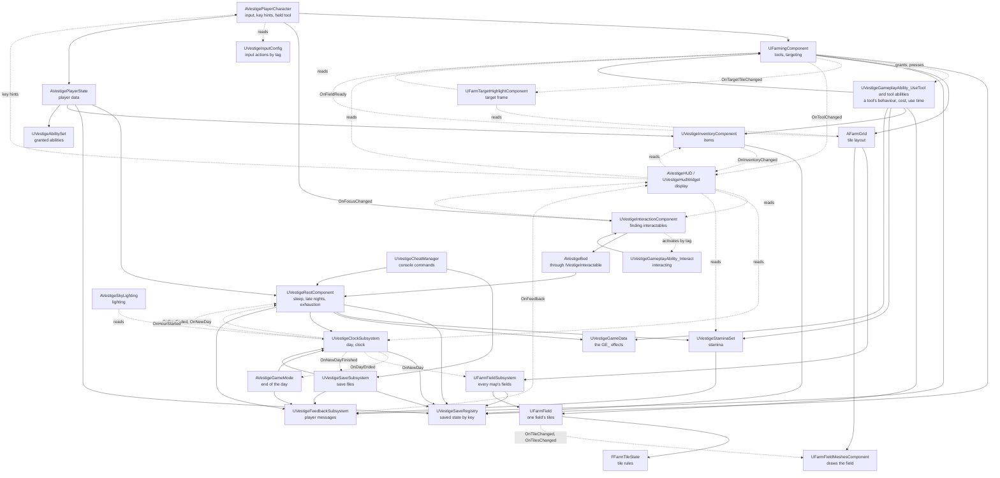
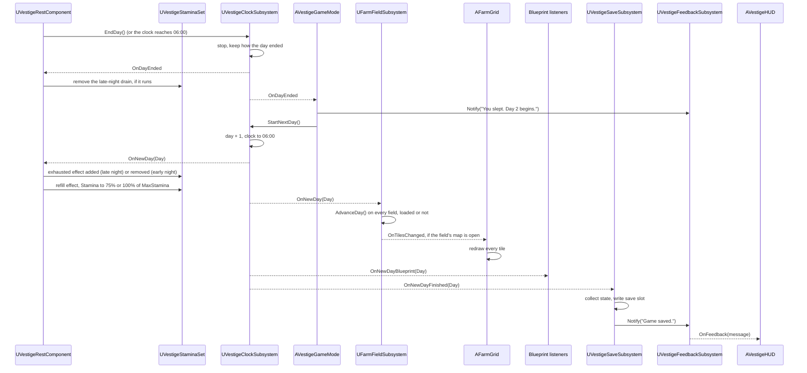

# Project Vestige architecture

How the game is put together and why. [CodingGuidelines.md](CodingGuidelines.md) covers how the code looks. This document covers how classes, systems and data fit together. [Systems.md](Systems.md) has a best-practice guide for each game system (saving, input, UI, the Gameplay Ability System, AI and so on).

It has three parts:

- **Part A: principles.** General architecture practice for C++ and Unreal Engine games. These hold for any project.
- **Part B: Project Vestige's design.** How this project applies them today: the systems, who owns what, and how data flows.
- **Part C: decisions.** A log of the design choices we made and why, plus known gaps and the changes we expect to make.

Keep Part B and Part C up to date. When a change adds a system, moves a responsibility or makes a design choice, update this document in the same commit.

Contents

- Part A: principles
  1. [Core principles](#1-core-principles)
  2. [Unreal's gameplay framework: where things go](#2-unreals-gameplay-framework-where-things-go)
  3. [Lifetimes and initialization order](#3-lifetimes-and-initialization-order)
  4. [How systems talk to each other](#4-how-systems-talk-to-each-other)
  5. [Data and content](#5-data-and-content)
  6. [Saving](#6-saving)
  7. [Presentation: UI, audio and effects](#7-presentation-ui-audio-and-effects)
  8. [C++ and Blueprints](#8-c-and-blueprints)
  9. [Modules and plugins](#9-modules-and-plugins)
  10. [Performance by design](#10-performance-by-design)
  11. [Patterns borrowed from Lyra](#11-patterns-borrowed-from-lyra)
  12. [Designing for mods](#12-designing-for-mods)
- Part B: Project Vestige's design
  13. [Systems and ownership](#13-systems-and-ownership)
  14. [Dependencies](#14-dependencies)
  15. [The day flow](#15-the-day-flow)
- Part C: decisions
  16. [Decision log](#16-decision-log)
  17. [Known gaps](#17-known-gaps)
  18. [Expected changes](#18-expected-changes)

---

# Part A: principles

## 1. Core principles

1. **One job per class.** Every actor, component and subsystem has one responsibility, and every piece of logic, component and setting lives on the class whose job it is. Never put something on a class because that class is convenient or already in the level. If nothing fits, create a new class.
2. **One source of truth.** Every piece of game state has exactly one owner. Everything else reads it or asks the owner to change it. Copies of state drift apart.
3. **Dependencies point one way.** Lower layers never know about higher ones (see [section 14](#14-dependencies)). Game rules don't know about UI, sound or effects. Data doesn't know about the systems that use it.
4. **Rules apart from presentation.** The code that decides what happens (a crop grows) is kept apart from the code that shows it (a bigger mesh). Rules can then be tested without a level, and visuals can change without touching rules.
5. **Composition over inheritance.** Build actors from components. Keep inheritance shallow: an engine base class, then at most one or two of our own levels.
6. **Data-driven content.** Content (crops, tools, items) is described in data, not in code branches. Adding a crop should mean adding an asset, not editing a `switch`.
7. **Make wrong states impossible.** Model state with enums and private members that only change through functions that check transitions (`FFarmTileState::Plant` refuses anything but tilled soil). Don't use loose booleans that can contradict each other.
8. **Commands go down, events go up.** A class calls functions on the things it owns or uses. Those things report back by broadcasting events, never by calling up into their users.
9. **The simplest design that works.** Don't build for features we don't have. Add a pattern when a real need appears, and write down why in the [decision log](#16-decision-log).

## 2. Unreal's gameplay framework: where things go

Unreal already has a home for most kinds of logic. Use it before inventing one.

| Class | Lifetime | Put here | Don't put here |
|---|---|---|---|
| `UGameInstance` and its subsystems | The whole run of the game, across map changes | Settings, the player profile, which save slot is active, music that plays across maps | Anything tied to one world |
| `AGameModeBase` | One world | The authoritative rules of the game in this world: default classes (pawn, HUD, controller), spawning, win/lose conditions | State the UI needs to read (in multiplayer it exists only on the server) |
| `AGameStateBase` | One world | Shared state of the world everyone may read: season, weather, calendar | Per-player state |
| `APlayerController` | One world, per player | The player's will: input routing, UI ownership, camera | The body's abilities or game rules |
| `APlayerState` | One world, per player, survives the pawn being destroyed | Per-player data that outlives the body: money, inventory, relationships | Things that need the body in the world |
| `APawn` / `ACharacter` | Until destroyed | The body: movement, animation, what it holds, abilities that need a position | Data that should survive the pawn |
| `UActorComponent` | Same as its actor | Reusable behavior: farming, inventory, interaction, health | Behavior only one actor will ever have (put it on that actor) |
| `AHUD` | One world, per player | Hosting the UI | Game state |
| `UWorldSubsystem` | One world | World-wide services with no transform: saving the world's state, lookups, registries | Settings that need tweaking per level; state that must survive a map change |
| `UGameInstanceSubsystem` | Whole run | Services that survive map changes | World-specific state |
| `ULocalPlayerSubsystem` | Per local player | Per-player UI, input and camera services | Shared state |
| `UDeveloperSettings` | Config | Project-wide tunables shown in Project Settings | Per-instance values |
| `UPrimaryDataAsset` | Asset | Definitions of content: a crop, a tool, an item | Runtime state |
| `USaveGame` | Save file | The saved data layout | Logic |

**World, map and level.** A *world* (`UWorld`) is the running game: one persistent map plus any sublevels streamed into it. The lifetimes above are world lifetimes, not sublevel lifetimes:

- **Streaming a sublevel** in or out only adds or removes that sublevel's actors. The world, its subsystems and the framework actors stay.
- **Opening a map** (`OpenLevel`, or non-seamless travel) tears the whole world down and creates a new one, with new world subsystems and framework actors. Only the game instance and its subsystems survive.
- **Seamless travel** also creates a new world, but carries a chosen set of actors (by default the game mode, game state, player controllers and player states) across through a transition map.

Project Vestige today has one map, no level streaming, and no travel except `OpenLevel` on the same map to start a new game. The clock (`UVestigeClockSubsystem`) and the farm data (`UFarmFieldSubsystem`) already live in the game instance (2026-11-04). Revisit this section and [section 13](#13-systems-and-ownership) before adding any of them.

**The world structure** (decision log, 2026-11-04): the game is a set of separate maps (the farm, the robot town, each wasteland zone, each faction hub), and moving between them opens the other map with `OpenLevel`. There is no persistent level with areas streamed in, and no World Partition. What follows from it:

- **The simulation lives outside the level.** Anything that must go on while its map isn't loaded (the clock, each map's farm data) belongs to a `UGameInstanceSubsystem`. A level is a view of that data: its actors read it, draw it and ask its owner to change it. Built for the clock (`UVestigeClockSubsystem`) and the fields (`UFarmFieldSubsystem`, one `UFarmField` per grid, found by the grid's `FieldId`); `AFarmGrid` (with the meshes that draw its field) and `AVestigeSkyLighting` are views.
- **The player's data crosses a map change as a snapshot.** Opening a map destroys the player state as well as the pawn, so the inventory and the ability system on it don't survive travel on their own. When the map starts tearing down, before any actor is destroyed, each owner writes its part into the snapshot `UVestigeSaveRegistry` holds in the game instance; in the new map, each owner reads its part back when it begins play. This is the same mechanism as loading a save (built 2026-11-06, [section 6](#6-saving)). Seamless travel isn't used: it is built for networked games and needs a transition map.
- **Interiors are part of their map.** The farmhouse and the room under it are in the farm map, so going indoors needs no load. A new map is for a new place, not for a door.
- **A map is content.** A zone or hub is a data asset that names its map by soft reference, so a mod can add one by shipping a map and its data asset.

A useful test for player data: **does it need to exist when the player's body doesn't?** Money and inventory do, so they belong on the player state (or a component on it). Tool use needs a position and facing, so it belongs on the pawn.

Placed actors versus subsystems: use an actor when something needs a place in the level or per-level settings a designer tweaks in the Details panel. Use a subsystem when it's a service that should always exist and needs no settings.

A service the game can't run without is a subsystem, which Unreal creates exactly once per game instance or world, before any actor's `BeginPlay`, with nothing to place. Until 2026-11-04 the day cycle, a placed actor, held the clock and found-or-spawned itself through a static `Get` when a level had none; the clock moved to `UVestigeClockSubsystem` and that `Get` went with it (decision log, 2026-11-04). An actor that is only presentation, such as the day cycle's lighting, is simply missing from a level that doesn't place it, and nothing spawns it.

## 3. Lifetimes and initialization order

Most hard-to-find Unreal bugs are about things running in a different order than assumed.

- **Constructors** run for the class default object at editor startup, with no world. Only create components and set defaults there. Never spawn, search the level or bind to other actors in a constructor.
- **`OnConstruction`** runs in the editor whenever a placed actor changes. Use it for editor previews (`AFarmGrid` sizes its bounds box), never for gameplay.
- **`PostInitializeComponents`** runs before `BeginPlay`, once the actor's own components exist. Use it to wire an actor's own components together.
- **`BeginPlay`** is where gameplay setup starts. **The order between different actors' `BeginPlay` calls is not guaranteed.** Never assume another actor has already run its `BeginPlay`.
- **`EndPlay`** runs when the actor is destroyed, when the sublevel it lives in is streamed out, or when the world is torn down. Unbind delegates and remove UI here.
- **World subsystems**: `Initialize` runs when the world is created, `OnWorldBeginPlay` before the actors' `BeginPlay`, and `Deinitialize` when it is torn down.
- **Opening a map** destroys the world and everything in it: actors, components and world subsystems. Only the game instance and its subsystems survive. Streaming a sublevel doesn't; see [section 2](#2-unreals-gameplay-framework-where-things-go) for the difference.

To deal with unknown order, in order of preference:

1. **Ask a subsystem.** What every world needs lives in a subsystem, which exists before any actor's `BeginPlay` (`UVestigeClockSubsystem::Get`, `UFarmFieldSubsystem::Get`).
2. **Register with a known owner.** Things announce themselves to a subsystem in their `BeginPlay`, and the subsystem broadcasts once everything it needs has arrived.
3. **Wait for a signal.** Bind to a "ready" event rather than guessing.
4. **Wait a tick** (`SetTimerForNextTick`). This works but hides the dependency. Use it only when the above don't fit, and comment why.

## 4. How systems talk to each other

Pick the loosest connection that does the job.

| Mechanism | Use when | Example |
|---|---|---|
| Direct function call | A class tells something it owns or clearly depends on to do something | `UFarmingComponent` calls `UFarmField::Till` |
| Multicast delegate | Something happened and any number of others may care. The sender must not know who listens | `UVestigeClockSubsystem::OnNewDay` |
| Interface (`UINTERFACE`) | Many unrelated classes respond to the same request | `IVestigeInteractable`: the bed, later the shipping bin, chests and robots |
| Subsystem lookup | Reaching a global service | `UVestigeSaveSubsystem::Get(GetWorld())` |
| Message bus (Lyra's Gameplay Message Router) | Many senders and many listeners that shouldn't know each other at all | Not needed yet |

Rules:

- **No circular dependencies.** If A calls B, B doesn't call A. B broadcasts an event that A listens to.
- **Ask, don't reach in.** Never change another class's state directly. Call a function that says what you want; the owner keeps itself consistent.
- **Find things in one place.** Each well-known object has one static `Find` / `Get` function (`AFarmGrid::Find`, built on `VestigeActorLookup::FindSingle`, which logs an error when a level has more than one; a subsystem's static `Get`, such as `UVestigeClockSubsystem::Get`). Don't scatter `TActorIterator` searches through the code, and call `Find` once and keep the result rather than every frame.
- **Bind with object-safe helpers** (`AddUObject`, `AddWeakLambda`) so a destroyed listener is never called, and unbind in `EndPlay` / `Deinitialize`.
- **C++-only events use non-dynamic delegates.** Use dynamic delegates only when Blueprints need to bind, which is what an extension point event is ([section 12](#12-designing-for-mods)). When C++ already listens to that event through a native delegate, the native one stays for C++ and the Blueprint one is its twin, named with `Blueprint` (`OnNewDay` and `OnNewDayBlueprint`) and broadcast right after it.

## 5. Data and content

| Kind of data | Use | Notes |
|---|---|---|
| A definition of one piece of content with assets attached (a crop with meshes and growth days) | `UPrimaryDataAsset` subclass | One asset per crop. The Asset Manager can find and load them all. |
| Many rows of the same numbers, edited like a spreadsheet (prices, balancing) | `UDataTable` with a `USTRUCT` row | Can be imported from CSV |
| Project-wide tunables | `UDeveloperSettings` | Shows up in Project Settings, stored in `Config/` |
| Per-class tunables | `EditDefaultsOnly` properties, set in a Blueprint subclass | How `BP_FarmGrid` sets the art its field is drawn with |
| Per-placed-instance tunables | `EditAnywhere` properties | `AFarmGrid` size |
| Open-ended categories designers extend | `FGameplayTag` | Item categories, seasons |
| Small closed sets that code switches on | `enum class` | `EFarmTileState`, `EVestigeLoadOutcome` |

- **Identify content by stable IDs**, not by pointers, array positions, asset paths or display names. This matters most for saves: an ID still means the same thing after content is added, reordered, renamed or moved.
- **One canonical content ID.** Every content data asset has a `ContentId` property, an `FName` of the form `<Namespace>.<Name>` (`Base.Turnip`). It is typed in by whoever makes the asset; it is not derived from the asset's file name or path, so renaming or moving the asset doesn't change it. The asset's `FPrimaryAssetId` is built from it (the data asset overrides `GetPrimaryAssetId` to return its type and `ContentId`), so the Asset Manager and saves use the same ID. This ID is what saves store.
  - **Format:** exactly one dot; namespace and name are PascalCase ASCII letters and digits. Base content uses the namespace `Base`; a mod uses its own name. Data validation (`IsDataValid`) rejects an asset with a missing or badly formed ID.
  - **IDs never change once a build has shipped.** Fix a display name instead; that's a separate localized `FText`. If an ID really must change, add an old-to-new entry to an ID redirect list that loading applies before looking content up. The redirect list is deferred until the first ID has to change (decision log, 2026-10-29).
  - **Duplicates are errors.** At startup the game checks every content type for repeated IDs and logs an error naming both assets. Base content wins over mods; between two mods, the first one loaded wins until mod load order exists ([section 12](#12-designing-for-mods)).
  - **Unknown IDs** in a save are skipped with a logged warning, and the player is told some content couldn't be found ([section 12](#12-designing-for-mods), rule 6).
  - **Tests** cover the format, a duplicate ID and an unknown ID in a save. A redirected ID gets its test with the redirect list.
- **Gameplay tags** identify open-ended categories (item categories, seasons), not individual pieces of content.
- **Reference assets softly** (`TSoftObjectPtr`) when they don't have to be in memory with the referencing class. Hard references load everything they point to.
- **Code never hard-codes paths to our own assets.** Expose a property and set it in a Blueprint subclass, a data asset or config. Engine default assets (`/Engine/BasicShapes/...`) are fine as placeholders.

## 6. Saving

- **Each owner saves its own state.** An owner provides a function that returns a plain save struct (`FFarmTileSaveData`) and one that restores from it. The save subsystem collects and stores these structs. It doesn't read or write other classes' internals.
- **Save data is plain structs** of IDs and values. No object pointers.
- **Version the save.** The save game has a version number, raised when a layout change would make older saves load wrong. From the first public build, each older version gets a migration step ([Roadmap.md, section 6](Roadmap.md#6-before-a-public-release)). Until then there are none: nobody else has a save to keep, so an older save is refused like a corrupt file and the developer starts a new game (decision log, 2026-11-04).
- **Never lose the player's save by accident.** Only an explicit choice by the player (starting a new game) deletes or replaces a save that couldn't be loaded. What loading does:

| What's in the slot | Outcome |
|---|---|
| Nothing | Start a new game. No message needed. |
| A save of the current version | Load it. |
| An older version that migrates (from the first public build) | Load the migrated data. Before the first save in the new format overwrites it, keep a copy of the original file next to it. |
| A corrupt file, a newer version than this build understands, or an older version without a migration | Don't load it and don't crash. Tell the player and log why. Leave the file untouched: saving stays off for the rest of the session, so a fresh day can't overwrite it. The player can start a new game, which is the explicit decision to replace it. |
| Content IDs this build doesn't know | Load the rest, skip those entries with a warning ([section 12](#12-designing-for-mods), rule 6). |

- **A failed write keeps the last good save.** Write the new save beside the old one and replace the old one only when the write succeeded; tell the player if it failed. The game carries on and tries again at the next save point. Built as two alternating slots (`Farm` and `Farm2`), each save numbered by a `SaveSequence`: a save always goes to the slot that doesn't hold the newest good save, and loading picks the readable save with the highest number.
- **Save at clear points.** We save when a new day starts. That keeps saves consistent: nothing is half-done mid-action. The accepted cost: quitting mid-day loses everything since that morning. Saving is synchronous (`SaveGameToSlot`), which is fine while saves are small; move to `AsyncSaveGameToSlot` if writing a save causes a visible hitch.
- **One game, one save, through a registry** (2026-11-06, [Systems.md, section 1](Systems.md#1-saving-and-loading)). Every owner of saved state implements `IVestigeSaveable` and registers with `UVestigeSaveRegistry`, a game-instance subsystem in `Core/` that holds the game's state in memory as one record per key (`Base.Clock`, `Base.Inventory`), each with its owner's own version. Records nobody registers for (a mod's) are kept. `UVestigeSaveSubsystem`, also in the game instance, reads the file once per game, when the first map is initialised and before any actor begins play, and writes every record on the new day; it names no owner. Opening another map doesn't load the file again, so the clock and the fields go on as they were, and the player's data crosses the map change through the registry ([section 2](#2-unreals-gameplay-framework-where-things-go)). Save slots and a main menu add a choice of slot in the save subsystem, and loading moves from the first map to the menu's Continue. Never open another map while a save is being written; with synchronous saves this can't happen yet.
- **Restore without side effects.** Restoring sets state directly; it doesn't replay game actions or broadcast "new day" again (`UVestigeClockSubsystem::RestoreFromSaveData`).
- **Test the save rules.** Save tests cover a save and load round trip through each owner's own save and restore functions, migration from every older version once there are migrations, a corrupt, older-version or newer-version file being left untouched, and unknown content being skipped.

## 7. Presentation: UI, audio and effects

- **Presentation depends on the game; the game doesn't depend on presentation.** UI, sounds and effects read state and listen to events. Game rules never call the UI, an audio component or a particle system directly.
- **The UI owns no game state.** It may keep display-only state, such as a message that is fading.
- **Cosmetics react to events.** When a tile is watered, the tile broadcasts a change and cosmetic code plays the splash. Gameplay code doesn't spawn the splash itself.
- **UI is UMG Widget Blueprints with C++ base classes.** The C++ base holds the logic and the Blueprint the layout and style, so the UI is laid out in the editor and mods can restyle it ([Systems.md, section 6](Systems.md#6-user-interface)). Common UI comes with the first menu, for controller navigation and layered menus.

## 8. C++ and Blueprints

The usual Unreal split, and Epic's own recommendation, is **C++ for systems, Blueprints for content**.

- **C++:** game rules, systems, data definitions, anything we test, anything that runs every frame or over many objects, and the base classes Blueprints extend.
- **Blueprints:** assigning assets (meshes, materials, sounds), tuning values, level layout and one-off level scripting, visual-only behavior like animation and effects timing.
- C++ classes are the base; Blueprint subclasses (`BP_...`) fill in assets and values. Code references the C++ class and gets the Blueprint through a `TSubclassOf` property (as `AFarmGrid::TileClass` does), never by asset path.
- If Blueprint logic grows past a handful of nodes, or two Blueprints duplicate it, move it to C++.

## 9. Modules and plugins

- The game is a **single runtime module** (`Vestige`). That's right for a project this size. Inside it, the code is split into folders by architecture layer ([section 14](#14-dependencies)), with the dependency order checked by a test, which gives most of what separate modules would without their cost (decision log, 2026-10-30).
- Add a separate module only for a concrete reason:
  - **`VestigeEditor`** (editor-only module): when we write editor tools, validators or custom detail panels, which must not ship in the game.
  - **`VestigeTests`**: if the tests outgrow `Source/Vestige/Tests/`.
  - **A plugin**: for a system that's finished, self-contained and reusable in another project.
- Module dependencies are one-way and listed in `.Build.cs`. Prefer private dependencies.

## 10. Performance by design

**Performance is a requirement.** Unreal Engine 5 games are often known for stutter and high hardware demands, and most of that comes from choices made early: what ticks, what loads, what references what, and which rendering features are on. We make those choices deliberately, against a budget, and check the budget at every milestone. The code rules are in [CodingGuidelines.md, section 12](CodingGuidelines.md#12-performance).

Two things stay true at the same time: designs and code follow the always-on rules from the start, and optimizations that make code harder to read wait for a measurement.

### Budget

**Target hardware (confirmed by David, 2026-10-29):** a 2020-era mid-range PC (an RTX 2060 or RX 5600 XT class GPU, a 6-core CPU, 16 GB of memory, an SSD) at 1920x1080 and the High scalability level.

| Budget | Limit | Notes |
|---|---|---|
| Frame time | 16.6 ms (60 fps) | On the target hardware at High, in a busy part of the farm |
| Game thread | 10 ms | All game thread work, engine included (`stat unit`) |
| Our gameplay code | 2 ms per frame | Everything in `Source/Vestige` that runs during normal play (Unreal Insights) |
| Hitches during play | No frame over 33 ms | Two frames at 60 fps. Includes first-time shader and PSO compilation and streaming |
| New day | 100 ms in total | All `OnNewDay` work plus the save, hidden by the sleep transition |
| Loading into the farm | 10 seconds | From the main menu or start of play, on an SSD |
| Video memory | 4 GB | At 1920x1080 High, of the target GPU's 6 GB; the rest is for Windows and other programs. 2.6 GB on the benchmark field (2026-11-05). In the CSV capture as `GPUMem/LocalUsedMB` |
| Memory | 8 GB in use (working set) | Of the target's 16 GB. 1.5 GB on the benchmark field, with 4.0 GB committed (2026-11-05). In the CSV capture as `PhysicalUsedMB` |

A change that breaks the budget is a bug and is fixed before more features go in. If the budget itself turns out wrong, change it here and log the decision.

### Scalability

- The game runs at all four scalability levels (Low, Medium, High, Epic). The target hardware holds the budget at High; weaker machines play at Low or Medium.
- Expensive rendering features are options, not requirements: high-quality Lumen reflections and similar features are only on at Epic. The game's look must hold up without them.
- How the project sets this up:
  - **No hardware ray tracing** (`r.RayTracing=False` in `DefaultEngine.ini`, checked by the test `Vestige.Rendering.HardwareRayTracingIsOff`). Lumen uses software ray tracing at every level, Epic included, so there is one lighting path to check and no ray tracing shaders to compile and ship.
  - **Cheaper volumetric clouds below Epic** (`Config/DefaultScalability.ini`, effects group, checked by the tests `Vestige.Rendering.CloudSamplesAreCappedBelowEpic` and `CloudSamplesAreFullAtEpic`). The engine doesn't scale clouds at all, so they cost the same at every level. High caps them at 48 samples along the view ray and 5 toward the sun (the engine's 96 and 10), Medium at 32 and 4, Low at 24 and 4. Epic and Cinematic name the engine's own values, because a level only sets the variables it lists: without them, switching from Low to Epic kept Low's caps. On the benchmark field, off screen at 1280x720, that is 0.83 ms at Epic, 0.31 at High, 0.20 at Medium and 0.16 at Low (0.74 at High at 1920x1080); the cloud edges get slightly grainier, the shapes and colours stay. These are the project's only changes to the engine's levels.
  - **New players start at High**, from `Config/DefaultGameUserSettings.ini`, instead of the engine's Epic. Their own choice overrides it; a first-run benchmark replaces it once there are settings ([Systems.md, section 17](Systems.md#17-settings)).
  - **Lumen, virtual shadow maps and Substrate stay on, High included.** Substrate is the material system the project's materials are made in. Lumen is the only dynamic global illumination for a sun that moves (the project has no baked lighting), and in the first baseline it cost about 0.6 ms of a 6.0 ms GPU frame, less than the volumetric clouds or the shadow depths ([Measuring](#measuring)).
  - **The default performance level stays Maximum** (Project Settings > Target Hardware). It isn't a quality level: on desktop, Scalable turns off auto-exposure, motion blur and anti-aliasing, and the dark nights depend on auto-exposure. Cost is set by the scalability levels.

### Design rules

- **Ticking is opt-in.** Most things react to events or timers. Only things that genuinely change every frame tick (`UVestigeClockSubsystem` runs the clock, `AVestigeSkyLighting` fades the light; the sun itself turns only in steps). Owners broadcast state changes so nobody has to poll them.
- **Event-driven daily updates.** Farm logic mostly happens once a day, on `OnNewDay`, while the sleep transition hides the work. Nothing checks crops every frame.
- **Find once, keep the reference.** Well-known objects are found through one `Find` / `Get` or registration ([section 4](#4-how-systems-talk-to-each-other)), never searched for every frame.
- **Load ahead, load softly.** Content is soft-referenced and loaded with its bundle before it's needed ([section 5](#5-data-and-content)). Nothing loads synchronously while the player is playing.
- **Scale with distance and relevance.** When there are many robots, animals or effects, things far away or off screen update less often or not at all (tick intervals, Unreal's significance manager, animation update rate optimization). Design new crowds with this in mind from the first version.
- **Decide structure up front when its cost is known, and optimise details when a profile says so.** Some costs are known before anything is measured: an actor, components and materials for each of thousands of tiles, or a system that has to work across maps. A small test level never shows them, so those choices are made when the design is, as the tiles were ([CodeReview.md, C2](CodeReview.md#c2--one-actor-per-tile-each-with-two-meshes-and-two-dynamic-materials)). Things that repeat by the hundred or thousand (tiles, crops, placed objects, robots) are data drawn with instances, not an actor each ([Systems.md, section 22](Systems.md#22-farm-fields-and-tiles)). Optimisations that make code harder to read still wait for a measurement.

### Content rules

What content does to performance is decided when it is made, so these apply to art and level work as well as code:

- **Meshes:** Nanite for static, detailed meshes (buildings, rocks, ruins). Skinned meshes (the farmer, robots) and anything Nanite doesn't suit get LODs.
- **Swaying crops and foliage** use World Position Offset sparingly: it makes virtual shadow maps redraw those shadows every frame. Set the mesh's WPO disable distance so distant plants stop moving.
- **Lights:** the sun and sky light are the main lights. Extra movable lights (robot lamps, windows) are small, few and usually don't cast shadows. The sun turns in steps (`SunStepDegrees` on the day cycle), not every frame: virtual shadow maps redraw all of a light's cached shadows whenever its direction changes.
- **Translucency:** the haze and similar effects use fog (exponential height fog, volumetric fog) and post-processing, not stacked translucent planes, which multiply GPU cost.
- **Triangle and texture budgets** are in [CONTRIBUTING.md, Budgets](../CONTRIBUTING.md#budgets): textures 1024 or smaller and props in the hundreds of triangles, unless there's a stated reason.
- **References:** check the Size Map of every new Blueprint and data asset ([CodingGuidelines.md, section 12.4](CodingGuidelines.md#124-assets-and-loading)).

### Measuring

- Use `stat unit`, `stat game`, `stat gpu` and Unreal Insights to find real costs, in a packaged Development build or a Standalone Game launch rather than Play in Editor ([CodingGuidelines.md, section 12.9](CodingGuidelines.md#129-measuring)).
- At the end of each roadmap milestone, measure on the target hardware in a fixed scene (the farm at midday and at night, the sleep transition, loading in) and add a row to the baseline below. Compare with the previous row; a regression gets fixed or explained.

| Date | Build | Hardware | Scene | Frame | Game thread | GPU | Worst hitch | New day |
|---|---|---|---|---|---|---|---|---|
| 2026-11-04 | Packaged Development, UE 5.8.4 | RTX 4070 Ti Super, Ryzen 7 9800X3D, 64 GB (about three times the target's GPU) | Benchmark field, 1920x1080 windowed, High, dawn to the next morning | 7.05 ms mean, 8.2 p99 (142 fps); the render thread (7.0 ms) sets the pace | 1.1 ms mean, 2.6 p99 | 6.0 ms mean, 7.4 p99 | 266 ms, a GPU stall 2 seconds after the new day, not explained yet. First-run shader pipeline compiles: 1.9 s on the first frame, then up to 222 ms | About 2.5 ms (that frame's game thread 3.5 ms; the save 2 ms) |
| 2026-11-05 | Farm tiles are data drawn with instances, not actors ([CodeReview.md, C2](CodeReview.md#c2--one-actor-per-tile-each-with-two-meshes-and-two-dynamic-materials), guide in [Systems.md, section 22](Systems.md#22-farm-fields-and-tiles), approved by David). `AFarmTile` and `BP_FarmTile` are gone; a tile is its field and coordinates. `UFarmFieldMeshesComponent` on the grid draws the field with one instanced static mesh component per mesh and material, and the placeholder color in per-instance custom data (`M_FarmPlaceholder`) instead of a dynamic material per tile. Watered soil stays a separate set with `M_Soil_Watered` until 4.2 makes water an amount. The extension points `On Crop Harvested` and `On Tool Used` carry the tile's coordinates instead of the actor. `L_Farm` places `BP_FarmGrid`, which holds the art. The design rule "change structure when a profile says so" became "decide structure up front when its cost is known" (section 10) | A real farm is thousands of tiles, and an actor with two components and two dynamic materials each costs at that scale what a small test field never shows; 4.2 (water and radiation per tile) and 4.5 (placing objects) were about to build on the tile representation. Instanced components draw every tile of a mesh together, and custom data keeps per-tile colors without breaking that. The Blender soil's materials are instances of the Interchange importer's material and can't read custom data, and a soil material that reads a water amount is better designed with 4.2. Changing the extension points' parameter costs nothing while no mods exist. Rejected: keeping an actor per tile until a profile of a farm-sized field; the hierarchical instanced component, whose CPU culling Nanite already does on the GPU |
| 2026-11-05 | Packaged Development, UE 5.8.4; ray tracing off, cheaper clouds, sun in 0.05 degree steps | Same PC | Benchmark field, 1920x1080 off screen, High, dawn to the next evening | 6.65 ms mean, 15.3 p99 (150 fps); waiting on the GPU, which sets the pace | 0.9 ms mean, 1.5 p99 | 6.0 ms mean, 7.9 p99 | 30 ms, 0.3 seconds after the new day, with neither thread nor the GPU busy. The 266 ms stall didn't come back. First frame 198 ms | 2.8 ms game thread |

**How the baseline is measured.** Package a Development build (`RunUAT BuildCookRun -platform=Win64 -clientconfig=Development -build -cook -stage -pak`), then start `Saved/StagedBuilds/Windows/Vestige.exe` with `-windowed -ResX=1920 -ResY=1080 -csvGpuStats -ExecCmds="scalability 2,r.VSync 0,t.MaxFPS 0,BenchmarkField 20 Base.Turnip,CsvProfile EXITONCOMPLETION,CsvProfile Frames=9000"`. `BenchmarkField` (a console command of `UVestigeCheatManager`) makes the farm a 20 by 20 field of ripe turnips, 400 tiles with a crop each. The game quits after 9000 frames and writes a CSV to `Saved/StagedBuilds/Windows/Vestige/Saved/Profiling/CSV/`; the numbers above leave out its first 10 seconds, except the hitches. `L_Farm`'s day cycle then ran a game hour in about 1.5 seconds, so one capture covered a whole day, the night and a new day. The clock's speed has been a project setting since 2026-11-04 (40 seconds per game hour); for the same capture, add `-ini:Game:[/Script/Vestige.VestigeClockSettings]:RealSecondsPerGameHour=1.5` to the command line.

Since 2026-11-05 the capture runs off screen, so no game window opens on the desktop: `-RenderOffScreen -ResX=1920 -ResY=1080 -ForceRes`, with `r.SetRes 1920x1080w` as the first of the `-ExecCmds`. Off screen the game ignores `-ResX` and `-ResY` on their own and renders at 1280x720, which is why the 2026-11-04 cloud timings off screen were lower than windowed. Check the resolution in the CSV's metadata (`systemresolution.resx`, the last line of the file). The CSV also holds the GPU frame (`GPUTime`) and video memory (`GPUMem/LocalUsedMB`). A console variable or a property of a placed actor can be changed for a comparison run in the same `-ExecCmds` (`r.AllowOcclusionQueries 0`, `set VestigeSkyLighting SunStepDegrees 0`). Before a run, check that no other program uses the GPU (Task Manager, or the `GPU Engine` performance counters).

**What the first baseline says (2026-11-04).**

- **On this PC everything is inside the budget**, with a lot of room on the game thread. Our gameplay code is a small part of the 1.1 ms.
- **The render thread sets the frame time**, at 7 ms, ahead of the GPU at 6 ms. 400 tile actors with two meshes and two dynamic materials each are the likely cause ([CodeReview.md, C2](CodeReview.md#c2--one-actor-per-tile-each-with-two-meshes-and-two-dynamic-materials)), not yet proven by a run with fewer tiles.
- **On the target the frame is probably over budget.** An RTX 2060 is roughly a third of this GPU, which puts the GPU near 18 ms, and a 2020 six-core CPU would roughly double the render thread. Both are estimates from published comparisons, not measurements.
- **The costliest GPU passes** are volumetric clouds (1.4 ms), shadow depths (0.9 ms, with the sun moving every frame), temporal super resolution (0.6 ms) and Lumen reflections (0.5 ms). Lumen as a whole is about 0.6 ms: the reflections, 0.1 ms of scene updates, and under 0.01 ms on average for its global illumination pass. Hardware ray tracing, then on but unused at High, cost no measurable GPU time and 0.2 MB of ray tracing geometry. The clouds are now cheaper below Epic ([Scalability](#scalability)): in the same build, run off screen from dawn to night, they went from 0.83 ms to 0.31 ms at High. Off screen they cost less than in this windowed run (1.37 ms) because those runs rendered at 1280x720; at 1920x1080 they cost 0.74 ms (2026-11-05, below).
- **Loading:** about 2 seconds from starting the game to `L_Farm` loaded and about 6 seconds to the first finished frame; the first frame alone took 1.9 seconds of shader pipeline compiles on this first run. The build ships no pipeline cache yet.
- **A second, shorter run was disturbed:** 15 seconds in, the GPU took 40 to 100 ms per frame for about 15 seconds, then recovered. The first run had nothing like it over a whole day, so something outside the game probably used the GPU. The 2026-11-05 runs, with no other program on the GPU, had nothing like it.

**What the second run says (2026-11-05).** Six runs of the same build, off screen at 1920x1080 High: the 20 by 20 field and the 8 by 8 field at the benchmark's 1.5 second game hour (a whole day, its night and the next day), the 20 by 20 field at the real 40 seconds per game hour with and without the sun's steps (06:00 to about 07:30), and one with occlusion queries off.

- **The frame waits on the GPU, not on the render thread.** This corrects the first baseline. Of the render thread's 6.7 ms, 3.5 ms is waiting for the visibility tasks (`EventWait/Visibility`), which wait for the GPU's occlusion query results. With `r.AllowOcclusionQueries 0` that wait is gone and the render thread's own work is 3.3 ms. So on this PC the GPU (6.0 ms) sets the frame, and the render thread has about half its time to spare.
- **400 tiles cost the GPU about 0.4 ms and the render thread nothing measurable.** The 8 by 8 field (64 tiles) against the 20 by 20 one: the render thread's own work is the same 3.1 ms, the GPU 5.6 ms against 6.0, video memory the same, and both draw about 100 draw calls, because Nanite draws the meshes together. 64 against 400 tiles is too small a step to show what thousands of tiles cost, so the case for [CodeReview.md, C2](CodeReview.md#c2--one-actor-per-tile-each-with-two-meshes-and-two-dynamic-materials) rests on a real farm's thousands of tiles and on tile state as data for [Roadmap.md, 4.2](Roadmap.md#42-farming-depth), not on today's frame.
- **The sun's steps save a quarter of the shadow depths.** At 40 seconds per game hour, shadow depths took 0.68 ms with the sun turning in 0.05 degree steps and 0.92 ms with it turning every frame, and the GPU frame 5.72 against 5.95 ms. At the benchmark's 1.5 second game hour the sun crosses a step every frame, so the day-long captures show no gain (0.91 ms); compare shadow costs at the real clock speed.
- **The volumetric clouds cost 0.74 ms at High**, against 1.37 ms with the engine's samples in the first baseline. They are now the third GPU pass, after shadow depths (0.91) and temporal super resolution (0.76), ahead of Lumen reflections (0.56).
- **The 266 ms GPU stall after the new day didn't come back** in two runs that each went through a new day; the slowest GPU frame was 9.6 ms. It was in the shadow depths while the sun turned every frame and ray tracing was on, and both have changed since, so its cause can't be found in this build. Measure again if a stall shows in a later capture.
- **The new day** takes 2.8 ms of game thread in its frame, inside its 100 ms budget.
- **Video memory is 2.6 GB** at 1920x1080 High (the CSV's `GPUMem/LocalUsedMB`), the same with 64 tiles as with 400; the working set is 1.5 GB and the committed memory 4.0 GB. Both are well inside the limits set in the [budget](#budget) from these numbers.
- **Some frames take 25 to 37 ms with neither thread nor the GPU busy,** one or two a second, which puts the 99th percentile at 12 to 15 ms where the windowed baseline had 8.2 ms. Nothing in the frame's own work explains them, and a windowed run of the same build doesn't have them after its first few seconds (7.0 ms mean, 7.4 ms p99), so they come from the off-screen mode, not from the game. Read hitches and the 99th percentile from windowed runs, and the means and GPU passes from either. That windowed run looked at a different part of the scene (its clouds took 0.01 ms), probably because the window had the mouse, so its GPU passes aren't comparable.

**What the instanced tiles changed (2026-11-05).** Two runs each of the packaged build before and after "Draw the farm tiles with instanced meshes", off screen at 1920x1080 High as above, with `BenchmarkField 60 Base.Turnip`: 3,600 tiles with a ripe turnip each.

- **The frame is the same:** 5.1 ms mean, the GPU 4.6 ms, about 100 draw calls and 181,000 primitives before and after. Nanite already drew the tile actors' meshes together, so on this PC drawing them as instances changes nothing per frame.
- **Making the field is ten times faster:** the frame that builds it took 237 to 270 ms of game thread with an actor, two mesh components and two dynamic materials per tile, and 23 to 33 ms with instances. Opening a farm map pays the same cost, so this is the loading time a real farm saves.
- **Memory is the same:** video memory 2.58 GB, working set about 1.55 GB.
- **The new day is slower, still well inside its budget:** its frame took 10.2 to 11.0 ms of game thread before and 12.6 to 13.5 ms after, because the meshes component rebuilds every instance on `OnTilesChanged`, where the actors only changed their components. That is about 13 ms of the 100 ms new-day budget for 3,600 tiles. If a bigger farm needs it, the new day can update the tiles that kept their set in place instead of rebuilding them; measure first.
- Packaging deletes `Saved/StagedBuilds/` with every CSV capture in it, so copy the captures out before packaging again. The 2026-11-04 and 2026-11-05 baseline captures were lost that way; their numbers are above.

## 11. Patterns borrowed from Lyra

Lyra is Epic's reference for a well-structured UE5 game. It is built for a large team and multiplayer, so **we adopt a Lyra pattern when we have a concrete need for it, not before.** When we do, we follow how Lyra and Epic's documentation build it, as written down per system in [Systems.md](Systems.md).

| Lyra pattern | Status in Project Vestige |
|---|---|
| Thin actors, behavior in components (`ULyraHealthComponent`, `ULyraHeroComponent`) | **Adopted.** `AVestigePlayerCharacter` is a template character plus `UFarmingComponent`. New behaviors (fishing, resting) become new components; stamina is an attribute on the ability system ([Systems.md, section 9](Systems.md#9-abilities-attributes-and-effects-gameplay-ability-system)). |
| Subsystems instead of singletons and managers | **Adopted.** `UVestigeSaveSubsystem`, `UVestigeSaveRegistry`, `UVestigeClockSubsystem`, `UFarmFieldSubsystem`. |
| A project prefix on every class (`Lyra...`) | **Adopted.** `Vestige...`, and `Farm...` for types about the farm itself ([CodingGuidelines.md, section 2.2](CodingGuidelines.md#22-the-vestige-and-farm-project-prefixes)). |
| Data assets describing content (`ULyraPawnData`) | **Adopted** for crops (`UFarmCropData`), tools (`UVestigeToolData`) and items (`UVestigeItemData`). |
| Item definitions built from fragments (`ULyraInventoryItemDefinition`, `ULyraInventoryItemFragment`) | **Adopted** for items, as data assets rather than Lyra's Blueprint classes ([Systems.md, section 8](Systems.md#8-inventory-and-items)). Lyra's inventory component comes with our inventory. |
| Gameplay tags for identifiers | **Later**, for open-ended categories. Closed sets stay enums. |
| Input actions mapped to tags through data assets | **Built** (2026-11-07, [CodeReview.md, H6](CodeReview.md#h6--input-is-built-in-c-with-hard-coded-keys)). `IA_` / `IMC_` assets, and `UVestigeInputConfig` (`DA_InputConfig_Player`) mapping each action to a native input tag; the character binds by tag to the owning components. Lyra's ability input actions and custom input component are skipped until a key maps straight to an ability ([Systems.md, section 5](Systems.md#5-input)). |
| Gameplay Message Router | **Not yet.** Plain delegates are enough. |
| Game Feature plugins and modular gameplay actors (actors that accept components from plugins) | **Later**, as a likely building block for mod loading ([section 12](#12-designing-for-mods)). |
| Gameplay Ability System | **Adopted, starting with stamina** (not built yet). The ability system component on the player state, attribute sets, gameplay effects and ability sets as data, as in Lyra; see [Systems.md, section 9](Systems.md#9-abilities-attributes-and-effects-gameplay-ability-system). |
| Experiences, Common UI, replication | **Not adopted.** Each adds a lot of setup that a single-player prototype doesn't need. Revisit when a feature calls for one. Common UI is covered in [Systems.md, section 6](Systems.md#6-user-interface). |

## 12. Designing for mods

**Goal: other people can add content and behavior to the game without our source code.**

**Status: mod-oriented design, not mod support.** The game can't load mods today, and nothing in it is a promised mod API yet. We follow the rules below so mod loading can be added later without a rewrite.

### How Unreal games are modded

- A mod is usually a **plugin**: content (meshes, data assets, Blueprints) plus, rarely, C++. Unreal doesn't discover, mount or activate plugins added to a packaged game on its own; the game has to do that, and the plugin's content has to be cooked for the same engine version.
- **Content and Blueprint mods** are the kind we design for. C++ mods have to be compiled against exactly the same engine version and build as the game, which is fragile; we don't plan for them.
- Lyra's **Game Feature plugins** are a likely building block. A Game Feature can add data assets, add components to existing actors and register gameplay tags without the base game knowing it exists. They aren't a mod loader, though: the game has to register and activate each one through the Game Features subsystem, and deactivation, dependencies and their lifecycle are ours to design.
- The best way to keep the game moddable is to **build the base game the way a mod would be built**: base content goes through the same discovery, IDs and extension points a mod would use.

### Rules from now on

1. **Content is discovered, not listed.** Crops, tools, items, recipes and shop stock are data assets of a registered primary asset type (for example `FarmCrop`). The game asks the Asset Manager for every asset of that type. There are no hard-coded lists or `switch` statements over content, so a mod adds a crop by adding a data asset.
2. **Enums only for fixed mechanics.** An `enum class` is fine for states that mods shouldn't extend, like `EFarmTileState` (grass, tilled, planted). Anything a modder might want more of (tools, crops, item categories) is a data asset or a gameplay tag.
3. **Namespaced IDs.** Every piece of content has a stable `ContentId` of the form `<Namespace>.<Name>`, with the format, rename and duplicate rules in [section 5](#5-data-and-content). Base game content uses `Base` (`Base.Parsnip`, `Base.WateringCan`). Mods use their own name. Gameplay tags we define live under `Vestige.`; mods add their own.
4. **Deliberate extension points.** Key classes are `Blueprintable`. Meaningful moments get Blueprint-assignable events or `BlueprintNativeEvent` hooks (a crop is harvested, a new day starts, a tool is used). Main actions are `BlueprintCallable`. Mark these with `/** Extension point: ... */` in the header. Everything else stays private, because every exposed function is a promise to modders.
5. **Behavior in components, and actors that tolerate extra ones.** A mod adds behavior by adding a component to an existing actor. Actors must not assume they have a fixed set of components, and systems should look for components and interfaces rather than concrete classes.
6. **Saves survive missing content.** Saves store content IDs, never positions in a list. When a save mentions content that no longer exists (a mod was removed), loading skips it with a warning instead of failing.
7. **No hard asset paths in code**, as in [section 5](#5-data-and-content). Mods can only replace or extend what goes through properties, data assets and the Asset Manager.

### Extension points today

What a Blueprint can use so far (rule 4). Each is marked `/** Extension point: ... */` in its header, and the tests `Vestige.ExtensionPoints.*` list them, because mod Blueprints use them by name: renaming or hiding one breaks every mod that uses it, so a rename needs a `PropertyRedirects` or `FunctionRedirects` entry in `[CoreRedirects]`, and a change to the list is a change to the mod API.

| Extension point | On | What it says |
|---|---|---|
| `On New Day` (`OnNewDayBlueprint`), with the day's number | `UVestigeClockSubsystem`, found in any Blueprint with **Get Vestige Clock** (the node Unreal makes for a game-instance subsystem), so it works in every map | A new day started. After `OnNewDay`'s C++ listeners (the farm has grown) and before `OnNewDayFinished` (the save), so what a listener changes through the game's functions is saved. It has `OnNewDay`'s contract: every change to saved state finishes in the handler ([section 15](#15-the-day-flow)) |
| `On Crop Harvested`, with the crop and the tile's coordinates (`FIntPoint`) | `UFarmingComponent` on the player's pawn | The player harvested a crop: the harvest is in the bag and the tile is tilled soil again. The tile was an actor until 2026-11-05 ([Systems.md, section 22](Systems.md#22-farm-fields-and-tiles)) |
| `On Tool Used`, with the tool and the tile's coordinates (`FIntPoint`) | `UFarmingComponent` on the player's pawn | A tool use changed the farm. Uses that change nothing (and so cost nothing) aren't broadcast. For a harvest it follows `On Crop Harvested` |
| **Get Content Id** | `UVestigeContentData`, so every crop, tool and item | The content's ID (`Base.Turnip`), for telling which crop or tool an event names without a hard reference to its asset |
| **Get Interaction Options** and **Interact** (`IVestigeInteractable`, with `FVestigeInteractionOption`) | Any actor that implements the interface, in C++ or a Blueprint, plus a shape with the `VestigeInteractable` collision profile | What the player can do with the actor now (the first option is the one the interact key uses), and doing it. An option can say where it is (`bHasLocation`, `Location`) when that isn't the actor (the farm grid's ripe tile); the player must face that location, or, without one, face the actor's shape. The interactable owns what happens ([Systems.md, section 7](Systems.md#7-interaction)) |

How they are built: an event is a `BlueprintAssignable` dynamic multicast delegate on the class that owns the moment, following [section 4](#4-how-systems-talk-to-each-other). Not yet exposed: callable main actions (tilling a tile, adding an item) and the state behind them (a tile's state, the clock, the inventory), which come when a mod or content Blueprint first needs them ([Roadmap.md, 4.1](Roadmap.md#41-foundations)).

### Before we say the game supports mods

All of these have to exist and be tested in a packaged build first:

- **Discovery and mounting:** finding mod plugins in a mods folder of a packaged build and mounting their cooked content.
- **Asset Manager scanning:** the primary asset types are configured to scan plugin content, so a mod's data assets are found like base content.
- **Activation:** turning a mod on and off, and what happens to its content in a running game.
- **Load order and conflicts:** which mod wins, and how duplicate content IDs are reported ([section 5](#5-data-and-content)).
- **Versions:** which game versions a mod works with, and what happens when it doesn't.
- **Saves without the mod:** a save made with a mod loads without it ([section 6](#6-saving)).
- **Trust and consent:** mods run with the player's trust (a Blueprint mod can do anything the game can), so the player turns each mod on knowingly, and the game never runs mods from untrusted sources automatically.
- **A documented mod API:** which classes, events and functions are extension points (rule 4).

### What we leave for later

- Everything in the list above.
- Moving base content into its own Game Feature plugin.
- A mod kit: the editor setup modders would build with.
- Letting mods override base content rather than only add to it.

---

# Part B: Project Vestige's design

## 13. Systems and ownership

| Class | Kind | Owns | Does not own |
|---|---|---|---|
| `UFarmFieldMeshesComponent` | Scene component on `AFarmGrid` (`Farming/`) | Drawing the grid's field ([Systems.md, section 22](Systems.md#22-farm-fields-and-tiles)): one instanced static mesh component per instance set (a mesh with a material override), created the first time a tile needs it; one soil instance and at most one crop instance per tile, named by `FPrimitiveInstanceId`; the color in per-instance custom data, never a dynamic material. Redraws one tile on the field's `OnTileChanged` and the whole field in one batch per set on `OnTilesChanged`. Its art (`FFarmTileLookSettings`) is set in `BP_FarmGrid`; what a tile looks like comes from `FarmTileLooks::GetLook`, a pure function. Presentation only | The tile's state, rules, input, saving |
| `FFarmTileState` | Struct, one per tile inside `UFarmField` (`FarmTileState.h`) | One tile's state (grass, tilled, planted, watered, growth, the crop planted in it) and the rules that change it. A tile has no actor: it is named by its field and coordinates | Visuals, the tile's place in the grid |
| `AFarmGrid` | Actor, placed in the level as `BP_FarmGrid`, found with `Find` | A view of one field in its level: its `FieldId` (`Base.Farm`), size and corner. At `BeginPlay` it asks `UFarmFieldSubsystem` for its field (made the first time, resized to the grid if it differs), hands it to its `UFarmFieldMeshesComponent` to draw, then broadcasts `OnFieldReady`. A tile's state (`GetTile`) and place in the world (`GetTileTransform`) by coordinates, converting between world and grid space, resizing the field for developer tools (`Resize`). The interactable for its tiles (`IVestigeInteractable`): offering Harvest while the interactor's targeting component aims at a ripe tile, from `InteractionVolume` (the field and one tile around, -50 to +200 cm), and asking the interactor's farming component to `Harvest`. No actor per tile | The field's data and rules, drawing, the new day, saving, the clock, lighting |
| `UFarmField` | Object owned by `UFarmFieldSubsystem` (`Farming/FarmField.h`) | One field's tiles as data: its ID, its size and an `FFarmTileState` per tile, row by row, keeping their crops loaded. The farming actions by coordinates (broadcasting `OnTileChanged`), a new day on every tile and resizing (broadcasting `OnTilesChanged`), saving and restoring its tiles by coordinates (`FFarmTileSaveData`) | Where the field is in a level, drawing it, the clock |
| `UFarmFieldSubsystem` | Game-instance subsystem (`Farming/`) | The farm data of every map, kept for the whole run: one `UFarmField` per `FieldId`, made when a grid or a save first names it. Starts a new day on every field on the clock's `OnNewDay`, whether or not its map is loaded. Saving and restoring every field under `Base.Fields` through the save registry (`FFarmFieldsSaveData`: each field's ID, size and tiles), loading the crops a save names, and dropping them all for a new game | Which map is open, drawing fields, the rules of one tile |
| `UVestigeClockSubsystem` | Game-instance subsystem and `FTickableGameObject` (`Time/`), reached with `Get` | Game time for the whole run, whichever map is open: day number and clock, advanced every frame with the game instance's world (so pause stops it, time dilation speeds it, and it stands still while a map loads) and stopped at the day's end. Broadcasts `OnNewDay`, then `OnNewDayBlueprint` (the `On New Day` extension point, found with **Get Vestige Clock**), then `OnNewDayFinished`; broadcasts `OnHourStarted` with the hour each time the running clock reaches a whole hour (24 is midnight), and `OnDayEnded` once when the day ends: when the clock reaches the day's end (06:00 the next morning), or earlier through `EndDay` when the player goes to bed. It then stops, and keeps how the day ended (`GetLastDayEnd`: the day, the time and whether it ended early) for the new day's listeners. An hour's listener that ends the day stops the hours left in that frame. Saving and restoring its day and clock under `Base.Clock` through the save registry, and day 1 for a new game. Running forward to a later time at once for developer commands (`AdvanceTo`), broadcasting the hours passed. The hours of sunrise and sunset, the same on every map. Its speed and hours come from `UVestigeClockSettings`, read once | Lighting, tiles, saving, HUD, what any hour means, starting the next day |
| `UVestigeClockSettings` | Developer settings (Project Settings > Game > Vestige Clock, `DefaultGame.ini`) | How the clock runs: real seconds per game hour (40), the hour each day starts (06:00) and ends (30, which is 06:00 the next morning) | The clock's state |
| `AVestigeSkyLighting` | Actor placed in a level whose sky follows the time (`Time/`) | The lighting only, read from the clock every frame: sun (turned in steps of `SunStepDegrees`) and moon, sky light, night exposure, following the clock's sunrise and sunset hours. A level without one keeps its lights as placed | The clock, days, events, the sky atmosphere and clouds |
| `UFarmingComponent` | Component on the farmer | Using what is in hand: the tool of the item in the selected hotbar slot of the inventory on the pawn's player state, found through the item's `UVestigeToolFragment`; an empty slot or an item without one is no tool, and E says "Nothing in hand to use.". The harvest, granted all the time from `HarvestToolId` (`DA_Tool_Hand`) and activated once by `Harvest()`, which the farm grid calls when the player interacts with a ripe tile. Follows that inventory's `OnItemInHandChanged` (`FollowInventory`, at `BeginPlay`, on a controller change and on each press) and broadcasts `OnToolChanged` when the tool changes. Loads every tool and crop with its visuals at `BeginPlay` (`FindCrop` for the plant ability). Grants the ability of the tool in hand (`UVestigeToolData::GetAbility`) on the ability system the pawn reaches, with the tool asset as the spec's source object, keeping the handle and that ability system so it can take the grant back after the pawn loses it (on a tool change, a controller change and `EndPlay`); a use under way finishes before its ability goes, and a grant still queued under the ability list lock is cleared; the harvest grant has its own handle and ability system and changes only with the ability system. Passes the use key to it: `StartUsingTool` presses the spec's input and activates it, `StopUsingTool` releases it, `UseTool` activates once without pressing; announces the key as `OnToolUseHeldChanged` for the walk speed. Broadcasts the extension points `OnCropHarvested` and `OnToolUsed` ([section 12](#extension-points-today)) when a tool ability reports them. Saves nothing | UI, input bindings, meshes, sleeping, what a tool does, which item is selected, how many items the player has, the target tile, stamina and how long a use takes |
| `UFarmTargetingComponent` | Component on the farmer | Tile targeting: finding the level's grid, the coordinates of the neighbour of the owner's tile in the aimed direction (`AimAt`), snapped to eight directions by `FarmTileTargeting`, recomputed only when the aim or the owner's tile changes, and broadcast as `OnTargetTileChanged` (no tick) | Using tools, input, drawing the frame |
| `UVestigeCharacterMovementComponent` | Character movement component (the farmer's, set in its constructor) | How the farmer walks and turns. Every turn goes through `RotationRate` (`VestigeMovement::TurnDegreesPerSecond`); without movement input it turns toward the idle facing the farmer sets (the aimed tile). While the use key is held it walks and jumps at `ToolUseSpeedScale` (half) of its speed (`GetMaxSpeed`); the farmer connects it to the farming component's `OnToolUseHeldChanged` | Input, targeting, which tile is aimed, whether the use key is held |
| `UFarmTargetHighlightComponent` | Instanced static mesh component on the farmer | Showing a frame around the target tile, moved only on `OnTargetTileChanged` to the transform the targeting component's grid gives for those coordinates. Presentation only, and ships (no debug drawing) | Which tile is targeted |
| `UVestigeRestComponent` | Component on the player state (`Farming/`), found with `Find` from the pawn or the player state | The player's side of the end of the day and the late-night rules ([GameDesign.md, section 5](GameDesign.md#5-time-days-and-seasons)): going to sleep (asked by the bed, or by the `SkipDay` console command) asks the clock to end the day (`EndDay`); the warnings at 22:00 and midnight and the stamina drain from midnight (`OnHourStarted`, `GE_LateNightDrain`, its amount per period worked out from the effect's period), stopped on `OnDayEnded`; waking up on `OnNewDay`, before the save: exhaustion after a day that ended at midnight or later (`GE_Exhausted`, read from the clock's `GetLastDayEnd`), cleared by an earlier one, and a stamina refill (`GE_StaminaRefill`), to 75% when exhausted; the effects come from `UVestigeGameData`. Saving and restoring whether the player is exhausted under `Base.Rest` through the save registry (`FVestigeRestSaveData`), and starting the drain at `BeginPlay` when a map opens after midnight. The rules' numbers are its settings | The clock, starting the next day, what else happens on a new day, the stamina numbers and their limits |
| `IVestigeInteractable` + `FVestigeInteractionOption` | Interface and struct (`Interaction/`) | The request every usable thing answers: its options for an interactor now (text, an action name, and where the option is when it isn't the actor) and doing one. Also the `Interactable` collision channel and `VestigeInteractable` profile names | What any interactable does; finding them |
| `UVestigeInteractionComponent` | Component on the player's pawn (`Interaction/`) | Finding and using interactables: every `ScanSeconds` (0.2 s) an overlap query on the `Interactable` channel within `InteractionRadius`, focusing the nearest one the pawn faces with options (an option's location within `FrontHalfAngleDegrees` of the facing direction, or the facing ray hitting the shape of an option without one; the facing direction from the `FacingDirection` delegate its owner binds, else the owner's forward vector), keeping the latest option and broadcasting `OnFocusChanged` when the focus or its first option's action or text changes (no tick). `Interact` only activates the abilities tagged `Vestige.Ability.Interact`; `InteractWithFocus` rescans, uses the first option and rescans again | What any interactable does; input; showing the prompt; what the owner aims at |
| `UVestigeGameplayAbility_Interact` | Gameplay ability, granted by `DA_AbilitySet_Player`, instanced per actor (`Interaction/`) | That interacting goes through the ability system, so tags can block it later: calls the avatar's `UVestigeInteractionComponent::InteractWithFocus` and ends. No cost, no duration yet | Which interactable, what it does |
| `AVestigeBed` | Actor (parent of `BP_Bed`, one placed in `L_Farm`; `Farming/`) | Being a bed: a mesh with blocking collision and the box it is used from. Offers `Sleep` to an interactor with a rest component (its own, or its player state's: `UVestigeRestComponent::Find`) and asks that component to sleep | The rules of sleeping |
| `UVestigeGameplayAbility_UseTool` | Abstract gameplay ability, instanced per actor (`Farming/`), granted by `UFarmingComponent` for the tool in hand | What every tool use shares: one press is one activation; each use that changes the farm spends the tool's `StaminaCost` (from the spec's source object) through the game data's `GE_StaminaCost`, reports `On Tool Used`, and waits the tool's `UseSeconds` (a `WaitDelay` task), doubled while `Vestige.State.OutOfStamina` is held; while the spec's input is pressed it repeats when the use ends, the target changes or the avatar lands (`WaitMovementModeChange`), only if the use would change the tile; no use in the air. Owns `Vestige.State.UsingTool` while active, which blocks every tool ability | Which tile and tool, what a tool does to a tile (its subclass), the stamina limits |
| `UFarmGameplayAbility_Till`, `_Plant`, `_Water`, `_Harvest` | Tool abilities (`Farming/`), named by `DA_Tool_Hoe`, `DA_Tool_Seeds`, `DA_Tool_WateringCan` and `DA_Tool_Hand` | One tool behaviour each (`CanUseOn`, `UseOn`): the farming action on the target tile through `UFarmField`'s rules, the seed taken from or the harvest put into the inventory on the player state, and the player's message. The harvest reports `On Crop Harvested` | When a use can start, its cost and time |
| `UVestigeStaminaSet` | Attribute set, granted by `DA_AbilitySet_Player` (`AbilitySystem/`) | `Stamina` and `MaxStamina`: their starting values, keeping `Stamina` between 0 and `MaxStamina`, holding `Vestige.State.OutOfStamina` while it is 0 and telling the player when it runs out. Writing and restoring the stamina's save part under `Base.Stamina` (`FVestigeStaminaSaveData`), registered with the save registry by the player state | What costs stamina, when it refills |
| `UVestigeGameData` | Primary data asset (`Content/`), one asset: `DA_GameData`, loaded by `UVestigeAssetManager` at startup and found with `Get` | Global data game code needs that isn't one piece of content: for now the gameplay effects code applies (`StaminaCostEffect`, `StaminaRefillEffect`, `LateNightDrainEffect`, `ExhaustedEffect`), as hard class references so they load with it at startup. Data validation reports an unset effect and a drain that isn't infinite with a period | Who applies the effects, the amounts, runtime state |
| `GE_StaminaCost`, `GE_StaminaRefill`, `GE_LateNightDrain`, `GE_Exhausted` | Gameplay effect Blueprints (`Content/Vestige/Abilities/`), named by `DA_GameData` | What each effect does: spending stamina by a set-by-caller amount (`Vestige.Data.StaminaCost`), setting it to one (`Vestige.Data.StaminaRefill`), draining it each 1 s period by one (`Vestige.Data.StaminaDrain`, infinite, not on application), and granting `Vestige.State.Exhausted` (infinite). Designers and mods change them in the editor | Who applies them, the amounts |
| `UVestigeAbilitySet` | Data asset (`DA_AbilitySet_Player` in `Content/Vestige/Abilities`, `AbilitySystem/`) | A list of attribute sets and abilities granted together, and granting them to an ability system | When it is granted, runtime state |
| `VestigeGameplayTags` | Native gameplay tags (`AbilitySystem/VestigeGameplayTags.h`) | The tags C++ uses: `Vestige.Ability.Interact`, `Vestige.Ability.UseTool`, `Vestige.Data.StaminaCost`, `Vestige.State.OutOfStamina`, `Vestige.State.UsingTool`, and the input tags under `Vestige.Input` (`UseTool`, `Interact`, `HotbarSlot.1` to `.9`, listed in slot order in `Input_HotbarSlots`, `HotbarNext`, `HotbarPrevious`) | Tags only content uses, which stay in `DefaultGameplayTags.ini` |
| `UVestigeInputConfig` | Data asset (`Player/`), one for the player: `DA_InputConfig_Player` in `Content/Vestige/Input`, hard-referenced by `BP_PlayerCharacter` | Which input action each native input tag means (`FindNativeInputActionForTag`), in an order the key hints follow, and checking in data validation that every entry has an action and a tag under `Vestige.Input`, that no tag or action is listed twice, that every action is Boolean and that every player-mappable action has a mapping name ([Systems.md, section 5](Systems.md#5-input)) | The keys (the mapping contexts'), what an action does, binding |
| `IA_UseTool`, `IA_Interact`, `IA_HotbarSlot1` to `9`, `IA_HotbarNext`, `IA_HotbarPrevious`, `IMC_Farming` | Input action and mapping context assets (`Content/Vestige/Input`) | Each farming action (Boolean, its description for the key hints, player-mappable key settings named after its input tag) and the farming keys: keyboard or mouse first, then the gamepad. Designers and, later, players change keys here, not in code | Who handles an action |

| `AVestigePlayerCharacter` | Character (parent of `BP_PlayerCharacter`) | Its input setup: its input config (`InputConfig`, `DA_InputConfig_Player`) and the mapping contexts of its body (`MappingContexts`: `IMC_Default` and `IMC_MouseLook` at 0, `IMC_Farming` at 1, set on `BP_PlayerCharacter`). Binds each config action by input tag in `SetupPlayerInputComponent` (keys 1 to 9 select hotbar slots on the player state's inventory, the mouse wheel and gamepad shoulders step through them, E goes to the farming component, F to the interaction component), adds its contexts to the player there, registered with the Enhanced Input user settings, and removes them on `UnPossessed`, after releasing a held use key. Describing those bindings as key hints, read from the input config and the contexts' keyboard and mouse keys, the hotbar hints named after the items in the slots. Turning movement input into the targeting component's aim and the movement component's idle facing, binding the interaction component's facing direction to that aim, and easing the walk in from a press (`MoveRampSeconds`). Showing the held mesh of the tool in hand. Handing out the player state's ability system through `IAbilitySystemInterface`, so code that has the pawn finds it without knowing the player state class | Farming rules, which tools exist, the ability system itself |
| `UVestigeCheatManager` | Cheat manager (`Player/`), the player controller's `CheatClass`, set in `AVestigePlayerController`'s constructor outside Shipping (`UE_WITH_CHEAT_MANAGER`) | The developer console commands, each of which asks the owner of the action to do it: `NewGame` (the save subsystem's `StartNewGame`), `SkipDay` (the rest component on the player's player state sleeps, with or without a pawn), `SkipToTime` (the clock's `AdvanceTo`) and `BenchmarkField` (the grid resizes its field, then the field restores a ripe crop on every tile, for the performance baseline). The engine creates it only outside Shipping, in a game whose game mode allows cheats (`AllowCheats`, true in a standalone game, Play in Editor included) | The rules behind any command; keys |
| `AVestigeGameMode` | Game mode (`Game/`, parent of `BP_GameMode`, named by `GlobalDefaultGameMode`) | The rules of a game map: the classes a player is made of (`BP_GameMode` sets `BP_PlayerCharacter`, `BP_PlayerState` and `BP_PlayerController`; `BP_HUD`, with the native `AVestigeHUD` as the C++ fallback), and the end of the day. On the clock's `OnDayEnded` it tells the player whether they slept or stayed up all night and starts the next day (`StartNextDay`), with or without a pawn. A sleep fade or a rule such as "not during a cutscene" goes here. `BP_GameMode` hard-references the player's Blueprints, so a main menu map overrides the game mode in its World Settings ([Systems.md, section 20](Systems.md#20-maps-loading-screens-and-the-main-menu)) | The clock, what the night does to the player, saving |
| `AVestigePlayerController` | Player controller (`Game/`, parent of `BP_PlayerController`) | The player's will: makes `UVestigeCheatManager` its cheat class outside Shipping. Menus will add their own mapping contexts here. No touch controls | The body's mapping contexts and keys (the character's since H6, 2026-11-07), the camera, game rules |
| `AVestigeHUD` + `UVestigeHudWidget` | HUD (`UI/`, parent of `BP_HUD`) + UMG widget bases (`WBP_Hud`, and `UVestigeHudMessageWidget` for `WBP_HudMessage`) | Display only. The HUD creates `WBP_Hud` for its local player at `BeginPlay` and pushes every text to it; the widget never reads the game. Keeps weak references to the clock (`UVestigeClockSubsystem::Get` at `BeginPlay`), to the possessed farmer and its farming and interaction components (updated on `OnPossessedPawnChanged`) and to the inventory and the ability system on its player's player state (found once at `BeginPlay`). Builds its texts when an event says they changed (`OnToolChanged`, the interaction component's `OnFocusChanged` for the prompt ("F Sleep"), the inventory's `OnInventoryChanged`, the change delegates of `Stamina` and `MaxStamina`, `OnFeedback`), and colours the stamina line red while the ability system's tag event says `Vestige.State.OutOfStamina` is held; only the clock is read every frame, in the HUD's `Tick`, and its line is rebuilt only when the shown minute changes. Shows each feedback message in a box of its own that fades out on its own timer (`FVestigeHudMessages`, up to the cap in `UVestigeHudSettings`, read at `BeginPlay`); boxes are created once, reused, and only a shown box ticks, for its opacity. The widgets fire Blueprint events after each change (`OnStaminaChanged`, `OnPromptChanged`, `OnMessageShown`) so a Blueprint can restyle without C++ | Any game state |
| `UVestigeSaveRegistry` | Game-instance subsystem (`Core/`), reached with `Get` | The game's saved state in memory ([Systems.md, section 1](Systems.md#1-saving-and-loading)): one `FVestigeSaveRecord` per key, and the owners registered with it, for the whole game (the clock, the fields) or while their map is open (the player's components). Hands an owner its part when it registers, or has it start a new game; asks every owner for its part when the game is saved; takes the open map's owners' parts when it starts tearing down (`FWorldDelegates::OnWorldBeginTearDown`), so the player's data crosses a map change; keeps records nobody registered for; counts parts left out, and notices parts from a newer build. A new game empties it, resets the game owners and forgets the map's owners | Files and slots; what any owner saves; game rules |
| `IVestigeSaveable` and `FVestigeSaveRecord` | Interface and struct (`Core/`) | What every owner of saved state provides: a stable key, its layout version, writing and reading its record, starting a new game. A record is the owner's save struct as tagged-property bytes, with its version and the engine versions it was written with, serialized natively as one block | Which owners exist |
| `UVestigeSaveSubsystem` | Game-instance subsystem (`Save/`), reached with `Get` | The save files: reading both slots once per game, when its first map is initialised (`FWorldDelegates::OnPostWorldInitialization`; never while automation tests run), handing the records to the registry, telling the player how loading went once that map has begun play, and writing every record on the clock's `OnNewDayFinished`. The file version, the two alternating slots, refusing to load or overwrite a save it can't read (or one with a part from a newer build). Starting a new game (deletes both slots, starts a new game in the registry, then reopens the map), asked for by the `NewGame` console command until there is a main menu | Any owner or what it saves; game rules |
| `UVestigeSaveGame` | Save game | The save file's layout and its format version (3): the sequence number and every owner's record by key. Names no owner; each owner's save struct lives with it: `FVestigeClockSaveData` (`Base.Clock`), `FFarmFieldsSaveData` (`Base.Fields`, one `FFarmFieldSaveData` per field by `FieldId`, with its size and its tiles as `FFarmTileSaveData`, by coordinates with the crop's `ContentId`), `FVestigeInventorySaveData` (`Base.Inventory`, by slot with the item's `ContentId`, and the selected hotbar slot), `FVestigeStaminaSaveData` (`Base.Stamina`) and `FVestigeRestSaveData` (`Base.Rest`). `Base.Farming` is retired (Systems.md, section 1) | Logic |
| `AVestigePlayerState` | Player state (parent of `BP_PlayerState`, set on the game mode) | The player's data that outlives the pawn: holds the inventory component and the ability system component (minimal replication), grants its `AbilitySets` (`DA_AbilitySet_Player`, set on `BP_PlayerState`) in `PostInitializeComponents`, and makes the pawn the ability system's avatar on `OnPawnSet`, cancelling running abilities when the pawn changes. Holds the rest component, so the night refills stamina and sets exhaustion with or without a body. Registers the ability system's saved attribute sets (the stamina) with the save registry from `BeginPlay` to `EndPlay`, since the sets have no lifetime of their own. Nothing below `Player/` knows the class; it finds the inventory with `FindComponentByClass` and the ability system through `IAbilitySystemInterface` | Rules of its own; anything that needs the body |
| `UVestigeInventoryComponent` | Component on the player state | The items the player carries: `SlotCount` slots, the starting items (`StartingItems`, set on `BP_PlayerState`), adding and removing items by ID (`TryAddItem`, `TryRemoveItem`, `CanAddItem`, `GetItemCount`) or from one slot (`TryRemoveItemFromSlot`), the hotbar (the first `HotbarSlotCount` slots, the selected one and the item in hand, `SelectHotbarSlot`, `GetItemInHand`), loading every item definition at `BeginPlay` so play never waits on one, broadcasting `OnInventoryChanged` after every change and `OnItemInHandChanged` when the hand changes, and saving and restoring its slots and the selected slot under `Base.Inventory` through the save registry; the starting items only when no save holds its part | What items do (planting, eating, which tool an item is); money; showing the bag |
| `FVestigeInventory` | Struct inside `UVestigeInventoryComponent` (`VestigeInventory.h`) | The slot rules: stacks up to each item's `MaxStackSize`, topping up stacks before filling empty slots, and adding or removing all or nothing | Finding or loading items, events, saving |
| `UVestigeHudSettings` | Developer settings (Project Settings > Game > Vestige HUD, `DefaultGame.ini`) | How the HUD shows feedback messages: how many at once (1 to 10) and how long each stays | Game state, the messages themselves |
| `UVestigeFeedbackSubsystem` | World subsystem | Carrying short messages for the player (`FText`) from game code to presentation: game code calls `Notify`, the HUD listens to `OnFeedback`. Every message is also written to the log (`LogVestigeFeedback`), so the full history survives the HUD's fading | Showing messages, or knowing who listens |
| `UVestigeContentData` | Abstract base of every content data asset | What all content shares: the `ContentId`, the primary asset ID built from it, the display name, the `Visuals` bundle name, and loading content with its visuals at play start, and checking the ID's format in data validation (`IsDataValid`) | Anything specific to one kind of content |
| `UVestigeAssetManager` | The project's Asset Manager (`AssetManagerClassName` in `DefaultEngine.ini`) | Startup checks of all content: after the initial scan it reports every content ID that more than one asset uses. Loading the global game data (`UVestigeGameData`, `GameDataPath` in `DefaultGame.ini`) once in `StartInitialLoading` and keeping it loaded; an error if it doesn't load (`Systems.md` sections 2 and 9) | Loading content for gameplay systems |
| `UVestigeToolData` | Primary data asset (type `VestigeTool`), one per tool in `Content/Vestige/Tools` | One tool's definition: the ability that is its behaviour (`Ability`, a `UVestigeGameplayAbility_UseTool` subclass, checked in `IsDataValid`), held mesh (in the `Visuals` bundle), stamina cost and how long one use takes (`UseSeconds`) | Which tools the player has, the grip offset in the hand |
| `UFarmCropData` | Primary data asset (type `FarmCrop`), one per crop in `Content/Vestige/Crops` | One crop's definition: seasons, days to mature, water need, contamination tolerance, growth stage meshes (in the `Visuals` bundle), the item a harvest gives (`HarvestItemId`) and how many (`Yield`) | Runtime state such as growth or which tiles grow it; prices, which belong to items |
| `UVestigeItemData` | Primary data asset (type `VestigeItem`), one per item in `Content/Vestige/Items` | One item's definition: what every item has (`MaxStackSize`, `SellPrice`) and its fragments, found with `FindFragment` ([Systems.md, section 8](Systems.md#8-inventory-and-items)) | Runtime state such as how many the player has; what only some items have, which is a fragment |
| `UVestigeItemFragment` and subclasses | Instanced objects inside an item asset (`VestigeItemData.h`, `FarmSeedFragment.h`, `VestigeToolFragment.h`) | One aspect that only some items have. `UFarmSeedFragment`: the crop a seed plants (`CropId`). `UVestigeToolFragment`: the tool holding the item uses (`ToolId`), so the hoe, the watering can and every seed item are tools | Runtime state, the item's other aspects |

When a new responsibility appears, decide its owner using [section 2](#2-unreals-gameplay-framework-where-things-go), add a row here, and say so in the commit message.

## 14. Dependencies

Arrows point from a class to what it knows about. Nothing points back up.

Solid arrows are calls and dotted arrows labelled "reads" are reads. The other dotted arrows are events, drawn from the class that broadcasts to the one that listens; the listener is the one that knows about the broadcaster. The exceptions are "activates by tag": the farming component asks the ability system to activate whatever ability has the `Vestige.Ability.UseTool` tag, without knowing the ability class, and the ability calls back into the farming component's tool rules; the interaction component does the same with `Vestige.Ability.Interact`. The interaction component knows the bed only as an `IVestigeInteractable`, never its class. Stamina changes go through the ability system's gameplay effects, which the set clamps; nothing writes the attributes directly.

The layers are the source folders ([CodingGuidelines.md, section 14.1](CodingGuidelines.md#141-source)), from bottom to top:

| Layer (folder) | Holds | May include |
|---|---|---|
| `Core/` | Shared services that know no game rules: `UVestigeFeedbackSubsystem` (player messages), the save registry (`UVestigeSaveRegistry`, `IVestigeSaveable`, `FVestigeSaveRecord` and `LogVestigeSave`), `VestigeActorLookup`, the module, `VESTIGE_LOG` and the shared log categories (`VestigeLog.h`). Each layer declares its own system's category in its own log header ([Systems.md, section 21](Systems.md#21-logging)) | Engine only |
| `AbilitySystem/` | Our Gameplay Ability System parts that know no farm: `UVestigeStaminaSet` and `FVestigeStaminaSaveData`, `UVestigeAbilitySet` and the native tags (`VestigeGameplayTags`). Below `Content/`, so content such as an item can grant abilities later | `Core/` |
| `Interaction/` | `IVestigeInteractable` and `FVestigeInteractionOption`, `UVestigeInteractionComponent` and `UVestigeGameplayAbility_Interact`: finding and using interactables, knowing none of them. Below everything that can be used | `Core/`, `AbilitySystem/` |
| `Content/` | Content definitions: `UVestigeContentData`, `UFarmCropData`, `UVestigeToolData`, `UVestigeItemData` and its fragments, `UVestigeGameData` (global data such as the gameplay effects), and `UVestigeAssetManager` (content checks and loading the game data at startup) | `Core/` to `Interaction/` |
| `Time/` | `UVestigeClockSubsystem`, `UVestigeClockSettings` and `FVestigeClockSaveData`, and `AVestigeSkyLighting` (the lighting that follows the clock) | `Core/` to `Content/` |
| `Inventory/` | `UVestigeInventoryComponent`, `FVestigeInventory` and `FVestigeInventorySaveData` | `Core/` to `Time/` |
| `Farming/` | `UFarmFieldSubsystem` and `UFarmField`, `FFarmTileState`, `AFarmGrid`, `UFarmFieldMeshesComponent` and `FarmTileLooks`, `UFarmingComponent`, `UFarmTargetingComponent`, `UVestigeGameplayAbility_UseTool` and the tool abilities (`UFarmGameplayAbility_*`), `UVestigeRestComponent` and `AVestigeBed`, `UFarmTargetHighlightComponent`, and their save structs | `Core/` to `Inventory/` |
| `Save/` | `UVestigeSaveGame` and `UVestigeSaveSubsystem`: the save files. They name no owner; above `Time/` only for the clock's new day | `Core/` to `Farming/` |
| `Player/` | `AVestigePlayerCharacter`, `UVestigeInputConfig`, `UVestigeCharacterMovementComponent`, `AVestigePlayerState`, `UVestigeCheatManager` | `Core/` to `Save/` |
| `UI/` | `AVestigeHUD`, the widget bases `UVestigeHudWidget` and `UVestigeHudMessageWidget`, and `UVestigeHudSettings` | `Core/` to `Player/` |
| `Game/` | `AVestigeGameMode` and `AVestigePlayerController`: the game's wiring, naming the HUD, the player state and the cheat manager. The top layer, so nothing includes it | `Core/` to `UI/` |

`Tests/` may include any layer, and no layer includes `Tests/`. `Template/` holds what is left of Epic's template code, `AVestigeCharacter`, which isn't maintained to our guide but is checked like the rest. It sits outside the layers: its files may include any layer, so only `Player/`, which derives the farmer from it, and the layers above may include it. Otherwise a low layer could reach a high one through it.

- **Lower layers never include or call higher layers.** They broadcast events, and the higher layer listens. Each owner's save struct lives with the owner, which registers with the save registry in `Core/`; `Save/` only reads and writes the files.
- **The test `Vestige.Architecture.IncludeDirection` enforces the order.** It reads the source and fails on a wrong-way include, on one of our headers included without its folder, and on a folder missing from its layer table. That table and this one must match.
- There are no exceptions today; any that appear are listed in [Known gaps](#17-known-gaps).

## 15. The day flow

What happens when the player sleeps in the bed (F, or the `SkipDay` console command), which asks the clock to end the day, or stays up until the clock reaches 06:00. Either way the clock broadcasts `OnDayEnded` and the game mode starts the next day, with or without a pawn. A day that ends at midnight or later wakes the player exhausted, with 75% stamina; an earlier one refills it fully and clears exhaustion:

`OnNewDayFinished` exists so saving always runs after every system has reacted to the new day, whatever order they subscribed in. The clock broadcasts it as soon as the `OnNewDay` broadcast and its Blueprint twin `OnNewDayBlueprint` return, so it only marks the end of work done **synchronously**. That's a contract for every listener of either:

- **Finish all changes to saved state inside the handler.** No timers, latent actions, async tasks or deferred spawns that change state the save captures.
- **Presentation may run later.** A crop-growth animation or a sound can play over the next seconds, because nothing about it is saved.
- **If a system ever needs asynchronous day work,** `OnNewDayFinished` stops being enough. Replace it with an explicit barrier first: each system reports pending work to the clock, and the clock signals that the day has finished only when every report is done. Save tests check the snapshot against whichever contract is in force.

At the start of a game, `UVestigeSaveSubsystem` reads the save when the first map is initialised, before any actor's `BeginPlay`, and hands it to `UVestigeSaveRegistry`: the clock and the fields restore at once. Each of the player's components and the player state's stamina then read their part in their own `BeginPlay`, so the inventory never adds its starting items over a save. Once every actor has begun play (`OnWorldBeginPlay`) the save subsystem tells the player how loading went. The sky lighting follows the clock on the next frame.

---

# Part C: decisions

## 16. Decision log

Newest first. Add an entry whenever we make a choice that someone could reasonably have made differently. Never delete an entry; if a decision is reversed, add a new entry that says so.

| Date | Decision | Why |
|---|---|---|
| 2026-11-08 | The HUD moves from C++ Slate to UMG ([CodeReview.md, H7](CodeReview.md#h7--the-hud-is-raw-slate-written-in-c), [Systems.md, section 6](Systems.md#6-user-interface)), reversing the entry of 2026-10-25. `AVestigeHUD` stays the data side: it builds each text on its event and pushes it to `WBP_Hud` (`UVestigeHudWidget`, `BindWidget` parts, style properties), which it creates with `AddToPlayerScreen` for a local player; `BP_HUD` names the widget and `BP_GameMode` names `BP_HUD`. Each feedback message is a reused `WBP_HudMessage` that fades by render opacity in its own C++ tick while shown. The widgets set their parts and then fire `BlueprintImplementableEvent`s (a hybrid of Epic's "UMG Best Practices" tech blog, where the Blueprint fills its widgets from events), and the assets were made by a temporary commandlet. Skipped for now: Common UI (with the first menu), the MVVM plugin, the UIExtension plugin and invalidation boxes. New HUD parts such as the hotbar row find their own data instead of growing `AVestigeHUD` | Raw Slate made every layout or colour change a recompile, nobody could lay out the UI in the editor, and mods couldn't touch it. Pushing finished text keeps the existing tested, event-driven HUD logic and needs no Blueprint graphs, which a commandlet can't reliably author; the events still let a Blueprint restyle without C++. A tick on at most five shown boxes is cheaper than UMG animations, which the blog asks to use sparingly in a HUD, and follows the configurable message time |
| 2026-11-07 | Input moves to assets bound by tag ([CodeReview.md, H6](CodeReview.md#h6--input-is-built-in-c-with-hard-coded-keys), [Systems.md, section 5](Systems.md#5-input)): `IA_` actions and `IMC_Farming` in `Content/Vestige/Input`, a `UVestigeInputConfig` data asset (`DA_InputConfig_Player`) naming the action for each native `Vestige.Input.*` tag, and the character binding by tag to the owning components. The pawn owns the contexts of its body (`MappingContexts` on `BP_PlayerCharacter`: `IMC_Default`, `IMC_MouseLook`, `IMC_Farming`), added in `SetupPlayerInputComponent` with `bNotifyUserSettings` and removed in `UnPossessed`; `AVestigePlayerController::DefaultMappingContexts` is gone. Every function has a gamepad key (X uses, B interacts, the shoulders and the mouse wheel step through the hotbar, folded in from 4.6), and every action has player-mappable key settings named after its tag. Key bindings will be saved by Enhanced Input's user settings save game, not in `UVestigeSettingsShared` (Systems.md, section 17 changed). Rejected: Lyra's ability input actions (every key goes through owner logic first), a custom input component like `ULyraInputComponent` (a small private function does the lookup), adding contexts in `NotifyControllerChanged` (setup already runs on each possession, and adding an applied context doesn't stack it), Lyra's `ClearAllMappings` on possession (it would also drop menu contexts), and reading hints with `QueryKeysMappedToAction` or the user settings now (nothing can be rebound yet; with rebinding, the hints ask for the player's key). Approved by a reviewer agent after three rounds, whose approval counts as David's | Hard-coded keys blocked rebinding, the gamepad and accessibility, and the hotbar had no gamepad key. Assets are Unreal's normal way and what the user settings are built around; binding by tag keeps code free of asset paths |
| 2026-11-07 | Ripe crops are harvested with F, the interact key, and E only uses the item in hand; an empty hand is no tool (decided by David after the hotbar play-test; [Systems.md, section 7](Systems.md#7-interaction), harvesting with F). The farm grid is the interactable for its tiles and offers Harvest while the farmer faces a ripe tile; the harvest ability is granted all the time (`HarvestToolId`, `DA_Tool_Hand`). The interaction focus goes by facing instead of nearest: an option with a location (the tile) must be within 50 degrees of the farmer's aim, an option without one (the bed) must be hit by the facing ray, and the nearest faced option wins. Replaces the 2026-11-01 nearest-wins focus and the hand-as-tool part of the hotbar entry. Rejected: an actor per ripe crop (undoes the instanced tiles, C2), harvesting with E whatever is held (two meanings for E), and an angle-only rule (beside the bed's foot end the bed falls inside any cone wide enough for the faced tile). Approved by a reviewer agent after three rounds, whose approval counts as David's | Harvesting with an empty slot was hidden, and next to the bed the nearest-wins focus would have slept when the player meant to harvest |
| 2026-11-07 | The toolbar becomes the inventory's hotbar ([CodeReview.md, H2](CodeReview.md#h2--ufarmingcomponent-does-seven-jobs-and-can-plant-only-one-seed), [Systems.md, section 8](Systems.md#8-inventory-and-items)): the first nine slots of `UVestigeInventoryComponent`, one of them selected, whose item is in hand and saved with the bag (`Base.Inventory` version 2; `Base.Farming` retired). Tools are items with a `UVestigeToolFragment` naming a tool asset (`DA_Item_Hoe`, `DA_Item_WateringCan`; every seed item names the Seeds tool), and an empty hand or an item without a tool uses the hand tool, `HandToolId` on the farming component. The plant ability plants the seed item in hand and takes it from that slot. The aim and the target tile move into `UFarmTargetingComponent`. Supersedes the 2026-10-29 toolbar entry. Rejected: a quick bar with slots of its own pointing into the bag, as Lyra's `ULyraQuickBarComponent` has (the two could disagree), a separate hotbar component (one more saved owner for the one inventory with a hand), and the hand as an item (it would take a slot and could be dropped). Approved by a reviewer agent after three rounds, whose approval counts as David's | The toolbar was a second inventory, and one `SeedItemId` couldn't plant the three or four crops of 4.2. `UFarmingComponent` had seven jobs; it now has the item in hand's tool and its ability, the use key and the extension points |
| 2026-11-07 | The stamina effects become gameplay effect Blueprints (`GE_StaminaCost`, `GE_StaminaRefill`, `GE_LateNightDrain`, `GE_Exhausted`) instead of C++ classes, reversing choice (1) of the 2026-11-01 stamina entry ([CodeReview.md, H1](CodeReview.md#h1--the-gameplay-ability-system-gates-tools-but-doesnt-run-them), [Systems.md, section 9](Systems.md#9-abilities-attributes-and-effects-gameplay-ability-system)), approved after two rounds of review by a senior Unreal C++ reviewer agent, whose approval counts as David's. Code finds them through `UVestigeGameData` (`DA_GameData`), global data that `UVestigeAssetManager` loads once in `StartInitialLoading` from `GameDataPath` in `DefaultGame.ini` and keeps loaded; it is an always-cooked primary asset type `VestigeGameData`. The effects are hard references, so they load with it. Missing data logs an error and leaves stamina unchanged rather than stopping the game. The late-night drain must be infinite and periodic, and the rest component reads its period from the effect instead of a constant. The use-tool ability's `CostGameplayEffectClass` stays unset and `GetCostGameplayEffect` returns the game data's cost. The four C++ classes are deleted with no redirects (no asset or save named them). A temporary headless commandlet, not committed, made the five assets | Designers and modders can only change what an effect does (its period, extra modifiers, a cue) in an asset, and the 2026-11-01 reason was the agent's tooling, not the game. One global data asset loaded by the asset manager is what Systems.md section 2 already planned and what Lyra does (`ULyraGameData`); Lyra's soft references load on first use during play, which our performance rules forbid, and four small effects cost nothing to keep loaded. Effect properties on each owner would need setting on `BP_PlayerState` and could not reach a C++ ability's cost. A drain with a duration would expire while the rest component still holds its handle and thinks it runs |
| 2026-11-07 | Each tool's behaviour is its own gameplay ability, named by the tool's data asset (`UVestigeToolData::Ability`) and granted by the farming component while the tool is in hand, with the tool asset as the spec's source object ([CodeReview.md, H1](CodeReview.md#h1--the-gameplay-ability-system-gates-tools-but-doesnt-run-them), [Systems.md, section 9](Systems.md#9-abilities-attributes-and-effects-gameplay-ability-system)). The shared base `UVestigeGameplayAbility_UseTool` runs one activation per press, with the hold-to-repeat loop, the cost and the use time inside it, on standard ability tasks (`WaitDelay`, `WaitMovementModeChange`). `EFarmToolAction`, the switch in the farming component and its repeat listeners are gone; the use-tool ability is no longer in `DA_AbilitySet_Player`. Rejected: granting every toolbar tool once (no object per switch, but not the equipment pattern the hotbar needs), a new interface on the grid (the field's rule functions already are one; a second kind of target gets its own), and Blueprint tool abilities now (they need the field's rules callable from Blueprints, a mod-support decision). Approved by a reviewer agent after two rounds, which David accepted | A tool that does something new was impossible without changing the farming component, and the component and the ability called each other. Now a tool is data plus one ability class. The ability tasks cost one small object per use, an exception recorded in [CodingGuidelines.md, section 12.3](CodingGuidelines.md#123-memory-and-allocation) (CodeReview.md, L3) |
| 2026-11-06 | The rest component moves from the pawn to the player state, as the reviewer of M2 advised, replacing "the rest component stays on the pawn for now" in the entry below. The bed and `SkipDay` find it with `UVestigeRestComponent::Find` (the actor's own, or a pawn's player state's) | Exhaustion and stamina already live on the player state's ability system, and its save part `Base.Rest` is the player's, not the body's: by the test in [section 2](#2-unreals-gameplay-framework-where-things-go), it must exist without a body. On the pawn, a night with no pawn skipped the refill and the exhaustion |
| 2026-11-06 | Our own game mode and player controller ([CodeReview.md, M2 and M6](CodeReview.md#m2--a-pawn-component-ends-the-worlds-day)), reviewed by a senior Unreal C++ reviewer agent: `AVestigeGameMode` and `AVestigePlayerController` in a new top layer `Game/`, written to our guide under the template classes' names (so assets and config need no redirect), with new Blueprints `BP_GameMode` and `BP_PlayerController` in `Content/Vestige/Blueprints`; the template's Blueprints and `Content/ThirdPerson/` are gone. The game mode owns the end of the day: the clock only says when a day has ended (`OnDayEnded`, reached at 06:00 or asked for early with `EndDay`) and keeps how it ended (`GetLastDayEnd`), and the rest component goes to bed through `EndDay` and wakes on `OnNewDay`. The touch controls are dropped. The rest component stays on the pawn for now | A component on the pawn ended the world's day, so without a pawn at 06:00 the clock stopped for good. The day's end is a world rule, and the game mode is where Unreal puts those; it is also per map, so a menu map won't start days. Rejected: the clock starting the next day itself (a sleep fade or a cutscene rule would then live in the clock), and a new "day ending" event with a rule to read the old time during it (the reviewer's point: the clock keeping how the day ended is plain data, and `OnNewDay` already comes before the save). New Blueprints rather than moved ones, so they are ours and not Epic's material |
| 2026-11-06 | Saving goes through a registry ([CodeReview.md, H3](CodeReview.md#h3--the-save-subsystem-knows-every-system-by-name), [Systems.md, section 1](Systems.md#1-saving-and-loading)), approved by David on 2026-11-06 after a review by a senior Unreal C++ reviewer agent. `UVestigeSaveRegistry` (game instance, `Core/`) holds one record per key, each owner implements `IVestigeSaveable` with its own key and version, and owners pull their part when they register. Records are the owner's struct as tagged-property bytes with the engine versions they were written with, not `FInstancedStruct`. The file is read once per game when the first map is initialised; the open map's owners give their parts when it starts tearing down. Before the first public build an outdated part is dropped and the rest loads, instead of the whole save being refused; a part from a newer build still turns saving off. The file format is version 3 | The save subsystem named every system, and a mod couldn't save anything. Bytes keep a part whose struct type is missing (an uninstalled mod), which `FInstancedStruct` throws away. Loading per world would roll the clock and the fields back after travel. The engine unpossesses the pawn before any actor's `EndPlay` when a map closes, so a part taken in `EndPlay` would lose what the pawn reads through the player state (the reviewer found that exhaustion was lost this way). Dropping one outdated part keeps the rest of a development save. Records copy their bytes in one block (a native serializer), since tagged byte arrays are written a byte at a time |
| 2026-11-06 | The console command `SkipToTime 1930` (the time as digits, for 19:30; `19` is 19:00, and an hour before the day's start is after midnight) jumps the clock forward through `UVestigeClockSubsystem::AdvanceTo`, which runs the clock to that time at once and broadcasts every whole hour it passes and the day's end, as a long frame would. It only runs forward | Checking the lighting, the late-night warnings and the drain took many real minutes at 40 seconds per game hour. A jump that broadcast nothing, as restoring a save does, would skip the 22:00 warning and the midnight drain and leave the late-night rules out of step with the clock; running forward through the same path as a frame keeps every hourly rule. Going back would need those rules undone, so starting the day again stays `SkipDay` or `NewGame` |
| 2026-11-05 | The hours of sunrise and sunset belong to the clock: `SunriseHour` and `SunsetHour` moved from the placed lighting actor to `UVestigeClockSettings` (Project Settings > Vestige Clock, **Sun**), and `UVestigeClockSubsystem` reads them once like its other hours (`GetSunriseHour`, `GetSunsetHour`). `AVestigeSkyLighting` reads them from the clock and keeps only how the light looks. This finishes [CodeReview.md, M1](CodeReview.md#m1--the-day-cycle-is-both-the-clock-and-the-lighting) | With separate maps (2026-11-04), hours on each level's actor could put the sun up at a different time in the town than on the farm. When the sun rises is a fact about the game's day, which gameplay will ask about (robots or crops that care about daylight, longer days in summer once seasons exist), and game rules can't read a presentation actor. `L_Farm` didn't override the hours, so nothing changes in play. Seasons can later change the hours in the clock without touching the levels |
| 2026-11-05 | `AVestigeDayCycle` is renamed `AVestigeSkyLighting` ([CodeReview.md, M1](CodeReview.md#m1--the-day-cycle-is-both-the-clock-and-the-lighting)), with a `[CoreRedirects]` class redirect from the old name (and the `FarmDayCycle` redirect pointed straight at the new one), since `L_Farm` places it. It stays in `Time/` and stays one actor per level that turns the sun, dims the sky light and darkens the exposure; the sky atmosphere and clouds remain ordinary placed actors | Since the clock moved to its subsystem (2026-11-04) the actor holds only the lighting, and "day cycle" named the job it no longer has. "Sky lighting" rather than "sky", because it doesn't own the atmosphere or the clouds. A redirect keeps the level loading without re-saving it in the same change, and a test checks both old names. A new folder for presentation waits for the layer decision ([CodeReview.md, M3](CodeReview.md#m3--the-strict-linear-layer-order-is-the-wrong-shape)) |
| 2026-11-05 | The memory budget is set: 4 GB of video memory and 8 GB of memory in use (working set) at 1920x1080 High on the target hardware (section 10). The baseline is measured off screen from now on, at 1920x1080 forced with `r.SetRes` | The second baseline measured 2.6 GB of video memory and a 1.5 GB working set on the benchmark field. The target GPU has 6 GB and the target PC 16 GB; Windows, the desktop and a browser or chat program next to the game need their share of both, and the realistic art planned for the public release (Megascans, Nanite meshes, Lumen) is what will use the room that is left, so the limits leave about a third of each card and half the memory free. Setting them now means a texture or a streaming setting that breaks them shows in the next capture instead of on a player's machine. Off screen keeps a game window from opening on the developer's desktop during a run, and forcing the resolution keeps the numbers comparable with the windowed baseline |
| 2026-11-05 | The sun turns in steps of 0.05 degrees instead of 0.25, tuned by David in play. A later item scales the step with the shadow quality level ([Roadmap.md, section 6](Roadmap.md#6-before-a-public-release)) rather than adding a separate graphics option | With the clock at 40 seconds per game hour, 0.25 and 0.1 degree steps showed as small jumps of the shadows; `L_Farm`'s old 1.5 second game hour had hidden them. 0.05 is a turn every 0.1 to 0.4 seconds, still far fewer shadow redraws than every frame; the packaged build measures its cost in the "Finish the baseline" item. The step trades shadow cost for smoothness, which is what the scalability levels already decide, so it belongs with them |
| 2026-11-04 | The clock and the farm data live in game-instance subsystems, as the world structure entry below requires ([CodeReview.md, C1](CodeReview.md#c1--all-game-state-lives-in-the-level-but-the-game-needs-several-maps)). `UVestigeClockSubsystem` (`Time/`) owns the day and the clock and their events, `On New Day` included, and ticks as an `FTickableGameObject` with its game instance's world; its speed and hours moved from the placed day cycle to `UVestigeClockSettings` in Project Settings. `AVestigeDayCycle` keeps only the lighting and reads the clock, and its find-or-spawn `Get`, `Find` and the **Get Day Cycle** node are deleted; Blueprints use **Get Vestige Clock**. `UFarmFieldSubsystem` (`Farming/`) keeps one `UFarmField` per field ID, each an `FFarmTileState` per tile, and starts a new day on all of them; `AFarmGrid` names its field (`FieldId`, `Base.Farm`) and shows it with its tile actors, which ask the field to change and redraw on its events. The save holds one entry per field (version 2). Tile actors stay until C2 | A clock on a placed actor and tiles inside tile actors end with their map, and the game needs crops that grow while the player is in town. A tickable game-instance subsystem keeps time across maps without an actor in each, follows the open world's pause and time dilation, and stops on its own while a map loads, because loading blocks. Settings that apply to the one clock are project settings, not a level's: `L_Farm`'s faster clock (1.5 s per game hour) is gone, and `slomo` or the setting speeds time for testing. The field is a `UObject` rather than a struct in a map, so grids and tiles can point at it while fields are added. Moving the state first and the drawing later (C2) keeps each step small and keeps the farming component, the highlight and the farming extension points, which name tile actors, unchanged for now. Tiles' rules and their tests are untouched |
| 2026-11-04 | The world is a set of separate maps opened with `OpenLevel`, decided by David ([CodeReview.md, C1](CodeReview.md#c1--all-game-state-lives-in-the-level-but-the-game-needs-several-maps); confirms the game design's 2026-10-26 choice). One streamed world (a persistent level with each area as a sublevel, or World Partition) was the alternative. Section 2 has the consequences: the clock and each map's farm data live in game-instance subsystems and levels are views of them; the player's data (the inventory, stamina and exhaustion on the player state) crosses a map change as an in-memory snapshot that owners write before and read after, the same mechanism the save registry uses for loading; interiors are part of their outdoor map; a zone or hub is a data asset naming its map. Seamless travel isn't used. Nothing is built by this entry: the clock and farm data move with the next item of [Roadmap.md, 4.0](Roadmap.md#40-structure-from-the-code-review), the snapshot with the save registry, and travel itself and its loading screen with the robot town | Each area gets its own sky, lighting, fog and post-processing; in one streamed world the sun, sky atmosphere and clouds sit in the shared persistent level, and dark interiors or a hazy zone would fight them. A mod can add a zone by shipping its own map. Each map is small and can be opened and tested alone. The cost is a short load between areas, with a loading screen. Keeping the simulation outside the level is needed with either choice (crops grow while the player is in town), so the C1 work doesn't depend on this one; what this choice adds is that the player state is rebuilt in each map, which the snapshot covers, and building it as the save registry's in-memory case means one mechanism instead of two. Seamless travel would carry the player state across, but it needs a transition map, is meant for networked games and is awkward in Play in Editor. The accepted limit: a server runs one map, so co-op players could never be on different maps; co-op is a cut candidate ([GameDesign.md, section 13](GameDesign.md#13-scope-and-milestones)) |
| 2026-11-04 | Volumetric clouds take fewer samples below Epic ([CodeReview.md, H8](CodeReview.md#h8--rendering-is-unreals-maximum-feature-set-unmeasured-on-the-target)). `Config/DefaultScalability.ini` is back, with the clouds' two sample caps in the effects group: High 48 along the view ray and 5 toward the sun, Medium 32 and 4, Low 24 and 4. Epic and Cinematic set the engine's own values back, so the clouds are as before at Epic. The level's cloud actor and its material (the engine's default clouds) are unchanged, and a cheaper sky (a painted cloud layer instead of volumetric clouds) was not needed | The clouds were the costliest GPU pass in the baseline, and the engine's scalability levels don't touch them. Eight settings were timed in the packaged build, off screen, from dawn to night: the default 0.83 ms, 48 view samples 0.43, 5 shadow samples 0.59, both 0.31, 32 and 4 0.20, 24 and 4 0.16, no clouds 0. Halving the view samples halves the pass, and fewer shadow samples take off a further quarter. Screenshots of the same moments at 06:30, 08:00, 12:00, 18:00, 19:30 and 21:00 show the same clouds at every setting, with slightly grainier edges at High and visibly grainier ones at Medium and Low. Scalability is the right owner because the cost is a property of the player's machine, not of the level; the effects group already holds the sky atmosphere. Volumetric clouds stay at every level, so the sky looks the same on every machine and the day cycle's colours keep lighting real clouds; a painted sky is the fallback if the target hardware still can't afford them |
| 2026-11-04 | Hardware ray tracing is off for the whole project (`r.RayTracing=False`), and High keeps Lumen for global illumination and reflections ([CodeReview.md, H8](CodeReview.md#h8--rendering-is-unreals-maximum-feature-set-unmeasured-on-the-target)). Epic is software Lumen at the engine's higher quality, `Config/DefaultScalability.ini` and its per-level `r.Lumen.HardwareRayTracing` lines are deleted, and the rendering test now checks that ray tracing is off. Volumetric clouds at High are the next GPU cost to look at ([Roadmap.md, 4.0](Roadmap.md#40-structure-from-the-code-review)). Decided by David for the time the game is being built; whether Epic gets it back is decided with the realistic art direction before a public release ([Roadmap.md, section 6](Roadmap.md#6-before-a-public-release)). Replaces the ray tracing part of the 2026-10-29 rendering entry | David: it isn't needed while the game is being developed. Hardware Lumen's gains (thin geometry, off-screen detail, mirror-like reflections) show only with final art, and until then an Epic-only path is a second look to check by hand for one developer. With ray tracing on, every material also compiled and shipped ray tracing shaders: a cook without them shrinks the SM6 shader archives from 190 MB to 140 MB (the whole package was 280 MB), with fewer shaders to compile in the editor and the cook. It cost nothing measurable at runtime at High in the baseline (0 ms, 0.2 MB), so frame time was not the reason. Lumen stays at High because the sun moves and the project has no baked lighting, so without it the day and night would lose their bounce light, and it was about 0.6 ms of the 6.0 ms GPU frame. Turning ray tracing back on is one line plus the scalability overrides from git history |
| 2026-11-04 | The day cycle turns the sun in steps ([CodeReview.md, H8](CodeReview.md#h8--rendering-is-unreals-maximum-feature-set-unmeasured-on-the-target)). `UpdateLighting` still runs every frame, but `TurnSunInSteps` turns the directional light to `GetSunRotation` only once it is `SunStepDegrees` (0.25 by default, under **Lighting**) or more away, so a new day or a loaded save still moves it at once. The light's intensity and colour, the sky light and the night exposure keep changing every frame. The step is an angle from where the sun is, not a time step, because the sun and the moon cross the sky at different speeds | Virtual shadow maps keep the sun's cached shadows while its direction stays the same and draw them all again when it changes. In UE 5.8 a directional light's shadow cache key is its direction (`FClipmapCacheKey`), so intensity and colour changes cost no redraw and can stay smooth. At 40 real seconds per game hour the sun now turns every 0.4 to 2 seconds instead of every frame. A quarter of a degree is too small to see on short shadows; long shadows at sunrise and sunset move further per step, which the play test checks. The sky actor from M1 takes this rule over when the lighting leaves the day cycle |
| 2026-11-04 | The performance baseline's fixed scene is a 20 by 20 field of ripe turnips made by the console command `BenchmarkField 20 Base.Turnip`, captured with Unreal's CSV profiler in a packaged Development build at 1080p High, as section 10 describes ([CodeReview.md, H8](CodeReview.md#h8--rendering-is-unreals-maximum-feature-set-unmeasured-on-the-target)). The command resizes the grid (`AFarmGrid::Resize`) and fills it through the grid's save restore. | The same busy farm can be measured at every milestone, with nothing to place or plant by hand. Resizing at run time keeps `L_Farm` the farm players get, and filling through the restore reuses the tiles' own rules. A CSV capture is a file that can be compared later, not numbers read off the screen. |
| 2026-11-04 | Save compatibility waits for the first public build ([CodeReview.md, H4](CodeReview.md#h4--save-upgrade-code-for-a-game-nobody-else-has-played)). The upgrades from save versions 0 to 3, the backups made before an upgrade (`Farm_Version<N>`), the version 0 fields, `EFarmTool`, the version 1 seed and harvest counts on `FFarmFarmingSaveData`, the empty `UFarmSaveGame` subclass, the tests for all of these, and the `[CoreRedirects]` that only old saves needed (the `FarmSim` module and `FarmClockSaveData`) are deleted. `CurrentVersion` restarts at 1 and the development saves are deleted. `DecideLoad` treats a save of an older version like a corrupt file: it never loads, and when no slot holds a current save, loading refuses and saving stays off until a new game. The two alternating slots and the refusal to load or overwrite a newer save stay. Until the first public build, a change that makes older saves load wrong raises the version; a new field whose default suits older saves doesn't. This reverses the upgrade parts of the 2026-10-29, 2026-10-31 and 2026-11-01 save entries | The upgrade chain, its legacy fields and its tests were code to maintain for the developer's own saves, with no one else playing. Refusing an older save, rather than loading what fields it has, keeps the one rule section 6 already has for data this build can't read, and never overwrites the file. Compatibility comes back as a version per saved owner with the save registry ([CodeReview.md, H3](CodeReview.md#h3--the-save-subsystem-knows-every-system-by-name)) at the first public build |
| 2026-11-04 | The test keys leave the game's input for a cheat manager, as `Systems.md` section 19 describes ([CodeReview.md, H5](CodeReview.md#h5--f9-deletes-both-saves-with-one-key-in-a-shipped-build)): `UVestigeCheatManager` in `Player/` with the console commands `NewGame` (was F9) and `SkipDay` (was N), each asking the owner of the action. The template's `AVestigePlayerController` sets it as its `CheatClass` in a constructor guarded by `UE_WITH_CHEAT_MANAGER`, and the engine never creates a cheat manager in Shipping. F9 and N are no longer bound, and the key hints show only E and F. A real New game comes with the main menu, behind a confirmation | F9 deleted both saves with one key and no confirmation, in every build, and clashed with the editor's screenshot key; section 6 of the roadmap was too late for a key that destroys data. The cheat manager is the engine's own place for developer commands: the console finds its exec functions, it costs nothing until it is created, and Shipping builds never create one. Setting the class in C++ rather than on `BP_ThirdPersonPlayerController` keeps it out of an asset that is replaced with our own controller ([M6](CodeReview.md#m6--the-template-code-is-load-bearing)), and a test checks the Blueprint inherits it. Commands ask the owners (the save subsystem, the rest component) instead of repeating their rules, so a cheat does exactly what the game does |
| 2026-11-03 | Details panel categories are named for their topic without a project prefix (`Time`, `Lighting`, `Rest`, `Movement`, `Content`, `Item`, `Tool`, `Economy`), and only the `Farm` types use `Farming` and its subcategories. Input settings join the template's `Input` category. Component `ClassGroup`s follow the same rule (the rest component is under Rest). `CodingGuidelines.md` section 6 has the rule | The general types were renamed from `Farm` on 2026-11-01, and their categories still said `Farming`, which put the clock and the lights under farming. A `Vestige` prefix on every category was the other choice: it would gather our settings in one place, but adds a level to every category, and the class name already says whose settings they are. The engine and the template name categories by topic, and our inventory, interaction and stamina settings already did. Categories are display text only, so no asset or save changes |
| 2026-11-03 | The tile highlight's material, `M_TileHighlight`, is set on `BP_PlayerCharacter`'s highlight component instead of loaded by path in `UFarmTargetHighlightComponent`'s constructor. The C++ class keeps only the engine cube, and without a material it warns and draws the frame with the cube's own material. `Vestige.Targeting.HighlightMaterialIsSavedForInstancedMeshes` now spawns the Blueprint, so it fails if the Blueprint loses the material or the material loses its saved flag | `CodingGuidelines.md` section 12.4 allows `ConstructorHelpers` only for engine placeholders. A path in a constructor is a hard reference from the class default object, so the editor refused to move `Content/Farm` until the path changed (the `Vestige` rename, 2026-11-01), and a modder can't swap the material without changing code. The Blueprint already holds the farmer's other content (toolbar, seed item) |
| 2026-11-02 | The late-night rules are built on `UVestigeRestComponent`, as agreed with David (the effects became `GE_` assets on 2026-11-07, see that entry): no pass-out at 02:00; the day cycle's `DayEndHour` moves to 30 (06:00 the next morning), when a player who never slept starts the next day where they stand, counted as the latest bedtime. A night that ends at `LateNightHour` (24, midnight) or later wakes the player exhausted, an infinite `UVestigeExhaustedEffect` granting `Vestige.State.Exhausted`, with stamina refilled to `ExhaustedRefillFraction` (75%); an earlier night refills fully and removes it. From midnight an infinite periodic `UVestigeStaminaDrainEffect` drains `LateNightDrainPerGameHour` (10) per game hour until the next day. Warnings at 22:00 and midnight are feedback messages. The day cycle gains `OnHourStarted(Hour)`, broadcast once per whole hour of the running clock. The refill effect's magnitude becomes a set-by-caller amount (`Vestige.Data.StaminaRefill`) instead of `MaxStamina` read by the effect. Saves store whether the player is exhausted (version 4) | Something has to end a day nobody sleeps through, or crops never grow; sunrise is the latest bedtime there can be, and it needs no teleport or faint. There is no daytime drain, so "drains faster after midnight" is a drain that starts then: it pushes toward bed more than dearer tool uses would, and its rate is per game hour so a faster clock doesn't change it. The hour event keeps the clock the only owner of time, and lets the rest component react without polling. A gameplay effect's coefficient can't come from the caller, so a refill to a share of the maximum is an amount the rest component works out; the stamina set still clamps it. Exhaustion is an effect rather than a loose tag because it isn't derived from a number: it is state that lasts a day and is saved |
| 2026-11-02 | Logging is built as `Systems.md` section 21 describes, approved by David on 2026-11-01. There is one log category per system: `LogVestige<System>` for the general systems (`LogVestigeSave`, `LogVestigeContent`, `LogVestigeTime`, `LogVestigeInventory`, `LogVestigeAbilitySystem`, `LogVestigeFeedback`) and `LogFarm` for the farm, which is one system. Each category is declared in its layer's own log header. `LogVestige` stays for level setup that belongs to no system and for the template code. Every line goes through `VESTIGE_LOG(Sender, Category, Verbosity, Format, ...)`, a macro over `UE_LOGFMT` in `Core/VestigeLog.h` that prints `[sender] function: ` before the message, and a source test fails on a direct `UE_LOG`. A new system gets its category with its first line | Unreal's logging already has the filters, colours, log files and the `log` command, so a logging tool of our own would only rebuild them (David's choice, 2026-10-30). A category per system lets the Output Log show one system's story without ticking a box per class. `LogFarm` alone, because `LogFarmFarming` would repeat itself. The sender is passed explicitly and comes first, as in Epic's `UE_VLOG`, because static and free functions have no `this`. For a component the sender name is its owner's name and its own, because a component's name alone doesn't say whose it is. Structured logging types its fields, so printf mismatches can't happen, and it evaluates nothing while the category is off. A header per layer keeps each category with its owner and keeps the include direction intact; one shared header, as Lyra has, would make `Core/` name every system above it |
| 2026-11-01 | Interaction is built as `Systems.md` section 7 describes, approved by David: an `IVestigeInteractable` interface (Blueprint-implementable, an extension point) whose `GetInteractionOptions` returns a list of `FVestigeInteractionOption`s, the interact key using the first until there is a way to choose; a `UVestigeInteractionComponent` on the pawn that queries a dedicated `Interactable` object channel every 0.2 s and focuses the nearest interactable with options; interacting as a gameplay ability (`Vestige.Ability.Interact`); F as the interact key, with E staying the tool; and a new `Interaction/` layer right above `AbilitySystem/`. The first interactable is `AVestigeBed`, which asks the interactor's rest component to sleep. N stays as a test key that skips to the next day, labelled "Skip day (test)", until the cheat manager takes it with F9 | A list from the start (David's call) keeps the interface, which mods implement, from changing when the first object offers two actions; until then the first option is used, so a second one can't be reached. A timer query on its own channel (Lyra's approach) costs one small query five times a second and nothing when nothing is near, needs no overlap events on the player and finds nothing but interactables; the nearest wins because a follow camera over a farm makes a camera trace a poor guess. An ability lets menus and dialogue block interacting with a tag later, as tool use already works. A separate key keeps a tile next to the bed usable, which one context-sensitive key wouldn't. The bed owns being a bed and the rest component keeps the rules of sleeping, so bedtime and exhaustion land in one place. The layer sits below everything that can be used (`Farming/`, later robots and content actors) and above nothing it needs |
| 2026-11-01 | The first Blueprint extension points, which the 2026-10-29 entry deferred until the systems they expose had settled (section 12, Extension points today): `On New Day` on the day cycle, a dynamic twin (`OnNewDayBlueprint`) of the native `OnNewDay`, broadcast between it and `OnNewDayFinished`, with a `GetDayCycle` Blueprint function that goes through `Get`; `On Crop Harvested` and `On Tool Used` on `UFarmingComponent`, broadcast only for uses that changed the farm; and `GetContentId` callable from Blueprints. Each event is a dynamic delegate on the class that owns the moment, not a central event subsystem or a message bus, and C++ keeps its native delegates. Callable actions and readable state stay hidden until something needs them. The tests `Vestige.ExtensionPoints.*` list every extension point by name. Tests hear the events through a test-only listener, `UVestigeTestEventRecorder` in `Tests/`, compiled only `WITH_TESTS` | Each moment already has one owner, and a Blueprint reaches it the way C++ does (the pawn's component, the day cycle); a hub would repeat every event and need every layer's types, against section 14, and Lyra's message router stays "not yet" (section 11). Keeping the native delegates leaves the C++ listeners and their tests as they are (lambdas can't bind to a dynamic delegate), and broadcasting the native one first keeps the game's own day work ahead of mods. Before the save, so what a mod changes on the new day isn't lost. Only uses that changed the farm, so the event means what the stamina cost means. Only the player's harvests, since nothing else harvests yet; the event moves to an owner that sees every harvest when something does (Roadmap 4.1). A content ID tells a mod which crop it got without a hard reference that loads the asset. A dynamic delegate only binds reflected functions, so a test that hears what a Blueprint hears needs a reflected listener; `WITH_TESTS` is the guard the header tool accepts around reflected types, so it never ships |
| 2026-11-01 | Stamina is built on the Gameplay Ability System as `Systems.md` section 9 designed, with four choices the design left open or that differ from it. Choice (1) was reversed on 2026-11-07: the effects are `GE_` assets. (1) The stamina effects are C++ classes (`UVestigeStaminaCostEffect`, `UVestigeStaminaRefillEffect`), not `GE_` Blueprint assets; every magnitude still comes from data (the tool's `StaminaCost`, `MaxStamina`). (2) `Vestige.State.OutOfStamina` is a loose tag `UVestigeStaminaSet` keeps in step with `Stamina`, not an infinite effect. (3) A tool use takes time: `UVestigeToolData::UseSeconds` (0.4 s), twice as long at zero stamina, during which the instanced-per-actor ability stays active and the next use can't start; walking stays free. (4) A use that changes nothing on the farm costs nothing and takes no time. Our ability system code is a new `AbilitySystem/` layer right above `Core/`; the use-tool ability lives in `Farming/`, since it calls the farming component's rules. `InitGlobalData` isn't called: the plugin calls it itself in 5.8. The pawn implements `IAbilitySystemInterface`, returning the player state's component. Save version 3 stores the stamina's base value. Starting stamina (100) is a named constant in the set | Editor scripting can't author gameplay effect modifiers, and effects whose shape is fixed are easier to review and test in C++; a designer-tuned number gets a data home when an effect has one. A tag derived from the number can't drift from it and needs no save. The design's "twice as long" needs a duration, and without animations the ability's active time is that duration; a timer on the one instance avoids an ability task object per use. Charging for a use that does nothing would punish aiming at the wrong tile, which a cozy game shouldn't. `Abilities/` would collide with the plugin's `Abilities/...` include paths, and below `Content/` an item can grant abilities later. The interface on the pawn is how the engine's own helpers find an ability system, so lower layers don't learn the player state class |
| 2026-11-01 | The player's character class is `AVestigePlayerCharacter` and its Blueprint `BP_PlayerCharacter`, replacing `AVestigeFarmerCharacter` and `BP_Farmer` from the rename below; the Blueprint is renamed in a commit of its own. `[CoreRedirects]` map both earlier class names (`FarmerCharacter`, `VestigeFarmerCharacter`) to it. The test area is `Vestige.PlayerCharacter` | David's call: "Farmer" names one of the player's activities in a game that is more than farming, the same reason the `Farm` prefix went. It matches `AVestigePlayerState` and `AVestigePlayerController`. The documents and the game design may still call the player the farmer; that is a role in the story, not a class name. Save files don't name the character, so only assets needed redirects |
| 2026-11-01 | The data names follow the C++ rename, David's call on the open question of the entry below: the asset types `FarmTool` and `FarmItem` become `VestigeTool` and `VestigeItem` (`FarmCrop` stays), the gameplay tag root `Farm.` becomes `Vestige.` (`Vestige.Season.Spring`, and the planned stamina tags in `Systems.md` section 9), and `Content/Farm/` becomes `Content/Vestige/`, which moves in a commit of its own. The tool, item and crop assets, `BP_Farmer` and `BP_PlayerState` were re-saved by a headless script with the new types in their content references. No redirects: saves store bare content IDs, so they never named the asset types, and no asset used the season tags yet. The item tests now build their IDs at test time: as globals they read `UVestigeItemData::AssetType`, a static of another file, before it was set when the build order changed | No mods exist yet, so this is the last time these names can change without breaking anyone's content. An asset type named for its class (`VestigeItem` for `UVestigeItemData`) is what Unreal projects usually do, and items, tools, stamina and seasons aren't only about the farm. Epic's asset naming conventions put a project's assets in one folder named after the project. Re-saving the assets instead of adding primary asset type redirects keeps the IDs our own code compares (the inventory's map, reference validation) in one form |
| 2026-11-01 | The general types are renamed from `Farm` to `Vestige`, as the 2026-10-31 entry planned: the HUD, its widget, settings and messages (`AVestigeHUD`, `SVestigeHudWidget`, `UVestigeHudSettings`, `FVestigeHudMessages`), saving (`UVestigeSaveSubsystem`, `UVestigeSaveGame`), `UVestigeFeedbackSubsystem` and `VestigeActorLookup`, the day cycle and its clock save struct and delegates (`AVestigeDayCycle`, `FVestigeClockSaveData`, `FOnVestigeNewDay`), the content base, asset manager, tool and item data and the item fragment base (`UVestigeContentData`, `UVestigeAssetManager`, `UVestigeToolData`, `UVestigeItemData`, `UVestigeItemFragment`), the rest and movement components, and the farmer (`AVestigeFarmerCharacter`), with their files and tests. Farm types keep `Farm`: the tile, grid and crops, the farming component and its save struct, targeting, the toolbar, `UFarmSeedFragment` (it names the crop a seed plants), `EFarmToolAction` (the farming actions) and the version 0 `EFarmTool`. `[CoreRedirects]` map each class that `L_Farm`, `BP_Farmer` and the tool and item assets name, and the clock struct that saves name. A save's own class can't be redirected, so `UFarmSaveGame` stays as an empty subclass of `UVestigeSaveGame` that only older saves load as. Tests write a save, swap in the old names and load it, also for the `FarmSim` module name. The save slots (`Farm`, `Farm2`) keep their names. Types the documents plan follow the same rule (`IVestigeInteractable`, `UVestigeStaminaSet`). Whether the data names change too (the `FarmTool` and `FarmItem` asset types, the `Farm.` tag root, `Content/Farm/`) is decided separately | Renaming before the ability system, interaction and mods build on these names is the cheapest it will get. Redirects keep the level and assets loading without re-saving binary assets in the same change; each asset takes the new names the next time it is saved. Loading a save looks up the class named in the file's header with `LoadObject`, which applies no class redirect to a C++ class (Unreal Engine 5.8, `UGameplayStatics::LoadGameFromMemory`); the test caught this, where a play-test with a fresh save would not have. Keeping the slot names keeps existing saves where the game looks for them. The farmer is `AVestigeFarmerCharacter` rather than `AVestigePlayerCharacter` because the game design and the Blueprint call the player the farmer, and `AVestigeCharacter` is the template's class |
| 2026-10-31 | The inventory is `UVestigeInventoryComponent` on a new `AVestigePlayerState` (set on `AVestigeGameMode`; `BP_PlayerState` holds the starting items and `BP_ThirdPersonGameMode` names it), designed in `Systems.md` section 8 and approved by David. Its rules are a plain `FVestigeInventory` struct in a new `Inventory/` layer between `Time/` and `Farming/`: 24 slots, stacks up to each item's `MaxStackSize`, adds and removes all or nothing, by item ID. It loads every item definition at `BeginPlay`. Seeds and the harvest are items: the farming component's counts, `StartingSeeds` and `OnInventoryChanged` go, its `SeedCropId` becomes `SeedItemId` (the crop comes from the seed fragment), and a harvest that doesn't fit leaves the crop in the ground. Save version 2 stores slots by index with item IDs; version 1 counts upgrade to `Base.TurnipSeeds` and `Base.Turnip`. Money is left out until the shipping bin. This replaces the 2026-10-29 entry that kept the counts on the farming component | The player state outlives the pawn, as inventory must. A struct keeps the rules testable without a world, as for tiles and the toolbar. All-or-nothing adds let a caller check first, so a full bag never destroys a harvest. Loading every definition (no meshes, a few hundred bytes each) is the simplest way to never load during play; revisit with a measurement if items get heavy or very many. Nothing earns or spends money yet, so a money field would be unused code with a guessed design. Lower code finds the inventory by component class, so only the game mode knows the player state class |
| 2026-10-31 | The project prefix for new types is `Vestige` (`AVestigePlayerState`); `Farm` stays only for types about the farm itself (tiles, grid, crops, the farming actions). The existing general `Farm` types (HUD, saving, feedback, time, content, the farmer) are renamed in their own refactor after the inventory, with `[CoreRedirects]` so Blueprints, levels and save files keep loading. Whether the data names content and modders see change too (the `FarmCrop`, `FarmTool` and `FarmItem` asset types, the `Farm.` tag root, `Content/Farm/`) is decided in that item. This replaces the 2026-10-28 entry's reason for keeping `Farm` | David's call: the game is more than farming now, so `FarmPlayerState` or `FarmInventory` would misdescribe them. Dropping the prefix isn't possible: `APlayerState` is the engine's own class, and short names like `UInventoryComponent` collide with plugins. `Vestige` already names the module, the log category and the template classes. Renaming first would hold the inventory up; renaming after it only adds the inventory's few types, which are born with the new prefix |
| 2026-10-31 | The project is on Unreal Engine 5.8 (5.8.4 on the maintainer's PC), replacing the 5.7 of the 2026-10-25 entry. Contributors need 5.8: assets saved in it don't open in 5.7. With Visual Studio 2026 the toolchain is MSVC 14.50 and the Windows 11 SDK 10.0.22621, as `.vsconfig` lists. The build changes are in the 2026-10-30 entry on target settings, and the one regression found in play, the tile highlight, in the next entry | Upgrading before the inventory and the Gameplay Ability System means those are built on the current engine APIs instead of being ported later. The upgrade was verified with a build with no warnings (deprecations included), all `Vestige` tests and play-testing in the editor |
| 2026-10-31 | The tile highlight frame uses a project material, `Content/Farm/Materials/M_TileHighlight`: opaque, unlit, a `Color` vector parameter into Emissive Color, and Used with Instanced Static Meshes set and saved. It replaces the engine's `DebugMeshMaterial` of the 2026-10-29 entry. The test `Vestige.Targeting.HighlightMaterialIsSavedForInstancedMeshes` fails when the frame's material lacks that flag on disk | The engine material isn't flagged for instanced meshes. Unreal Engine 5.7 set a missing usage flag in memory during Play in Editor, so the frame looked right there; 5.8 no longer does during Play in Editor, so it draws the engine's default material (grey and lit), which the log reports as "missing usage flag InstancedStaticMeshes". Standalone and packaged games never set it, so the frame would have been grey there in 5.7 too. Engine content can't be re-saved with the flag. Opaque instead of the engine material's translucency costs less, has no sorting with crops, and the frame is a solid colour anyway |
| 2026-10-30 | `Vestige.uproject` lists the VisualStudioTools plugin again, enabled and `"Optional": true`, replacing the unlisted plugin of the entry below; `Plugins/VisualStudioTools/` stays ignored by Git | Visual Studio reads the plugin's entry in the project file, and wrote it back as soon as it opened the project, so unlisted didn't last and showed no Blueprint hints. An optional reference is ignored by the build tool and the editor when the plugin is missing (checked with a reference to a plugin that doesn't exist), so it is enabled for those who installed it and harmless for everyone else |
| 2026-10-30 | `Vestige.uproject` no longer lists the VisualStudioTools plugin, and `Plugins/VisualStudioTools/`, where Visual Studio copies Microsoft's plugin on request, is ignored by Git. A developer who wants it installs it into their own copy, where it loads by default. This replaces the template's entry, which we had disabled | Listing it as enabled breaks the build for everyone without the plugin, which is why it was disabled, and listing it as disabled turns it off for those who have it. Unlisted, it is each developer's own IDE tool. Committing its source would add third-party code to maintain and credit for something the game doesn't use |
| 2026-10-30 | For Unreal Engine 5.8, both target files use `BuildSettingsVersion.V7` and `EngineIncludeOrderVersion.Unreal5_8`, the engine's current defaults, as in its Third Person template. For the editor this means precise floating point semantics, and errors for missing return values, dangling references and unreachable code. The repository ignores the `.slnx` solutions 5.8 generates, as it ignores `.sln` | The installed 5.8 editor is built with these settings and our editor target shares its build products, so 5.8 refuses an editor target that keeps 5.7's `V6` settings, and the project didn't compile at all. The alternative, a unique build environment, would build the whole engine from source on every machine. Taking the new defaults now, before the inventory and the ability system, keeps the fixes small; the stricter compiler found an overflow in the move ramp, fixed in its own commit |
| 2026-10-30 | Items are `UFarmItemData` primary data assets of type `FarmItem`, scanned in `/Game/Farm/Items` and always cooked, designed in `Systems.md` section 8 and approved by David. Every item has a stack size and a sell price; what only some items have is an instanced `UFarmItemFragment` subclass in the item's `Fragments` list, found with `FindFragment`, as in Lyra. The first is `UFarmSeedFragment`, naming the crop a seed plants by `FPrimaryAssetId`. Crops name their harvest item (`HarvestItemId`), and lose `SeedPrice` and `SellPrice` (unused, zero on the turnip): prices belong to items, and shop prices to the shop's stock when shops exist. Tools stay `UFarmToolData`; a tool item will point to its tool through a fragment when the toolbar joins the inventory. Validation checks the stack size, empty or repeated fragments and every content reference (`UFarmContentData::FindContentReferenceError`). The fragment base is `BlueprintType`, as every data asset already is, so editor Python can make items. Nothing in play reads items until the inventory | Fragments let a new kind of item be a new small class instead of a field on every item or a subclass hierarchy. Lyra's definitions are Blueprint classes, which have no stable ID for saves and mods, so ours are content assets like crops and tools. References by ID keep a seed from loading its crop's meshes, and the same check reports a broken one in the editor. Keeping prices on both crops and items would put one number in two places. Merging tools into items now would redo the toolbar before the inventory that would hold it |
| 2026-10-30 | The HUD shows up to five feedback messages, not three. The cap and the time each message stays move from `AFarmHUD`'s defaults to a new `UFarmHudSettings` (`UDeveloperSettings`, Project Settings > Game > Farm HUD), read once at `BeginPlay`, and the cap is kept between 1 and 10 in code. `UFarmFeedbackSubsystem::Notify` also writes every message to `LogVestige` | David wanted more messages while the game is being built. The HUD is a C++ class with no Blueprint, so its defaults could only be changed in code; developer settings are section 4's place for project-wide tunables, edited without a build. The same cap applies in every build, so play-tests show what ships, and the final number is settled before release. Raising the cap only helps with bursts, since every message fades after a few seconds anyway, so the log keeps the whole history |
| 2026-10-30 | The farmer's turn rate is 540 degrees per second and the walk ramp 0.25 s, tuned by David in play, replacing 900 and 0.15 s from the entry below. They are the C++ defaults (`FarmMovement::TurnDegreesPerSecond`, `MoveRampSeconds`), and the farmer Blueprint keeps the defaults. A test checks only that the real Blueprint uses `UFarmCharacterMovementComponent` and turns at all, not its values | A half turn takes a third of a second. A 100 ms tap now moves about 2 cm and a 150 ms tap about 6 cm, and full walking speed comes after about 0.37 s. Keeping the values in C++ keeps the code, the docs and the game in step; tuning in the Blueprint stays possible, and a test on exact Blueprint values would fail on every tuning |
| 2026-10-30 | A tap no longer turns the farmer in place (replaces that part of the tile targeting entry below). `AFarmerCharacter::DoMove` scales the movement input from 0 at the press to 1 after `MoveRampSeconds` (0.15 s), and `TapToTurnSeconds` and the `SetActorRotation` call are gone. A new `UFarmCharacterMovementComponent` overrides `ComputeOrientToMovementRotation`: with movement input it turns along it as the engine does, and without it turns toward an idle facing that the farmer sets from the farming component's aim, at `RotationRate` (900 degrees per second, `FarmMovement::TurnDegreesPerSecond`). To swap the movement component class, the template's `AVestigeCharacter` constructor now takes an `FObjectInitializer` and passes it on; the rest of the template file is untouched | Play-testing found three jerks: the tap turn popped in one frame while walking turned at `RotationRate`, the tap faced the snapped grid direction and walking the raw one, and the farmer stood still until the tap time ran out. With a ramp, a 100 ms tap moves 2 to 3 cm on a 100 cm tile (the farmer's acceleration is 2048 cm/s squared), so it rarely changes the farmer's tile, and a held key never waits. Turning through the movement component gives taps, walking and stopping one turning path, and the override is the engine's hook for exactly that choice. The constructor change is the only way to set the movement component's class from a subclass; reparenting the farmer onto `ACharacter` waits until the template is deleted. The rate is set in the farmer's constructor because the template's constructor sets its own after the component is created |
| 2026-10-30 | Each feedback message is its own box: `AFarmHUD` keeps the messages in a plain `FFarmHudMessages` model (`UI/FarmHudMessages`), each with the time it appeared, and one timer set to the next expiry. `SFarmHudWidget` creates `MaxMessages` boxes once and only changes their text and visibility when the list changes; every frame it reads each box's opacity, which fades in over 0.15 s and out over the last 0.4 s of `MessageDuration`. A fourth message still pushes out the oldest. `UFarmFeedbackSubsystem` is unchanged. This replaces the one-line-per-message block of the 2026-10-29 entry | In play-testing, the messages stacked in one box read like a log, and the sleep and save messages looked like one message. Separate boxes that fade on their own show which messages are separate. Keeping the rules in a plain class lets them be tested without Slate or a world, and fixed boxes avoid creating widgets during play |
| 2026-10-30 | Tile targeting by neighbour: `UFarmingComponent::AimAt` takes the movement direction, snaps it to one of eight grid steps (`Farming/FarmTileTargeting`, pure functions) and targets the neighbour of the owner's tile. `AFarmerCharacter` overrides the template's virtual `DoMove` to pass the direction on, and while the move input is younger than `TapToTurnSeconds` (0.15 s) it turns the farmer instead of walking. The hold time comes from the move action's Enhanced Input instance (`GetElapsedTime`), not from a Tap or Hold trigger. The target is recomputed only when the snapped step or the owner's tile changes | The game design choice is in `GameDesign.md`, 2026-10-30. Overriding `DoMove` keeps the template code untouched. Reading the action's elapsed time keeps the template's `IA_Move` asset and its keyboard and gamepad mappings as they are, where a Tap or Hold trigger would mean editing and splitting the action. Targeting stays with the farming component and input with the character, so the highlight and the HUD didn't change |
| 2026-10-30 | The source is split into folders by architecture layer inside the one `Vestige` module, not into several modules: `Core`, `Content`, `Time`, `Farming`, `Save`, `Player`, `UI`, plus `Template` for Epic's code and `Tests`. A folder includes only from its own and lower layers, enforced by the test `Vestige.Architecture.IncludeDirection`. Each owner's save struct moved next to its owner so `Save/` is the only layer that gathers them. Revisit modules for an editor-only `VestigeEditor` module as soon as there is editor-only code; a gameplay module only for a boundary that has stopped moving and a concrete need, such as build times, reuse in another project or a mod plugin | A class's reflected path includes its module, so every later move between modules would mean redirects and a risk to saves and assets; the boundaries are still moving with the ability system, items and the inventory, and folder moves are free. Modules also cost export macros, `Build.cs` dependency lists and public/private header splits on every change. Lyra keeps its gameplay in one module, organized by folders. The one real benefit of modules, a dependency order the build enforces, comes from the include test without that cost |
| 2026-10-29 | Epic's template code (`VestigeCharacter`, `VestigeGameMode`, `VestigePlayerController`) is not maintained to our guide: it keeps Epic's style and is deleted once nothing uses it. This is a documentation rule (`CodingGuidelines.md` section 2.2), not a code change | Tidying Epic's files in passing mixes their code with ours and churns files we mean to replace (Roadmap, before a public release). A file we change substantially is first brought up to the guide in its own commit |
| 2026-10-29 | The toolbar stays fixed per farmer Blueprint (`ToolbarIds` on the farming component's defaults); only the tool in hand is saved | There are no items to put on a toolbar yet. When items exist the toolbar becomes part of the inventory and is saved with it; building that now would be a second inventory |
| 2026-10-29 | Seeds, the harvest count and later money stay on `UFarmingComponent` until the inventory work moves them to an inventory component on the player state (section 18) | Moving two integers now means building a player state and an inventory component before the item design exists. They are private with getters and a save struct, so the move only touches the farming component and its save part |
| 2026-10-29 | Blueprint extension points (section 12, rule 4) wait until the systems they would expose exist: tool use as an ability, items, interaction | Every exposed function and event is a promise to modders. Exposing today's prototype functions would promise an API that the stamina, item and interaction work is about to change. Each of those systems adds its extension points, marked `/** Extension point: ... */`, when it is built |
| 2026-10-29 | Rendering for the target PC: Lumen's hardware ray tracing is on only at Epic and Cinematic (`DefaultScalability.ini`), new players start at High (`DefaultGameUserSettings.ini`), and Lumen, virtual shadow maps and Substrate stay on. The default performance level stays Maximum, against the earlier plan to move off it | Section 10 makes hardware ray tracing an Epic-only option and the target holds the budget at High. "Maximum" versus "Scalable" isn't a quality level: on desktop, Scalable only switches off auto-exposure, motion blur and anti-aliasing by default, which would break the dark nights (they use the auto-exposure bias) and leave edges unsmoothed without saving the frame time that scalability controls. Turning off Substrate or virtual shadow maps would change the look and needs a measurement first |
| 2026-10-29 | Content IDs are checked twice: `UFarmContentData::IsDataValid` rejects a missing or badly formed `ContentId` (exactly one dot, both parts PascalCase ASCII letters and digits), and a new `UFarmAssetManager` reports duplicate IDs after the initial asset scan, reading each asset's primary asset ID from its Asset Registry tags so nothing loads. The ID redirect list is deferred until an ID first has to change | Two assets with one ID collapse into one primary asset, so one would vanish without a word; a startup error names both. A project Asset Manager is Lyra's place for startup content work, and the same class will load global game data later. No ID has been renamed and none has shipped, so a redirect list would be untested code with nothing to redirect. `LoadWithVisuals` stays synchronous: it is only called at play start (the farmer's `BeginPlay` and loading a save), which section 10 allows |
| 2026-10-29 | Saving follows section 6 and `Systems.md` section 1. `UFarmSaveGame` has a `SaveVersion` (1 now; files from before read as 0) and a `SaveSequence`, and holds one struct per owner: the day cycle, the farming component and the grid each write and restore their own part, and the grid saves tiles by coordinates with their crop's `ContentId`. Saves alternate between the slots `Farm` and `Farm2`; loading takes the readable save with the highest sequence. A corrupt file, a newer version or a failed upgrade turns saving off for the session and leaves the files alone; a corrupt slot next to a readable one is treated as a failed write and replaced by the next save. A version 0 save is copied to `Farm_Version0` and upgraded in place: tiles get coordinates from their grid order and planted tiles the turnip, the only crop version 0 could plant, and the old `EFarmTool` value maps to a tool ID. Unknown content IDs are skipped with a warning and one message to the player. Loading waits for `UWorld::OnWorldBeginPlay` instead of a tick | Each rule closes a known gap: owners keep their own fields private, a grid resize or new crops no longer scramble saves, and no path overwrites the only copy of a save the game couldn't read. Two slots keep a good save through a failed or interrupted write without platform-specific file renames. `EFarmTool` stays because the version 0 upgrade needs it to read old saves; it is now confined to that upgrade. The grid's `OnTilesReady` was considered for the load and rejected: it doesn't say the farmer's toolbar is loaded, and the world's begin-play broadcast covers both |
| 2026-10-29 | A tile's rules and state move into a plain `FFarmTileState` struct (`FarmTileState.h`, with `EFarmTileState`) that `AFarmTile` owns and shows. The save structs and the legacy `EFarmTool` move into `FarmSaveData.h`, so `FarmSaveGame.h` no longer includes an actor header | The data layer must not depend on the actors above it (section 14, ArchitectureAudit A-12). With the rules in a struct they can be tested without spawning a tile, as `FFarmToolbar` already is, and a later change to how tiles are drawn (instancing, section 10) leaves the rules alone |
| 2026-10-29 | The HUD's texts are built when an event says what they show changed, and kept: `UFarmingComponent` broadcasts `OnInventoryChanged` (and `OnToolChanged` once its toolbar is loaded), and the seed and harvest counts are private with getters and `RestoreInventory`. Only the clock is read every frame. Key hints come from the farmer's mapping context: `AFarmerCharacter` creates its input actions and mapping context once, in `PostInitializeComponents`, gives each action an `ActionDescription`, and reports its keys through `GetToolbarKeyHints` and `GetActionKeyHints`. It removes the mapping context on `UnPossessed` | One source of truth for keys (ArchitectureAudit A-14): changing a binding changes the hint. Strings are no longer formatted every frame ([CodingGuidelines.md, section 12.6](CodingGuidelines.md#126-user-interface)). Creating input once means a second possession binds the same actions instead of new ones. Reading the mapping context rather than the player's active mappings is enough while keys can't be rebound; with player-mappable keys the hints should ask Enhanced Input for each action's key |
| 2026-10-29 | The tile highlight is a `UFarmTargetHighlightComponent` on the farmer: an instanced static mesh of four thin engine cubes framing the tile, in the tile's own space, moved only when `UFarmingComponent::OnTargetTileChanged` fires. The farming component finds the target when its owner's root component moves or turns (`TransformUpdated`) and when the grid's tiles are ready, so it no longer ticks. The default material is the engine's unlit `DebugMeshMaterial`, replaceable through `HighlightMaterial` | Debug drawing is compiled out of shipping builds, so the highlight would have vanished from a packaged game (ArchitectureAudit A-10), and drawing it was the only reason the farming component ticked. A frame needs no new mesh or decal asset, ships today and stays visible at night because it is unlit. Following the transform event costs nothing while the farmer stands still. A project material (`M_TileHighlight`) can replace the engine one without code |
| 2026-10-29 | Sleeping and passing out move from `UFarmingComponent` to a new `UFarmRestComponent` on the farmer, which listens to `OnDayEndReached`. It has no Gameplay Ability System parts yet; the late-night drain and exhaustion join it with stamina | This is the split `Systems.md` section 9 and ArchitectureAudit A-13 planned: the farming component keeps tools and targeting, and the end of the day gets one owner before stamina and late-night rules arrive. Adding the ability system pieces now would build ahead of the stamina work they belong to |
| 2026-10-29 | Messages for the player go through `UFarmFeedbackSubsystem`, a world subsystem: game code calls `Notify(World, Text)` with `LOCTEXT` text, and `AFarmHUD` listens to `OnFeedback`. The HUD shows up to three messages at once, one per line, each for `MessageDuration`, instead of concatenating them. `AFarmHUD::GetFor`, `ShowMessage` and `AppendMessage` are gone from its public interface | Game rules no longer depend on the HUD (principle 3, section 7). A single channel is the smallest thing that works for many senders; a delegate per sender would make the HUD bind to every new system. A world subsystem is enough while the game is single-player; a split-screen or networked game would need one per player. One line per message keeps sentences whole for translators (CodingGuidelinesAudit C-10) |
| 2026-10-29 | The end of the day is an event: `AFarmDayCycle` broadcasts `OnDayEndReached` once when the clock reaches `DayEndHour`, then stops ticking until the next day starts (a clock restored at the end still broadcasts on its next tick). Starting the next day no longer needs a grid | The day cycle already knew the moment the clock stopped, so polling it every frame was wasted work, and every new "the night is over" rule would have added another poll (ArchitectureAudit A-11). A field without a grid still has days |
| 2026-10-29 | Actors the game expects one of are found through `FarmActorLookup::FindSingle`, wrapped in each class's static `Find` (`AFarmGrid::Find` is new). It logs an error when a level has more than one and uses the first. `AFarmDayCycle::Get` spawns only in a game world whose actors are initialized for play and that isn't tearing down, and warns when it spawns. The grid broadcasts `OnTilesReady` once its tiles exist. The HUD keeps weak references to the day cycle and the possessed pawn's farming component, updated from the controller's `OnPossessedPawnChanged`, instead of searching every frame | One search, written once, makes a duplicate actor visible instead of silently picking one, and keeps lookups out of per-frame code. `HasBegunPlay` is only true after every actor's `BeginPlay`, where `Get` is mostly called, so the spawn check uses actor initialization instead. The HUD reacts to possession rather than polling, so a respawned pawn is picked up too |
| 2026-10-29 | Stamina design in `Systems.md` section 9 approved as written | Reviewed against the game design's stamina rules before any code, as the system-guide rule requires |
| 2026-10-29 | Target hardware confirmed: a 2020-era mid-range PC (RTX 2060 or RX 5600 XT class GPU, 6-core CPU, 16 GB, SSD) at 1080p and High, 60 fps | Ordinary PCs are the audience for a cozy farming game. It keeps Lumen available while hardware ray tracing stays an Epic-only option |
| 2026-10-29 | Adopt the Gameplay Ability System, starting with stamina: a `UFarmStaminaSet` on the ability system component of a new `AFarmPlayerState`, tool use as an ability with a stamina cost effect, and the late-night drain, zero-stamina slowdown, exhaustion and sleep refill as gameplay effects and tags. Sleep and the late-night rules move to a new `UFarmRestComponent`. Design in `Systems.md` section 9, to be approved before code | Stamina is the first of several numbers (health, exposure, buffs from food and mutated crops) that change through costs, drains over time and temporary states. Building it on the ability system now avoids moving it later, and it's small enough to learn the system on. The player state keeps stamina when the pawn is replaced |
| 2026-10-29 | Every game system has a best-practice guide in `Systems.md`, based on Epic's documentation and Lyra. A system without a guide gets one, approved by David, before its first code; adopting an engine framework is logged here | Systems built ad hoc drift from engine practice and are expensive to fix later. Writing the guide first makes us read how Epic and Lyra solve the problem, and records what we adopt and skip before code depends on it |
| 2026-10-29 | Performance is a requirement with a budget: 60 fps at 1080p, High scalability, on a provisional mid-range target PC; no frame over 33 ms during play; 2 ms per frame for our gameplay code; the new day within 100 ms. Always-on performance rules in `CodingGuidelines.md` section 12 apply to every change; optimizations that cost readability still need a measurement. Expensive rendering features are scalability options. A performance pass with a recorded baseline ends every milestone | Unreal Engine 5 projects often end up stuttering or demanding high-end hardware because of early choices about ticking, loading, references and rendering features. A budget makes those choices checkable, and cheap rules applied from the start avoid a late, expensive clean-up. The target hardware is provisional until David confirms it |
| 2026-10-28 | `EFarmTool` replaced by tool data. The farming component owns the toolbar: `ToolbarIds`, a list of `FarmTool` IDs set on the farmer Blueprint, loaded with their visuals at `BeginPlay` into an `FFarmToolbar`. A missing tool leaves its slot empty, with a warning. The character binds keys 1 to 9 to slots and shows the held mesh of whatever tool is in hand. The HUD shows the tool's display name and builds its key hints from the toolbar. Saves store the tool in hand as its `ContentId` (`CurrentToolId`). Saves made before this only have the old `EFarmTool` value, which stays in `FarmSaveGame.h` and is mapped to the base tool IDs when loading. There is still no save version number | The toolbar is per player, so it belongs with the other tool state, while input stays on the character. Keeping the slot rules in a plain struct lets them be tested without a level. Mapping the old enum keeps existing saves loading the right tool. An empty `CurrentToolId` already marks a save as older, so a version number can wait for its own roadmap item |
| 2026-10-28 | Tools are `UFarmToolData` primary data assets of type `FarmTool`, scanned in `/Game/Farm/Tools` and always cooked. What a tool does is an `EFarmToolAction` enum (till, plant, water, harvest), not a gameplay tag. The held mesh is a soft reference in the `Visuals` bundle. There is no per-tool grip offset: the farmer Blueprint's `HeldTool` component keeps the one hand transform it has today. `StaminaCost` is defined but unused until stamina exists | The actions are fixed mechanics that code switches on, which is what enums are for ([section 12](#12-designing-for-mods), rule 2). The compiler then flags a missing case, and modders combine actions rather than invent new ones. A per-tool offset can move into the asset when a second held mesh needs a different grip |
| 2026-10-28 | `ContentId`, the display name, the primary asset ID and loading with the `Visuals` bundle moved from `UFarmCropData` into an abstract `UFarmContentData` base. Each content type only names its primary asset type | Tools are the second kind of content, and both need the same ID and loading code. One copy keeps the ID rules from [section 5](#5-data-and-content) in one place |
| 2026-10-28 | CQTest set up: a private `CQTest` dependency in builds with developer tools, and the first tests in `Source/Vestige/Tests/FarmTileTests.cpp` | Rule changes to the tile needed tests. Tying the dependency to developer tools keeps the developer module out of shipping builds |
| 2026-10-28 | The farming component owns which crop the seeds plant, as a `FPrimaryAssetId` (`SeedCropId`, set on the farmer Blueprint). It loads that crop with its `Visuals` bundle at `BeginPlay` and passes it to `AFarmTile::Plant`. A tile keeps a pointer to its crop while planted. The turnip's settings moved from `BP_FarmTile` to `DA_Crop_Turnip` (`Base.Turnip`). Harvests add the crop's yield. Saves still don't store crop IDs: planted tiles are restored with the seed crop | Choosing what to plant is a player action, and seeds already belong to the farming component. A seed or inventory system will replace the single ID later. Loading at play start means planting never waits on a load. Every crop planted so far is the seed crop, so old saves load unchanged; storing crop IDs is its own roadmap item |
| 2026-10-28 | Crops are `UFarmCropData` primary data assets of type `FarmCrop`, scanned in `/Game/Farm/Crops` and always cooked. The primary asset ID is `FarmCrop:<ContentId>`. Growth stage meshes are soft references in a `Visuals` asset bundle. Seasons are gameplay tags (`Farm.Season.*`). Growth stays one stage per watered day up to `DaysToMature`, with no separate day count per stage. Fields no system reads yet (seasons, water need, contamination tolerance, prices) have neutral defaults | Content is found by the Asset Manager, not listed in code. Crops nothing refers to are still cooked, so mods and shops can find them. Soft meshes load only for crops in use. Seasons are open-ended categories ([section 5](#5-data-and-content)). One stage per day matches the prototype; add per-stage days when a crop needs uneven stages. Defining every field now means later systems only fill in data |
| 2026-10-28 | Game module, targets and project file renamed from `FarmSim` to `Vestige` (`Vestige.uproject`, `VestigeEditor`, `VESTIGE_API`, `LogVestige`, `AVestigeCharacter`/`GameMode`/`PlayerController`); the `Farm`-prefixed gameplay types, `Content/Farm/`, `L_Farm` and the save slot keep their names; `[CoreRedirects]` in `DefaultEngine.ini` map `/Script/FarmSim` to `/Script/Vestige` | The project's codename is now Project Vestige. Renaming the gameplay types too would touch every class, asset reference and doc for no gain; the `Farm` prefix still describes what they are. The redirects keep Blueprints, `L_Farm` and existing save files that name the old module loading |
| 2026-10-28 | Licensing tightened after the licensing audit: contributors' grant to the maintainer narrowed so official builds stay GPL (no closed-source versions, by anyone); the Unreal/platform permission moved into `LICENSE-EXCEPTION.txt` and applies to later GPL versions too; SPDX headers in our source files; a path-level license table in `LICENSING.md`; contributions only as pull requests with a ticked terms box; a list of accepted third-party licenses | Matches the stated goal that nobody ships a closed-source FarmSim, keeps the permission attached to every copy of the code, and gives a recorded rights chain for selling builds. Commercial asset use stays reserved to the maintainer on purpose. Still needs a lawyer's check |
| 2026-10-28 | One canonical content ID: a typed-in `ContentId` (`<Namespace>.<Name>`) on each content data asset, used for the `FPrimaryAssetId` and in saves; IDs never change after shipping (redirects if they must), duplicates are startup errors, base content wins | An ID derived from an asset's name or path changes when the asset is renamed or moved, which would break saves and mods. Settled before the first crop asset exists |
| 2026-10-28 | A save that can't be loaded is never overwritten without the player starting a new game; a failed write keeps the last good save; quitting mid-day loses that day's progress | Treating an unreadable or newer save as a clean start would turn a fixable problem into lost progress. Saving only at day start keeps saves consistent, and the loss window is an accepted trade-off for now |
| 2026-10-28 | Save subsystem scope is one world and one slot; slot and profile choice move to a game-instance subsystem before save slots, menus or map travel arrive | A world subsystem is recreated with every new world, so anything that must survive a map change can't live there |
| 2026-10-28 | `OnNewDay` listeners finish changes to saved state synchronously; an explicit completion barrier replaces `OnNewDayFinished` if that ever changes | `OnNewDayFinished` only follows synchronous work. Without the contract a save could capture a half-advanced day |
| 2026-10-28 | Find-or-spawn (`Get`) only spawns in a running game world, is the only creator, and warns when it spawns or finds duplicates; subsystems are used instead for services | The fallback should keep a level running without hiding a broken level setup or spawning into editor or dying worlds |
| 2026-10-28 | Mod support described as a design goal with a readiness checklist, not as a supported feature | Data-driven rules alone don't make plugin content loadable in a packaged build; contributors shouldn't build against a mod API that doesn't exist |
| 2026-10-26 | Removed the template's unused code and content: the Combat, Platforming and SideScrolling variants, `LevelPrototyping`, `Lvl_ThirdPerson` and mannequin assets nothing references. Kept only what `L_Farm` and the third person Blueprints use | Keeps the public repository small and clear, and limits how much Epic template material we redistribute. Drops the AI and StateTree dependencies |
| 2026-10-26 | Code under GPL-3.0-or-later with an Unreal Engine linking permission; assets under CC BY-NC-SA 4.0; contributors grant the maintainer commercial use (see `LICENSING.md`) | Open for contributors and modders, no closed-source forks, and only the maintainer sells complete builds. The linking permission is needed because the engine isn't free software |
| 2026-10-26 | Design for content and Blueprint mods; don't build mod loading yet | David wants the game to be easy to mod later. Following the rules in [section 12](#12-designing-for-mods) costs little now; retrofitting them later would mean rewriting content and saves |
| 2026-10-26 | Architecture documented here; code style in `CodingGuidelines.md` | Keep "how it fits together" apart from "how code looks" |
| 2026-10-25 | Adopt CQTest for game-rule tests; setup is pending (see the Tests checklist in [Roadmap.md](Roadmap.md)) | Epic's newest C++ test framework; simpler than Automation Spec. Setup was done on 2026-10-28 (see that entry) |
| 2026-10-25 | Save in a `UWorldSubsystem`, written when a new day starts | Saving is a world-wide service with no transform. A new world means a fresh subsystem, so a new game is "delete save, reopen the map". Saving at day start keeps saves consistent |
| 2026-10-25 | HUD is an `AHUD` hosting a C++ Slate widget | No widget assets to maintain for a tiny HUD. Revisit with UMG when menus arrive |
| 2026-10-25 | Clock, lighting and night exposure moved from `AFarmGrid` to a new `AFarmDayCycle` | The grid's job is tiles. Time has its own owner, which the grid listens to |
| 2026-10-25 | `AFarmDayCycle` is found or spawned on demand | The game works even in a level where nobody placed one |
| 2026-10-25 | Input actions created in code | No input assets needed while there are only a few keys |
| 2026-10-25 | Farming lives in `UFarmingComponent`, not in the character | Composition: the character stays a body with input |
| 2026-10-25 | Single-player only, no replication | A solo prototype. Designing for multiplayer would cost a lot of complexity now |
| 2026-10-25 | Unreal Engine 5.7, C++ first, Blueprints for content; one game module | Developer knows C++; Epic's recommended split |

## 17. Known gaps

Places where the current code doesn't follow Part A yet. Fix them when working nearby, each in its own commit, and remove the line when it's done. Code-style gaps are listed in [CodingGuidelines.md](CodingGuidelines.md#16-known-deviations-to-clean-up).

None at the moment. Deliberate deferrals, such as the content ID redirect list and the Blueprint extension points not built yet, are recorded in the [decision log](#16-decision-log) instead, with the reason and when to revisit them.

## 18. Expected changes

Likely next steps as the game grows, with the design we intend. These aren't commitments; record the real decision in the log when we get there.

- **Money** arrives with the shipping bin, the first thing that pays, on the player state: a count on the inventory component or a small wallet component, decided then ([Systems.md, section 8](Systems.md#8-inventory-and-items)).
- **The clock runs only where the game mode lets it.** Today the clock ticks in any game world, so a main menu map would run the day. When the menu arrives, the game mode starts and stops the clock (and a world without our game mode never runs it), which also shows a missing game mode at once instead of at 06:00.
- **Save slots and a main menu** add a choice of slot to `UVestigeSaveSubsystem`, which already lives in the game instance, and move loading from the first map's initialisation to an explicit Continue (and New game) in the menu, plus the gameplay game mode for Play in Editor started on a farm map ([Systems.md, section 1](Systems.md#1-saving-and-loading)).
- **More interactables** (the shipping bin, the water source, chests, robots) implement `IVestigeInteractable`, built 2026-11-01 with the bed. A way to choose between several options (a menu or a key per option) comes with the first object that offers two at once ([Systems.md, section 7](Systems.md#7-interaction)).
- **Seasons and weather** belong to the game state, or to the day cycle if they stay small. They broadcast changes like `OnNewDay`.
- **Menus and inventory UI** move to UMG Widget Blueprints with C++ base classes.
