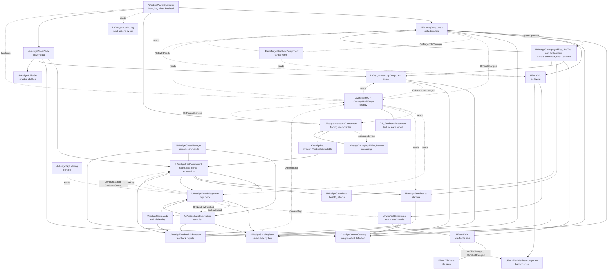
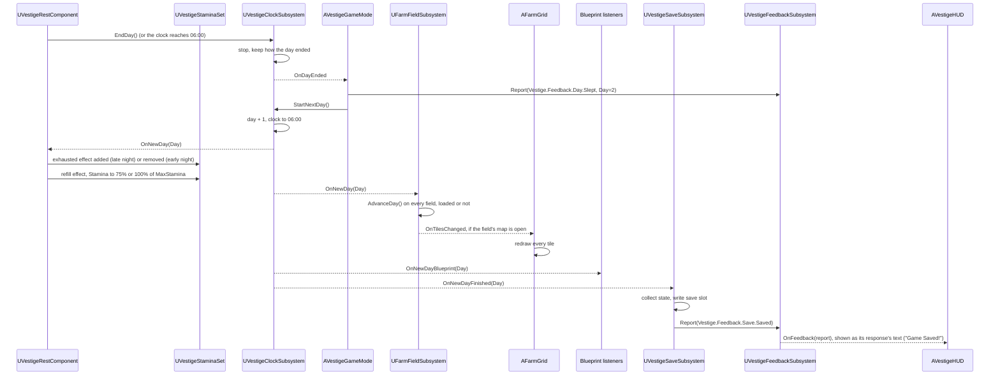

# Project Vestige architecture

How the game is put together and why. [CodingGuidelines.md](CodingGuidelines.md) covers how the code looks. This document covers how classes, systems and data fit together. [Systems.md](Systems.md) has a best-practice guide for each game system (saving, input, UI, the Gameplay Ability System, AI and so on).

It has three parts:

- **Part A: principles.** General architecture practice for C++ and Unreal Engine games. These hold for any project.
- **Part B: Project Vestige's design.** How this project applies them today: the systems, who owns what, and how data flows.
- **Part C: decisions.** A log of the design choices we made and why, plus known gaps and the changes we expect to make.

Keep Part B and Part C up to date. When a change adds a system, moves a responsibility or makes a design choice, update this document in the same commit.

Contents

- Part A: principles
  1. [Core principles](#1-core-principles)
  2. [Unreal's gameplay framework: where things go](#2-unreals-gameplay-framework-where-things-go)
  3. [Lifetimes and initialization order](#3-lifetimes-and-initialization-order)
  4. [How systems talk to each other](#4-how-systems-talk-to-each-other)
  5. [Data and content](#5-data-and-content)
  6. [Saving](#6-saving)
  7. [Presentation: UI, audio and effects](#7-presentation-ui-audio-and-effects)
  8. [C++ and Blueprints](#8-c-and-blueprints)
  9. [Modules and plugins](#9-modules-and-plugins)
  10. [Performance by design](#10-performance-by-design)
  11. [Patterns borrowed from Lyra](#11-patterns-borrowed-from-lyra)
  12. [Designing for mods](#12-designing-for-mods)
- Part B: Project Vestige's design
  13. [Systems and ownership](#13-systems-and-ownership)
  14. [Dependencies](#14-dependencies)
  15. [The day flow](#15-the-day-flow)
- Part C: decisions
  16. [Decision log](#16-decision-log)
  17. [Known gaps](#17-known-gaps)
  18. [Expected changes](#18-expected-changes)

---

# Part A: principles

## 1. Core principles

1. **One job per class.** Every actor, component and subsystem has one responsibility, and every piece of logic, component and setting lives on the class whose job it is. Never put something on a class because that class is convenient or already in the level. If nothing fits, create a new class.
2. **One source of truth.** Every piece of game state has exactly one owner. Everything else reads it or asks the owner to change it. Copies of state drift apart.
3. **Dependencies point one way.** Lower layers never know about higher ones (see [section 14](#14-dependencies)). Game rules don't know about UI, sound or effects. Data doesn't know about the systems that use it.
4. **Rules apart from presentation.** The code that decides what happens (a crop grows) is kept apart from the code that shows it (a bigger mesh). Rules can then be tested without a level, and visuals can change without touching rules.
5. **Composition over inheritance.** Build actors from components. Keep inheritance shallow: an engine base class, then at most one or two of our own levels.
6. **Data-driven content.** Content (crops, tools, items) is described in data, not in code branches. Adding a crop should mean adding an asset, not editing a `switch`.
7. **Make wrong states impossible.** Model state with enums and private members that only change through functions that check transitions (`FFarmTileState::Plant` refuses anything but tilled soil). Don't use loose booleans that can contradict each other.
8. **Commands go down, events go up.** A class calls functions on the things it owns or uses. Those things report back by broadcasting events, never by calling up into their users.
9. **The simplest design that works.** Don't build for features we don't have. Add a pattern when a real need appears, and write down why in the [decision log](#16-decision-log).

## 2. Unreal's gameplay framework: where things go

Unreal already has a home for most kinds of logic. Use it before inventing one.

| Class | Lifetime | Put here | Don't put here |
|---|---|---|---|
| `UGameInstance` and its subsystems | The whole run of the game, across map changes | Settings, the player profile, which save slot is active, music that plays across maps | Anything tied to one world |
| `AGameModeBase` | One world | The authoritative rules of the game in this world: default classes (pawn, HUD, controller), spawning, win/lose conditions | State the UI needs to read (in multiplayer it exists only on the server) |
| `AGameStateBase` | One world | Shared state of the world everyone may read: season, weather, calendar | Per-player state |
| `APlayerController` | One world, per player | The player's will: input routing, UI ownership, camera | The body's abilities or game rules |
| `APlayerState` | One world, per player, survives the pawn being destroyed | Per-player data that outlives the body: money, inventory, relationships | Things that need the body in the world |
| `APawn` / `ACharacter` | Until destroyed | The body: movement, animation, what it holds, abilities that need a position | Data that should survive the pawn |
| `UActorComponent` | Same as its actor | Reusable behavior: farming, inventory, interaction, health | Behavior only one actor will ever have (put it on that actor) |
| `AHUD` | One world, per player | Hosting the UI | Game state |
| `UWorldSubsystem` | One world | World-wide services with no transform: saving the world's state, lookups, registries | Settings that need tweaking per level; state that must survive a map change |
| `UGameInstanceSubsystem` | Whole run | Services that survive map changes | World-specific state |
| `ULocalPlayerSubsystem` | Per local player | Per-player UI, input and camera services | Shared state |
| `UDeveloperSettings` | Config | Project-wide tunables shown in Project Settings | Per-instance values |
| `UPrimaryDataAsset` | Asset | Definitions of content: a crop, a tool, an item | Runtime state |
| `USaveGame` | Save file | The saved data layout | Logic |

**World, map and level.** A *world* (`UWorld`) is the running game: one persistent map plus any sublevels streamed into it. The lifetimes above are world lifetimes, not sublevel lifetimes:

- **Streaming a sublevel** in or out only adds or removes that sublevel's actors. The world, its subsystems and the framework actors stay.
- **Opening a map** (`OpenLevel`, or non-seamless travel) tears the whole world down and creates a new one, with new world subsystems and framework actors. Only the game instance and its subsystems survive.
- **Seamless travel** also creates a new world, but carries a chosen set of actors (by default the game mode, game state, player controllers and player states) across through a transition map.

Project Vestige today has one map, no level streaming, and no travel except `OpenLevel` on the same map to start a new game. The clock (`UVestigeClockSubsystem`) and the farm data (`UFarmFieldSubsystem`) already live in the game instance (2026-11-04). Revisit this section and [section 13](#13-systems-and-ownership) before adding any of them.

**The world structure** (decision log, 2026-11-04): the game is a set of separate maps (the farm, the robot town, each wasteland zone, each faction hub), and moving between them opens the other map with `OpenLevel`. There is no persistent level with areas streamed in, and no World Partition. What follows from it:

- **The simulation lives outside the level.** Anything that must go on while its map isn't loaded (the clock, each map's farm data) belongs to a `UGameInstanceSubsystem`. A level is a view of that data: its actors read it, draw it and ask its owner to change it. Built for the clock (`UVestigeClockSubsystem`) and the fields (`UFarmFieldSubsystem`, one `UFarmField` per grid, found by the grid's `FieldId`); `AFarmGrid` (with the meshes that draw its field) and `AVestigeSkyLighting` are views.
- **The player's data crosses a map change as a snapshot.** Opening a map destroys the player state as well as the pawn, so the inventory and the ability system on it don't survive travel on their own. When the map starts tearing down, before any actor is destroyed, each owner writes its part into the snapshot `UVestigeSaveRegistry` holds in the game instance; in the new map, each owner reads its part back when it begins play. This is the same mechanism as loading a save (built 2026-11-06, [section 6](#6-saving)). Seamless travel isn't used: it is built for networked games and needs a transition map.
- **Interiors are part of their map.** The farmhouse and the room under it are in the farm map, so going indoors needs no load. A new map is for a new place, not for a door.
- **A map is content.** A zone or hub is a data asset that names its map by soft reference, so a mod can add one by shipping a map and its data asset.

A useful test for player data: **does it need to exist when the player's body doesn't?** Money and inventory do, so they belong on the player state (or a component on it). Tool use needs a position and facing, so it belongs on the pawn.

Placed actors versus subsystems: use an actor when something needs a place in the level or per-level settings a designer tweaks in the Details panel. Use a subsystem when it's a service that should always exist and needs no settings.

A service the game can't run without is a subsystem, which Unreal creates exactly once per game instance or world, before any actor's `BeginPlay`, with nothing to place. Until 2026-11-04 the day cycle, a placed actor, held the clock and found-or-spawned itself through a static `Get` when a level had none; the clock moved to `UVestigeClockSubsystem` and that `Get` went with it (decision log, 2026-11-04). An actor that is only presentation, such as the day cycle's lighting, is simply missing from a level that doesn't place it, and nothing spawns it.

## 3. Lifetimes and initialization order

Most hard-to-find Unreal bugs are about things running in a different order than assumed.

- **Constructors** run for the class default object at editor startup, with no world. Only create components and set defaults there. Never spawn, search the level or bind to other actors in a constructor.
- **`OnConstruction`** runs in the editor whenever a placed actor changes. Use it for editor previews (`AFarmGrid` sizes its bounds box), never for gameplay.
- **`PostInitializeComponents`** runs before `BeginPlay`, once the actor's own components exist. Use it to wire an actor's own components together.
- **`BeginPlay`** is where gameplay setup starts. **The order between different actors' `BeginPlay` calls is not guaranteed.** Never assume another actor has already run its `BeginPlay`.
- **`EndPlay`** runs when the actor is destroyed, when the sublevel it lives in is streamed out, or when the world is torn down. Unbind delegates and remove UI here.
- **World subsystems**: `Initialize` runs when the world is created, `OnWorldBeginPlay` before the actors' `BeginPlay`, and `Deinitialize` when it is torn down.
- **Opening a map** destroys the world and everything in it: actors, components and world subsystems. Only the game instance and its subsystems survive. Streaming a sublevel doesn't; see [section 2](#2-unreals-gameplay-framework-where-things-go) for the difference.

To deal with unknown order, in order of preference:

1. **Ask a subsystem.** What every world needs lives in a subsystem, which exists before any actor's `BeginPlay` (`UVestigeClockSubsystem::Get`, `UFarmFieldSubsystem::Get`).
2. **Register with a known owner.** Things announce themselves to a subsystem in their `BeginPlay`, and the subsystem broadcasts once everything it needs has arrived.
3. **Wait for a signal.** Bind to a "ready" event rather than guessing.
4. **Wait a tick** (`SetTimerForNextTick`). This works but hides the dependency. Use it only when the above don't fit, and comment why.

## 4. How systems talk to each other

Pick the loosest connection that does the job.

| Mechanism | Use when | Example |
|---|---|---|
| Direct function call | A class tells something it owns or clearly depends on to do something | `UFarmingComponent` calls `UFarmField::Till` |
| Multicast delegate | Something happened and any number of others may care. The sender must not know who listens | `UVestigeClockSubsystem::OnNewDay` |
| Interface (`UINTERFACE`) | Many unrelated classes respond to the same request | `IVestigeInteractable`: the bed, later the shipping bin, chests and robots |
| Subsystem lookup | Reaching a global service | `UVestigeSaveSubsystem::Get(GetWorld())` |
| Message bus (Lyra's Gameplay Message Router) | Many senders and many listeners that shouldn't know each other at all | Not needed yet |

Rules:

- **No circular dependencies.** If A calls B, B doesn't call A. B broadcasts an event that A listens to.
- **Ask, don't reach in.** Never change another class's state directly. Call a function that says what you want; the owner keeps itself consistent.
- **Find things in one place.** Each well-known object has one static `Find` / `Get` function (`AFarmGrid::Find`, built on `VestigeActorLookup::FindSingle`, which logs an error when a level has more than one; a subsystem's static `Get`, such as `UVestigeClockSubsystem::Get`). Don't scatter `TActorIterator` searches through the code, and call `Find` once and keep the result rather than every frame.
- **Bind with object-safe helpers** (`AddUObject`, `AddWeakLambda`) so a destroyed listener is never called, and unbind in `EndPlay` / `Deinitialize`.
- **C++-only events use non-dynamic delegates.** Use dynamic delegates only when Blueprints need to bind, which is what an extension point event is ([section 12](#12-designing-for-mods)). When C++ already listens to that event through a native delegate, the native one stays for C++ and the Blueprint one is its twin, named with `Blueprint` (`OnNewDay` and `OnNewDayBlueprint`) and broadcast right after it.

## 5. Data and content

| Kind of data | Use | Notes |
|---|---|---|
| A definition of one piece of content with assets attached (a crop with meshes and growth days) | `UPrimaryDataAsset` subclass | One asset per crop. The Asset Manager can find and load them all. |
| Many rows of the same numbers, edited like a spreadsheet (prices, balancing) | `UDataTable` with a `USTRUCT` row | Can be imported from CSV |
| Project-wide tunables | `UDeveloperSettings` | Shows up in Project Settings, stored in `Config/` |
| Per-class tunables | `EditDefaultsOnly` properties, set in a Blueprint subclass | How `BP_FarmGrid` sets the art its field is drawn with |
| Per-placed-instance tunables | `EditAnywhere` properties | `AFarmGrid` size |
| Open-ended categories designers extend | `FGameplayTag` | Item categories, seasons |
| Small closed sets that code switches on | `enum class` | `EFarmTileState`, `EVestigeLoadOutcome` |

- **Identify content by stable IDs**, not by pointers, array positions, asset paths or display names. This matters most for saves: an ID still means the same thing after content is added, reordered, renamed or moved.
- **One canonical content ID.** Every content data asset has a `ContentId` property, an `FName` of the form `<Namespace>.<Name>` (`Base.Turnip`). It is typed in by whoever makes the asset; it is not derived from the asset's file name or path, so renaming or moving the asset doesn't change it. The asset's `FPrimaryAssetId` is built from it (the data asset overrides `GetPrimaryAssetId` to return its type and `ContentId`), so the Asset Manager and saves use the same ID. This ID is what saves store.
  - **Format:** exactly one dot; namespace and name are PascalCase ASCII letters and digits. Base content uses the namespace `Base`, which is reserved for it (checked once mods load); a mod uses its own name. Data validation (`IsDataValid`) rejects an asset with a missing or badly formed ID. IDs that differ only in case are the same ID, because `FName` ignores case.
  - **Unique within its primary asset type, which is its category.** There is no category segment (`Base.Character.Gage` fails validation): a character is `Base.Gage` of type `VestigeCharacter`, so its primary asset ID is `VestigeCharacter:Base.Gage`. The same name in two types is allowed, and is the convention for one thing in two roles (the crop `Base.Turnip` and the item it yields, `Base.Turnip`; the tool and the item `Base.Hoe`). A pairing is still always an explicit typed reference (`HarvestItemId`, a seed's `CropId`, an item's `ToolId`): code never builds one type's ID from another type's `ContentId`. Grouping that might change (human or robot, item categories) is a gameplay tag, never part of the ID (decision log, 2026-11-10).
  - **Primary asset types are part of the ID**, so choose them by data shape, one per content class (`UVestigeCharacterData` is `VestigeCharacter`, for humans and robots alike), never by story category. Like a content ID, a type's name never changes once a build has shipped; a rename then needs a `PrimaryAssetTypeRedirects` entry in the Asset Manager settings.
  - **Carry the type wherever the context doesn't fix it.** A property that names content is an `FPrimaryAssetId` with `meta = (AllowedTypes = "...")`, and its asset checks it in `IsDataValid` with `FindContentReferenceError`, because `AllowedTypes` only filters the editor's picker and imports, scripts and mods can put any type there. A save field, log line or console command uses the bare `ContentId` only where its type is fixed (a tile's `CropId`, "The tool {ToolId}", `BenchmarkField 20 Base.Turnip`). One that can name more than one type uses the full primary asset ID (`VestigeItem:Base.Turnip`): an `FPrimaryAssetId` property in data and saves, never a string, and `ToString()` in text. A collection keyed by a bare `FName` across types (seen content, a collection log) would merge the crop and the item `Base.Turnip`, so it is keyed by `FPrimaryAssetId`. A Blueprint that must tell content of any type apart uses the engine's **Get Primary Asset Id From Object**. This rule has no test; reviews check it.
  - **Only content.** Other IDs (save keys such as `Base.Inventory`, dialogue line IDs, quest IDs) are not content IDs and get their own rules when their system is designed.
  - **IDs never change once a build has shipped.** Fix a display name instead; that's a separate localized `FText`. If an ID really must change, add an old-to-new entry to an ID redirect list that loading applies before looking content up. The redirect list is deferred until the first ID has to change (decision log, 2026-10-29). When it comes, it is the engine's `PrimaryAssetIdRedirects` (Asset Manager settings, applied by `UAssetManager::GetRedirectedPrimaryAssetId`), keyed by the full primary asset ID, not a list of our own. When it comes, the content catalogue's `Find` applies `GetRedirectedPrimaryAssetId` itself, so saves and references in data are redirected in one place (today `Find` is a plain map lookup).
  - **Duplicates are errors.** At startup the game checks every content type for repeated IDs and logs an error naming both assets. Base content wins over mods; between two mods, the first one loaded wins until mod load order exists ([section 12](#12-designing-for-mods)).
  - **Unknown IDs** in a save are skipped with a logged warning, and the player is told some content couldn't be found ([section 12](#12-designing-for-mods), rule 6).
  - **Tests** cover the format, a duplicate ID and an unknown ID in a save. A redirected ID gets its test with the redirect list.
- **Gameplay tags** identify open-ended categories (item categories, seasons), not individual pieces of content.
- **Reference assets softly** (`TSoftObjectPtr`) when they don't have to be in memory with the referencing class. Hard references load everything they point to.
- **Code never hard-codes paths to our own assets.** Expose a property and set it in a Blueprint subclass, a data asset or config. Engine default assets (`/Engine/BasicShapes/...`) are fine as placeholders.

## 6. Saving

- **Each owner saves its own state.** An owner provides a function that returns a plain save struct (`FFarmTileSaveData`) and one that restores from it. The save subsystem collects and stores these structs. It doesn't read or write other classes' internals.
- **Save data is plain structs** of IDs and values. No object pointers.
- **Version the save.** The save game has a version number, raised when a layout change would make older saves load wrong. From the first public build, each older version gets a migration step ([Roadmap.md, section 6](Roadmap.md#6-before-a-public-release)). Until then there are none: nobody else has a save to keep, so an older save is refused like a corrupt file and the developer starts a new game (decision log, 2026-11-04).
- **Never lose the player's save by accident.** Only an explicit choice by the player (starting a new game) deletes or replaces a save that couldn't be loaded. What loading does:

| What's in the slot | Outcome |
|---|---|
| Nothing | Start a new game. No message needed. |
| A save of the current version | Load it. |
| An older version that migrates (from the first public build) | Load the migrated data. Before the first save in the new format overwrites it, keep a copy of the original file next to it. |
| A corrupt file, a newer version than this build understands, or an older version without a migration | Don't load it and don't crash. Tell the player and log why. Leave the file untouched: saving stays off for the rest of the session, so a fresh day can't overwrite it. The player can start a new game, which is the explicit decision to replace it. |
| Content IDs this build doesn't know | Load the rest, skip those entries with a warning ([section 12](#12-designing-for-mods), rule 6). |

- **A failed write keeps the last good save.** Write the new save beside the old one and replace the old one only when the write succeeded; tell the player if it failed. The game carries on and tries again at the next save point. Built as two alternating slots (`Farm` and `Farm2`), each save numbered by a `SaveSequence`: a save always goes to the slot that doesn't hold the newest good save, and loading picks the readable save with the highest number.
- **Save at clear points.** We save when a new day starts. That keeps saves consistent: nothing is half-done mid-action. The accepted cost: quitting mid-day loses everything since that morning. Saving is synchronous (`SaveGameToSlot`), which is fine while saves are small; move to `AsyncSaveGameToSlot` if writing a save causes a visible hitch.
- **One game, one save, through a registry** (2026-11-06, [Systems.md, section 1](Systems.md#1-saving-and-loading)). Every owner of saved state implements `IVestigeSaveable` and registers with `UVestigeSaveRegistry`, a game-instance subsystem in `Core/` that holds the game's state in memory as one record per key (`Base.Clock`, `Base.Inventory`), each with its owner's own version. Records nobody registers for (a mod's) are kept. `UVestigeSaveSubsystem`, also in the game instance, reads the file once per game, when the first map is initialised and before any actor begins play, and writes every record on the new day; it names no owner. Opening another map doesn't load the file again, so the clock and the fields go on as they were, and the player's data crosses the map change through the registry ([section 2](#2-unreals-gameplay-framework-where-things-go)). Save slots and a main menu add a choice of slot in the save subsystem, and loading moves from the first map to the menu's Continue. Never open another map while a save is being written; with synchronous saves this can't happen yet.
- **Restore without side effects.** Restoring sets state directly; it doesn't replay game actions or broadcast "new day" again (`UVestigeClockSubsystem::RestoreFromSaveData`).
- **Test the save rules.** Save tests cover a save and load round trip through each owner's own save and restore functions, migration from every older version once there are migrations, a corrupt, older-version or newer-version file being left untouched, and unknown content being skipped.

## 7. Presentation: UI, audio and effects

- **Presentation depends on the game; the game doesn't depend on presentation.** UI, sounds and effects read state and listen to events. Game rules never call the UI, an audio component or a particle system directly.
- **The UI owns no game state.** It may keep display-only state, such as a message that is fading.
- **Cosmetics react to events.** When a tile is watered, the tile broadcasts a change and cosmetic code plays the splash. Gameplay code doesn't spawn the splash itself.
- **UI is UMG Widget Blueprints with C++ base classes.** The C++ base holds the logic and the Blueprint the layout and style, so the UI is laid out in the editor and mods can restyle it ([Systems.md, section 6](Systems.md#6-user-interface)). Common UI comes with the first menu, for controller navigation and layered menus; its Common Input subsystem already tells the key hints which device the player used last.

## 8. C++ and Blueprints

The usual Unreal split, and Epic's own recommendation, is **C++ for systems, Blueprints for content**.

- **C++:** game rules, systems, data definitions, anything we test, anything that runs every frame or over many objects, and the base classes Blueprints extend.
- **Blueprints:** assigning assets (meshes, materials, sounds), tuning values, level layout and one-off level scripting, visual-only behavior like animation and effects timing.
- C++ classes are the base; Blueprint subclasses (`BP_...`) fill in assets and values. Code references the C++ class and gets the Blueprint through a `TSubclassOf` property (as `AFarmGrid::TileClass` does), never by asset path.
- If Blueprint logic grows past a handful of nodes, or two Blueprints duplicate it, move it to C++.

## 9. Modules and plugins

- The game is a **single runtime module** (`Vestige`). That's right for a project this size. Inside it, the code is split into folders by architecture layer ([section 14](#14-dependencies)), with the dependency order checked by a test, which gives most of what separate modules would without their cost (decision log, 2026-10-30).
- Add a separate module only for a concrete reason:
  - **`VestigeEditor`** (editor-only module): when we write editor tools, validators or custom detail panels, which must not ship in the game.
  - **`VestigeTests`**: if the tests outgrow `Source/Vestige/Tests/`.
  - **A plugin**: for a system that's finished, self-contained and reusable in another project.
- Module dependencies are one-way and listed in `.Build.cs`. Prefer private dependencies.

## 10. Performance by design

**Performance is a requirement.** Unreal Engine 5 games are often known for stutter and high hardware demands, and most of that comes from choices made early: what ticks, what loads, what references what, and which rendering features are on. We make those choices deliberately, against a budget, and check the budget at every milestone. The code rules are in [CodingGuidelines.md, section 12](CodingGuidelines.md#12-performance).

Two things stay true at the same time: designs and code follow the always-on rules from the start, and optimizations that make code harder to read wait for a measurement.

### Budget

**Target hardware (confirmed by David, 2026-10-29):** a 2020-era mid-range PC (an RTX 2060 or RX 5600 XT class GPU, a 6-core CPU, 16 GB of memory, an SSD) at 1920x1080 and the High scalability level.

| Budget | Limit | Notes |
|---|---|---|
| Frame time | 16.6 ms (60 fps) | On the target hardware at High, in a busy part of the farm |
| Game thread | 10 ms | All game thread work, engine included (`stat unit`) |
| Our gameplay code | 2 ms per frame | Everything in `Source/Vestige` that runs during normal play (Unreal Insights) |
| Hitches during play | No frame over 33 ms | Two frames at 60 fps. Includes first-time shader and PSO compilation and streaming |
| New day | 100 ms in total | All `OnNewDay` work plus the save, hidden by the sleep transition |
| Loading into the farm | 10 seconds | From the main menu or start of play, on an SSD |
| Video memory | 4 GB | At 1920x1080 High, of the target GPU's 6 GB; the rest is for Windows and other programs. 2.6 GB on the benchmark field (2026-11-05). In the CSV capture as `GPUMem/LocalUsedMB` |
| Memory | 8 GB in use (working set) | Of the target's 16 GB. 1.5 GB on the benchmark field, with 4.0 GB committed (2026-11-05). In the CSV capture as `PhysicalUsedMB` |

A change that breaks the budget is a bug and is fixed before more features go in. If the budget itself turns out wrong, change it here and log the decision.

### Scalability

- The game runs at all four scalability levels (Low, Medium, High, Epic). The target hardware holds the budget at High; weaker machines play at Low or Medium.
- Expensive rendering features are options, not requirements: high-quality Lumen reflections and similar features are only on at Epic. The game's look must hold up without them.
- How the project sets this up:
  - **No hardware ray tracing** (`r.RayTracing=False` in `DefaultEngine.ini`, checked by the test `Vestige.Rendering.HardwareRayTracingIsOff`). Lumen uses software ray tracing at every level, Epic included, so there is one lighting path to check and no ray tracing shaders to compile and ship.
  - **Cheaper volumetric clouds below Epic** (`Config/DefaultScalability.ini`, effects group, checked by the tests `Vestige.Rendering.CloudSamplesAreCappedBelowEpic` and `CloudSamplesAreFullAtEpic`). The engine doesn't scale clouds at all, so they cost the same at every level. High caps them at 48 samples along the view ray and 5 toward the sun (the engine's 96 and 10), Medium at 32 and 4, Low at 24 and 4. Epic and Cinematic name the engine's own values, because a level only sets the variables it lists: without them, switching from Low to Epic kept Low's caps. On the benchmark field, off screen at 1280x720, that is 0.83 ms at Epic, 0.31 at High, 0.20 at Medium and 0.16 at Low (0.74 at High at 1920x1080); the cloud edges get slightly grainier, the shapes and colours stay. These are the project's only changes to the engine's levels.
  - **New players start at High**, from `Config/DefaultGameUserSettings.ini`, instead of the engine's Epic. Their own choice overrides it; a first-run benchmark replaces it once there are settings ([Systems.md, section 17](Systems.md#17-settings)).
  - **Lumen, virtual shadow maps and Substrate stay on, High included.** Substrate is the material system the project's materials are made in. Lumen is the only dynamic global illumination for a sun that moves (the project has no baked lighting), and in the first baseline it cost about 0.6 ms of a 6.0 ms GPU frame, less than the volumetric clouds or the shadow depths ([Measuring](#measuring)).
  - **The default performance level stays Maximum** (Project Settings > Target Hardware). It isn't a quality level: on desktop, Scalable turns off auto-exposure, motion blur and anti-aliasing, and the dark nights depend on auto-exposure. Cost is set by the scalability levels.

### Design rules

- **Ticking is opt-in.** Most things react to events or timers. Only things that genuinely change every frame tick (`UVestigeClockSubsystem` runs the clock, `AVestigeSkyLighting` fades the light; the sun itself turns only in steps). Owners broadcast state changes so nobody has to poll them.
- **Event-driven daily updates.** Farm logic mostly happens once a day, on `OnNewDay`, while the sleep transition hides the work. Nothing checks crops every frame.
- **Find once, keep the reference.** Well-known objects are found through one `Find` / `Get` or registration ([section 4](#4-how-systems-talk-to-each-other)), never searched for every frame.
- **Load ahead, load softly.** Content is soft-referenced and loaded with its bundle before it's needed ([section 5](#5-data-and-content)). Nothing loads synchronously while the player is playing.
- **Scale with distance and relevance.** When there are many robots, animals or effects, things far away or off screen update less often or not at all (tick intervals, Unreal's significance manager, animation update rate optimization). Design new crowds with this in mind from the first version.
- **Decide structure up front when its cost is known, and optimise details when a profile says so.** Some costs are known before anything is measured: an actor, components and materials for each of thousands of tiles, or a system that has to work across maps. A small test level never shows them, so those choices are made when the design is, as the tiles were ([CodeReview.md, C2](CodeReview.md#c2--one-actor-per-tile-each-with-two-meshes-and-two-dynamic-materials)). Things that repeat by the hundred or thousand (tiles, crops, placed objects, robots) are data drawn with instances, not an actor each ([Systems.md, section 22](Systems.md#22-farm-fields-and-tiles)). Optimisations that make code harder to read still wait for a measurement.

### Content rules

What content does to performance is decided when it is made, so these apply to art and level work as well as code:

- **Meshes:** Nanite for static, detailed meshes (buildings, rocks, ruins). Skinned meshes (the farmer, robots) and anything Nanite doesn't suit get LODs.
- **Swaying crops and foliage** use World Position Offset sparingly: it makes virtual shadow maps redraw those shadows every frame. Set the mesh's WPO disable distance so distant plants stop moving.
- **Lights:** the sun and sky light are the main lights. Extra movable lights (robot lamps, windows) are small, few and usually don't cast shadows. The sun turns in steps (`SunStepDegrees` on the day cycle), not every frame: virtual shadow maps redraw all of a light's cached shadows whenever its direction changes.
- **Translucency:** the haze and similar effects use fog (exponential height fog, volumetric fog) and post-processing, not stacked translucent planes, which multiply GPU cost.
- **Triangle and texture budgets** are in [CONTRIBUTING.md, Budgets](../CONTRIBUTING.md#budgets): textures 1024 or smaller and props in the hundreds of triangles, unless there's a stated reason.
- **References:** check the Size Map of every new Blueprint and data asset ([CodingGuidelines.md, section 12.4](CodingGuidelines.md#124-assets-and-loading)).

### Measuring

- Use `stat unit`, `stat game`, `stat gpu` and Unreal Insights to find real costs, in a packaged Development build or a Standalone Game launch rather than Play in Editor ([CodingGuidelines.md, section 12.9](CodingGuidelines.md#129-measuring)).
- At the end of each roadmap milestone, measure on the target hardware in a fixed scene (the farm at midday and at night, the sleep transition, loading in) and add a row to the baseline in [PerformanceBaseline.md](PerformanceBaseline.md). Compare with the previous row; a regression gets fixed or explained.

**Latest results** (2026-11-05, after the instanced tiles; packaged Development build, off screen at 1920x1080 High, a 60 by 60 field of ripe turnips): the frame takes 5.1 ms on average (the GPU 4.6 ms) against the 16.6 ms budget, and the new day 12.6 to 13.5 ms of game thread against its 100 ms. These are from a PC with about three times the target's GPU, not from the target. Every run, how it is measured and what it found: [PerformanceBaseline.md](PerformanceBaseline.md).

## 11. Patterns borrowed from Lyra

Lyra is Epic's reference for a well-structured UE5 game. It is built for a large team and multiplayer, so **we adopt a Lyra pattern when we have a concrete need for it, not before.** When we do, we follow how Lyra and Epic's documentation build it, as written down per system in [Systems.md](Systems.md).

| Lyra pattern | Status in Project Vestige |
|---|---|
| Thin actors, behavior in components (`ULyraHealthComponent`, `ULyraHeroComponent`) | **Adopted.** `AVestigePlayerCharacter` is a template character plus `UFarmingComponent`. New behaviors (fishing, resting) become new components; stamina is an attribute on the ability system ([Systems.md, section 9](Systems.md#9-abilities-attributes-and-effects-gameplay-ability-system)). |
| Subsystems instead of singletons and managers | **Adopted.** `UVestigeSaveSubsystem`, `UVestigeSaveRegistry`, `UVestigeClockSubsystem`, `UFarmFieldSubsystem`. |
| A project prefix on every class (`Lyra...`) | **Adopted.** `Vestige...`, and `Farm...` for types about the farm itself ([CodingGuidelines.md, section 2.2](CodingGuidelines.md#22-the-vestige-and-farm-project-prefixes)). |
| Data assets describing content (`ULyraPawnData`) | **Adopted** for crops (`UFarmCropData`), tools (`UVestigeToolData`) and items (`UVestigeItemData`). |
| Item definitions built from fragments (`ULyraInventoryItemDefinition`, `ULyraInventoryItemFragment`) | **Adopted** for items, as data assets rather than Lyra's Blueprint classes ([Systems.md, section 8](Systems.md#8-inventory-and-items)). Lyra's inventory component comes with our inventory. |
| Gameplay tags for identifiers | **Later**, for open-ended categories. Closed sets stay enums. |
| Input actions mapped to tags through data assets | **Built** (2026-11-07, [CodeReview.md, H6](CodeReview.md#h6--input-is-built-in-c-with-hard-coded-keys)). `IA_` / `IMC_` assets, and `UVestigeInputConfig` (`DA_InputConfig_Player`) mapping each action to a native input tag; the character binds by tag to the owning components. Lyra's ability input actions and custom input component are skipped until a key maps straight to an ability ([Systems.md, section 5](Systems.md#5-input)). |
| Gameplay Message Router | **Not yet.** Plain delegates are enough. |
| Game Feature plugins and modular gameplay actors (actors that accept components from plugins) | **Later**, as a likely building block for mod loading ([section 12](#12-designing-for-mods)). |
| Gameplay Ability System | **Adopted, starting with stamina** (not built yet). The ability system component on the player state, attribute sets, gameplay effects and ability sets as data, as in Lyra; see [Systems.md, section 9](Systems.md#9-abilities-attributes-and-effects-gameplay-ability-system). |
| Experiences, Common UI, replication | **Not adopted**, except Common Input, Common UI's input subsystem, which the key hints follow since 2026-11-08. Each adds a lot of setup that a single-player prototype doesn't need. Revisit when a feature calls for one. Common UI's widgets and input routing come with the first menu ([Systems.md, sections 5 and 6](Systems.md#5-input)). |

## 12. Designing for mods

**Goal: other people can add content and behavior to the game without our source code.**

**Status: mod-oriented design, not mod support.** The game can't load mods today, and nothing in it is a promised mod API yet. We follow the rules below so mod loading can be added later without a rewrite.

### How Unreal games are modded

- A mod is usually a **plugin**: content (meshes, data assets, Blueprints) plus, rarely, C++. Unreal doesn't discover, mount or activate plugins added to a packaged game on its own; the game has to do that, and the plugin's content has to be cooked for the same engine version.
- **Content and Blueprint mods** are the kind we design for. C++ mods have to be compiled against exactly the same engine version and build as the game, which is fragile; we don't plan for them.
- Lyra's **Game Feature plugins** are a likely building block. A Game Feature can add data assets, add components to existing actors and register gameplay tags without the base game knowing it exists. They aren't a mod loader, though: the game has to register and activate each one through the Game Features subsystem, and deactivation, dependencies and their lifecycle are ours to design.
- The best way to keep the game moddable is to **build the base game the way a mod would be built**: base content goes through the same discovery, IDs and extension points a mod would use.

### Rules from now on

1. **Content is discovered, not listed.** Crops, tools, items, recipes and shop stock are data assets of a registered primary asset type (for example `FarmCrop`). The game asks the Asset Manager for every asset of that type. There are no hard-coded lists or `switch` statements over content, so a mod adds a crop by adding a data asset.
2. **Enums only for fixed mechanics.** An `enum class` is fine for states that mods shouldn't extend, like `EFarmTileState` (grass, tilled, planted). Anything a modder might want more of (tools, crops, item categories) is a data asset or a gameplay tag.
3. **Namespaced IDs.** Every piece of content has a stable `ContentId` of the form `<Namespace>.<Name>`, with the format, rename and duplicate rules in [section 5](#5-data-and-content). Base game content uses `Base` (`Base.Parsnip`, `Base.WateringCan`). Mods use their own name. An ID is unique only within its primary asset type (`VestigeCharacter:Base.Gage`) and has no category segment. Gameplay tags we define live under `Vestige.`; mods add their own.
4. **Deliberate extension points.** Key classes are `Blueprintable`. Meaningful moments get Blueprint-assignable events or `BlueprintNativeEvent` hooks (a crop is harvested, a new day starts, a tool is used). Main actions are `BlueprintCallable`. Mark these with `/** Extension point: ... */` in the header. Everything else stays private, because every exposed function is a promise to modders.
5. **Behavior in components, and actors that tolerate extra ones.** A mod adds behavior by adding a component to an existing actor. Actors must not assume they have a fixed set of components, and systems should look for components and interfaces rather than concrete classes.
6. **Saves survive missing content.** Saves store content IDs, never positions in a list. When a save mentions content that no longer exists (a mod was removed), loading skips it with a warning instead of failing.
7. **No hard asset paths in code**, as in [section 5](#5-data-and-content). Mods can only replace or extend what goes through properties, data assets and the Asset Manager.

### Extension points today

What a Blueprint can use so far (rule 4). Each is marked `/** Extension point: ... */` in its header, and the tests `Vestige.ExtensionPoints.*` list them, because mod Blueprints use them by name: renaming or hiding one breaks every mod that uses it, so a rename needs a `PropertyRedirects` or `FunctionRedirects` entry in `[CoreRedirects]`, and a change to the list is a change to the mod API.

| Extension point | On | What it says |
|---|---|---|
| `On New Day` (`OnNewDayBlueprint`), with the day's number | `UVestigeClockSubsystem`, found in any Blueprint with **Get Vestige Clock** (the node Unreal makes for a game-instance subsystem), so it works in every map | A new day started. After `OnNewDay`'s C++ listeners (the farm has grown) and before `OnNewDayFinished` (the save), so what a listener changes through the game's functions is saved. It has `OnNewDay`'s contract: every change to saved state finishes in the handler ([section 15](#15-the-day-flow)) |
| `On Crop Harvested`, with the crop and the tile's coordinates (`FIntPoint`) | `UFarmingComponent` on the player's pawn | The player harvested a crop: the harvest is in the bag and the tile is tilled soil again. The tile was an actor until 2026-11-05 ([Systems.md, section 22](Systems.md#22-farm-fields-and-tiles)) |
| `On Tool Used`, with the tool and the tile's coordinates (`FIntPoint`) | `UFarmingComponent` on the player's pawn | A tool use changed the farm. Uses that change nothing (and so cost nothing) aren't broadcast. For a harvest it follows `On Crop Harvested` |
| **Get Content Id** | `UVestigeContentData`, so every crop, tool and item | The content's ID (`Base.Turnip`), for telling which crop or tool an event names without a hard reference to its asset. Unique only within its primary asset type (a crop and an item can both be `Base.Turnip`); to tell content of any type apart, use the engine's **Get Primary Asset Id From Object** |
| **Get Interaction Options** and **Interact** (`IVestigeInteractable`, with `FVestigeInteractionOption`) | Any actor that implements the interface, in C++ or a Blueprint, plus a shape with the `VestigeInteractable` collision profile | What the player can do with the actor now (the first option is the one the interact key uses), and doing it. An option can say where it is (`bHasLocation`, `Location`) when that isn't the actor (the farm grid's ripe tile); the player must face that location, or, without one, face the actor's shape. The interactable owns what happens ([Systems.md, section 7](Systems.md#7-interaction)) |

How they are built: an event is a `BlueprintAssignable` dynamic multicast delegate on the class that owns the moment, following [section 4](#4-how-systems-talk-to-each-other). Not yet exposed: callable main actions (tilling a tile, adding an item) and the state behind them (a tile's state, the clock, the inventory), which come when a mod or content Blueprint first needs them ([Roadmap.md, 4.1](Roadmap.md#41-foundations)).

### Before we say the game supports mods

All of these have to exist and be tested in a packaged build first:

- **Discovery and mounting:** finding mod plugins in a mods folder of a packaged build and mounting their cooked content.
- **Asset Manager scanning:** the primary asset types are configured to scan plugin content, so a mod's data assets are found like base content.
- **Activation:** turning a mod on and off, and what happens to its content in a running game.
- **Load order and conflicts:** which mod wins, and how duplicate content IDs are reported ([section 5](#5-data-and-content)).
- **Versions:** which game versions a mod works with, and what happens when it doesn't.
- **Saves without the mod:** a save made with a mod loads without it ([section 6](#6-saving)).
- **Trust and consent:** mods run with the player's trust (a Blueprint mod can do anything the game can), so the player turns each mod on knowingly, and the game never runs mods from untrusted sources automatically.
- **A documented mod API:** which classes, events and functions are extension points (rule 4).

### What we leave for later

- Everything in the list above.
- Moving base content into its own Game Feature plugin.
- A mod kit: the editor setup modders would build with.
- Letting mods override base content rather than only add to it.

---

# Part B: Project Vestige's design

## 13. Systems and ownership

One row per class, lowest layer first: its job in a sentence and what it doesn't own. How it does its job is in its header comment and in its system's guide in [Systems.md](Systems.md).

| Class | Kind and layer | Job | Does not own |
|---|---|---|---|
| `UVestigeSaveRegistry` | Game-instance subsystem, `Core/` | The game's saved state in memory, one record per key: hands each owner its part when it registers, asks every owner for its part when the game is saved and the open map's owners as it tears down, and keeps records nobody claims ([Systems.md, section 1](Systems/01-Saving.md)) | Files and slots; what any owner saves; game rules |
| `IVestigeSaveable` and `FVestigeSaveRecord` | Interface and struct, `Core/` | What every owner of saved state provides (a key, a layout version, writing and reading its part, a new game) and the record a part is stored as | Which owners exist |
| `UVestigeFeedbackSubsystem` | World subsystem, `Core/` | Carrying feedback reports (a `Vestige.Feedback` tag and values) from game code to presentation, and writing each to the log ([Systems.md, section 15](Systems/15-EffectsAndFeedback.md)) | The player's text, showing messages, or knowing who listens |
| `UVestigeStaminaSet` | Attribute set, `AbilitySystem/` | The stamina numbers and their limits (0 to the maximum), the out-of-stamina tag, and the stamina's save part ([Systems.md, section 9](Systems/09-AbilitySystem.md)) | What costs stamina, when it refills |
| `UVestigeAbilitySet` | Data asset, `AbilitySystem/` (`DA_AbilitySet_Player`) | A list of attribute sets and abilities granted together, and granting them to an ability system | When it is granted, runtime state |
| `VestigeGameplayTags` | Native gameplay tags, `AbilitySystem/` | The tags C++ uses: abilities, set-by-caller data, states, feedback reasons and input | Tags only content uses, which stay in `DefaultGameplayTags.ini` |
| `IVestigeInteractable` + `FVestigeInteractionOption` | Interface and struct, `Interaction/` | What a usable thing offers an interactor now (its options) and doing one; the `Interactable` collision channel and profile names ([Systems.md, section 7](Systems/07-Interaction.md)) | What any interactable does; finding them |
| `UVestigeInteractionComponent` | Component on the player's pawn, `Interaction/` | Finding the nearest faced interactable with a timer query on the `Interactable` channel, telling listeners when the focus changes, and using its first option | What any interactable does; input; showing the prompt; what the owner aims at |
| `UVestigeGameplayAbility_Interact` | Gameplay ability, `Interaction/`, granted by `DA_AbilitySet_Player` | That interacting goes through the ability system, so tags can block it later | Which interactable, what it does |
| `UVestigeContentData` | Abstract data asset base, `Content/` | What all content shares: the `ContentId` and the primary asset ID built from it, the display name, the `Visuals` bundle, and checking the ID in data validation ([Systems.md, section 2](Systems/02-Content.md)) | Anything specific to one kind of content |
| `UVestigeAssetManager` | The project's Asset Manager, `Content/` | Startup checks of all content (content IDs used twice) and loading the global game data once | Loading content for gameplay systems |
| `UVestigeContentCatalog` | Game-instance subsystem, `Content/` | Every content definition with its visuals, loaded once per game before any world plays; finding one by ID, never loading | Loading icons or other bundles for a UI, content added while a game runs, the global game data |
| `UVestigeGameData` | Primary data asset, `Content/` (`DA_GameData`) | Global data code needs that isn't one piece of content: today the gameplay effects code applies | Who applies the effects, the amounts, runtime state |
| `GE_StaminaCost`, `GE_StaminaRefill`, `GE_LateNightDrain`, `GE_Exhausted` | Gameplay effect Blueprints (`Content/Vestige/Abilities/`) | What each effect does to stamina or the exhausted state, changed in the editor by designers and mods | Who applies them, the amounts |
| `UVestigeToolData` | Primary data asset `VestigeTool`, `Content/` | One tool's definition: the ability that is its behaviour, its held mesh, stamina cost and use time | Which tools the player has, the grip offset in the hand |
| `UFarmCropData` | Primary data asset `FarmCrop`, `Content/` | One crop's definition: seasons, growth, its meshes, and the item a harvest gives and how many | Runtime state such as growth or which tiles grow it; prices, which belong to items |
| `UVestigeItemData` | Primary data asset `VestigeItem`, `Content/` | One item's definition: stack size, sell price and its fragments ([Systems.md, section 8](Systems/08-Inventory.md)) | Runtime state such as how many the player has; what only some items have, which is a fragment |
| `UVestigeItemFragment` and subclasses | Instanced objects inside an item asset, `Content/` | One aspect only some items have: `UFarmSeedFragment` the crop a seed plants, `UVestigeToolFragment` the tool an item is | Runtime state, the item's other aspects |
| `UVestigeClockSubsystem` | Game-instance subsystem, `Time/` | Game time across maps: the day and the clock, their events (the new day, each minute and hour, the day's end), how the day ended, running forward for developer commands, and its save part ([Systems.md, section 4](Systems/04-Time.md)) | Lighting, tiles, saving, HUD, what any hour means, starting the next day |
| `UVestigeClockSettings` | Developer settings, `Time/` | How the clock runs: its speed and its hours (the day's start and end, sunrise and sunset) | The clock's state |
| `AVestigeSkyLighting` | Placed actor, `Time/` | The lighting, read from the clock: the sun (turned in steps) and the moon, the sky light and the night exposure | The clock, days, events, the sky atmosphere and clouds |
| `UVestigeInventoryComponent` | Component on the player state, `Inventory/` | The items the player carries: the slots and the starting items, adding and removing by item ID, the hotbar and the item in hand, their events, and its save part ([Systems.md, section 8](Systems/08-Inventory.md)) | What items do (planting, eating, which tool an item is); money; showing the bag |
| `FVestigeInventory` | Struct, `Inventory/` | The slot rules: stacks up to each item's limit, topping up stacks before filling empty slots, all or nothing | Finding or loading items, events, saving |
| `UFarmFieldSubsystem` | Game-instance subsystem, `Farming/` | Every map's farm data: one `UFarmField` per field ID, the new day on every field whether its map is open or not, and their save part ([Systems.md, section 22](Systems/22-FarmFields.md)) | Which map is open, drawing fields, the rules of one tile |
| `UFarmField` | Object owned by the field subsystem, `Farming/` | One field's tiles as data and the farming actions on them by coordinates, with change events and saving its tiles | Where the field is in a level, drawing it, the clock |
| `FFarmTileState` | Struct, one per tile in a `UFarmField`, `Farming/` | One tile's state, the crop planted in it included, and the rules that change it. A tile is its field and coordinates; there is no actor per tile | Visuals, the tile's place in the grid |
| `AFarmGrid` | Placed actor (`BP_FarmGrid`), `Farming/` | A view of one field in its level: finding its field, converting between world and tile coordinates, a tile's transform, resizing the field for developer tools, and offering Harvest on the ripe tile the interactor aims at | The field's data and rules, drawing, the new day, saving, the clock, lighting |
| `UFarmFieldMeshesComponent` | Scene component on the grid, `Farming/` | Drawing the field: one instanced static mesh component per mesh and material, the colour in per-instance custom data, redrawn on the field's events; what a tile looks like is the pure function `FarmTileLooks::GetLook`. Presentation only | The tile's state, rules, input, saving |
| `UFarmingComponent` | Component on the pawn, `Farming/` | Using what is in hand: the tool of the hotbar item in hand and granting its ability, the use key, the harvest the grid asks for, and the extension points `On Crop Harvested` and `On Tool Used` | UI, input bindings, meshes, sleeping, what a tool does, which item is selected, how many items the player has, the target tile, stamina and how long a use takes |
| `UFarmTargetingComponent` | Component on the pawn, `Farming/` | The aim and the target tile: the neighbour of the owner's tile in the aimed direction, snapped to eight steps, and its change event (no tick) | Using tools, input, drawing the frame |
| `UFarmTargetHighlightComponent` | Instanced static mesh component on the pawn, `Farming/` | The frame around the target tile, moved when the target changes. Presentation only, and it ships (no debug drawing) | Which tile is targeted |
| `UVestigeRestComponent` | Component on the player state, `Farming/` | The player's side of the end of the day: going to sleep (asking the clock to end the day), the late-night warnings and drain, waking up on the new day (exhausted after a late night), and its save part ([Systems.md, section 9](Systems/09-AbilitySystem.md)) | The clock, starting the next day, what else happens on a new day, the stamina numbers and their limits |
| `AVestigeBed` | Actor (`BP_Bed`), `Farming/` | Being a bed: offering Sleep and asking the interactor's rest component to sleep | The rules of sleeping |
| `UVestigeGameplayAbility_UseTool` | Abstract gameplay ability, `Farming/` | What every tool use shares: one use at a time, its stamina cost and time (twice as long out of stamina), repeating while the key is held, never in the air | Which tile and tool, what a tool does to a tile (its subclass), the stamina limits |
| `UFarmGameplayAbility_Till`, `_Plant`, `_Water`, `_Harvest` | Tool abilities, `Farming/` | One tool's behaviour each: the farming action on the target tile through the field's rules, the seed taken from or the harvest put into the inventory, and why a use can't happen | When a use can start, its cost and time |
| `UVestigeSaveSubsystem` | Game-instance subsystem, `Save/` | The save files: read once per game, written on the new day, two alternating slots, refusing a save it can't read, and starting a new game ([Systems.md, section 1](Systems/01-Saving.md)) | Any owner or what it saves; game rules |
| `UVestigeSaveGame` | Save game, `Save/` | The file's layout and format version: the sequence number and every owner's record by key. Names no owner | Logic |
| `AVestigePlayerState` | Player state (`BP_PlayerState`), `Player/` | The player's data that outlives the pawn: holds the inventory, the ability system and the rest component, grants the ability sets, and registers the stamina's save part | Rules of its own; anything that needs the body |
| `AVestigePlayerCharacter` | Character (`BP_PlayerCharacter`), `Player/` | Input: its mapping contexts, binding actions by tag and the key hints that describe them; turning movement into the aim; showing the held tool; handing out the player state's ability system ([Systems.md, section 5](Systems/05-Input.md)) | Farming rules, which tools exist, the ability system itself |
| `UVestigeCharacterMovementComponent` | Character movement component, `Player/` | How the farmer walks and turns: toward the aim without input, at half speed while the use key is held | Input, targeting, which tile is aimed, whether the use key is held |
| `UVestigeInputConfig` | Data asset (`DA_InputConfig_Player`), `Player/` | Which input action each native input tag means, in the order the key hints follow, checked in data validation | The keys (the mapping contexts'), what an action does, binding |
| `IA_` actions and `IMC_Farming` | Input assets (`Content/Vestige/Input`) | Each farming action and its keys, keyboard and mouse first, then the gamepad. Designers, and later players, change keys here | Who handles an action |
| `UVestigeCheatManager` | Cheat manager, `Player/`, never in Shipping | The developer console commands, each asking the owner of the action to do it ([Systems.md, section 19](Systems/19-DebuggingAndCheats.md)) | The rules behind any command; keys |
| `AVestigeHUD` + `UVestigeHudWidget` | HUD (`BP_HUD`) and UMG widget bases, `UI/` | Display only: the HUD builds each text when an event says it changed and pushes it to `WBP_Hud`, which never reads the game; each feedback message in a box that fades ([Systems.md, section 6](Systems/06-UserInterface.md)) | Any game state |
| `UVestigeHudSettings` | Developer settings, `UI/` | How many feedback messages show at once and for how long | Game state, the messages themselves |
| `UVestigeFeedbackResponses` | Data asset (`DA_FeedbackResponses`), `UI/` | The text (later the sound) presentation gives each feedback tag | Deciding when anything is reported |
| `AVestigeGameMode` | Game mode (`BP_GameMode`), `Game/` | The classes a player is made of (`BP_GameMode` names the player's character, state and controller Blueprints and `BP_HUD`), and the end of the day: on the clock's `OnDayEnded` it tells the player and starts the next day, with or without a pawn | The clock, what the night does to the player, saving |
| `AVestigePlayerController` | Player controller (`BP_PlayerController`), `Game/` | The player's will: the cheat class outside Shipping, and later the menus' mapping contexts | The body's mapping contexts and keys (the character's since H6, 2026-11-07), the camera, game rules |

When a new responsibility appears, decide its owner using [section 2](#2-unreals-gameplay-framework-where-things-go), add a row here, and say so in the commit message.

## 14. Dependencies

Arrows point from a class to what it knows about. Nothing points back up.

Solid arrows are calls and dotted arrows labelled "reads" are reads. The other dotted arrows are events, drawn from the class that broadcasts to the one that listens; the listener is the one that knows about the broadcaster. The exceptions are "activates by tag": the farming component asks the ability system to activate whatever ability has the `Vestige.Ability.UseTool` tag, without knowing the ability class, and the ability calls back into the farming component's tool rules; the interaction component does the same with `Vestige.Ability.Interact`. The interaction component knows the bed only as an `IVestigeInteractable`, never its class. Stamina changes go through the ability system's gameplay effects, which the set clamps; nothing writes the attributes directly.

The layers are the source folders ([CodingGuidelines.md, section 14.1](CodingGuidelines.md#141-source)), from bottom to top:

| Layer (folder) | Holds | May include |
|---|---|---|
| `Core/` | Shared services that know no game rules: `UVestigeFeedbackSubsystem` (player messages), the save registry (`UVestigeSaveRegistry`, `IVestigeSaveable`, `FVestigeSaveRecord` and `LogVestigeSave`), `VestigeActorLookup`, the module, `VESTIGE_LOG` and the shared log categories (`VestigeLog.h`). Each layer declares its own system's category in its own log header ([Systems.md, section 21](Systems.md#21-logging)) | Engine only |
| `AbilitySystem/` | Our Gameplay Ability System parts that know no farm: `UVestigeStaminaSet` and `FVestigeStaminaSaveData`, `UVestigeAbilitySet` and the native tags (`VestigeGameplayTags`). Below `Content/`, so content such as an item can grant abilities later | `Core/` |
| `Interaction/` | `IVestigeInteractable` and `FVestigeInteractionOption`, `UVestigeInteractionComponent` and `UVestigeGameplayAbility_Interact`: finding and using interactables, knowing none of them. Below everything that can be used | `Core/`, `AbilitySystem/` |
| `Content/` | Content definitions: `UVestigeContentData`, `UFarmCropData`, `UVestigeToolData`, `UVestigeItemData` and its fragments, `UVestigeGameData` (global data such as the gameplay effects), and `UVestigeAssetManager` (content checks and loading the game data at startup), and `UVestigeContentCatalog` (every content definition, loaded once per game) | `Core/` to `Interaction/` |
| `Time/` | `UVestigeClockSubsystem`, `UVestigeClockSettings` and `FVestigeClockSaveData`, and `AVestigeSkyLighting` (the lighting that follows the clock) | `Core/` to `Content/` |
| `Inventory/` | `UVestigeInventoryComponent`, `FVestigeInventory` and `FVestigeInventorySaveData` | `Core/` to `Time/` |
| `Farming/` | `UFarmFieldSubsystem` and `UFarmField`, `FFarmTileState`, `AFarmGrid`, `UFarmFieldMeshesComponent` and `FarmTileLooks`, `UFarmingComponent`, `UFarmTargetingComponent`, `UVestigeGameplayAbility_UseTool` and the tool abilities (`UFarmGameplayAbility_*`), `UVestigeRestComponent` and `AVestigeBed`, `UFarmTargetHighlightComponent`, and their save structs | `Core/` to `Inventory/` |
| `Save/` | `UVestigeSaveGame` and `UVestigeSaveSubsystem`: the save files. They name no owner; above `Time/` only for the clock's new day | `Core/` to `Farming/` |
| `Player/` | `AVestigePlayerCharacter`, `UVestigeInputConfig`, `UVestigeCharacterMovementComponent`, `AVestigePlayerState`, `UVestigeCheatManager` | `Core/` to `Save/` |
| `UI/` | `AVestigeHUD`, the widget bases `UVestigeHudWidget` and `UVestigeHudMessageWidget`, and `UVestigeHudSettings` | `Core/` to `Player/` |
| `Game/` | `AVestigeGameMode` and `AVestigePlayerController`: the game's wiring, naming the HUD, the player state and the cheat manager. The top layer, so nothing includes it | `Core/` to `UI/` |

`Tests/` may include any layer, and no layer includes `Tests/`. `Template/` holds what is left of Epic's template code, `AVestigeCharacter`, which isn't maintained to our guide but is checked like the rest. It sits outside the layers: its files may include any layer, so only `Player/`, which derives the farmer from it, and the layers above may include it. Otherwise a low layer could reach a high one through it.

- **Lower layers never include or call higher layers.** They broadcast events, and the higher layer listens. Each owner's save struct lives with the owner, which registers with the save registry in `Core/`; `Save/` only reads and writes the files.
- **The test `Vestige.Architecture.IncludeDirection` enforces the order.** It reads the source and fails on a wrong-way include, on one of our headers included without its folder, and on a folder missing from its layer table. That table and this one must match.
- There are no exceptions today; any that appear are listed in [Known gaps](#17-known-gaps).

## 15. The day flow

What happens when the player sleeps in the bed (F, or the `SkipDay` console command), which asks the clock to end the day, or stays up until the clock reaches 06:00. Either way the clock broadcasts `OnDayEnded` and the game mode starts the next day, with or without a pawn. A day that ends at midnight or later wakes the player exhausted, with 75% stamina; an earlier one refills it fully and clears exhaustion:

`OnNewDayFinished` exists so saving always runs after every system has reacted to the new day, whatever order they subscribed in. The clock broadcasts it as soon as the `OnNewDay` broadcast and its Blueprint twin `OnNewDayBlueprint` return, so it only marks the end of work done **synchronously**. That's a contract for every listener of either:

- **Finish all changes to saved state inside the handler.** No timers, latent actions, async tasks or deferred spawns that change state the save captures.
- **Presentation may run later.** A crop-growth animation or a sound can play over the next seconds, because nothing about it is saved.
- **If a system ever needs asynchronous day work,** `OnNewDayFinished` stops being enough. Replace it with an explicit barrier first: each system reports pending work to the clock, and the clock signals that the day has finished only when every report is done. Save tests check the snapshot against whichever contract is in force.

At the start of a game, `UVestigeSaveSubsystem` reads the save when the first map is initialised, before any actor's `BeginPlay`, and hands it to `UVestigeSaveRegistry`: the clock and the fields restore at once. Each of the player's components and the player state's stamina then read their part in their own `BeginPlay`, so the inventory never adds its starting items over a save. Once every actor has begun play (`OnWorldBeginPlay`) the save subsystem tells the player how loading went. The sky lighting follows the clock on the next frame.

---

# Part C: decisions

## 16. Decision log

The decision log is its own document, [DecisionLog.md](DecisionLog.md): every design choice with its reasons, newest first. "The decision log, YYYY-MM-DD" means its entry of that date.

## 17. Known gaps

Places where the current code doesn't follow Part A yet. Fix them when working nearby, each in its own commit, and remove the line when it's done. Code-style gaps are listed in [CodingGuidelines.md](CodingGuidelines.md#16-known-deviations-to-clean-up).

None at the moment. Deliberate deferrals, such as the content ID redirect list and the Blueprint extension points not built yet, are recorded in the [decision log](#16-decision-log) instead, with the reason and when to revisit them.

## 18. Expected changes

Likely next steps as the game grows, with the design we intend. These aren't commitments; record the real decision in the log when we get there.

- **Money** arrives with the shipping bin, the first thing that pays, on the player state: a count on the inventory component or a small wallet component, decided then ([Systems.md, section 8](Systems.md#8-inventory-and-items)).
- **The clock runs only where the game mode lets it.** Today the clock ticks in any game world, so a main menu map would run the day. When the menu arrives, the game mode starts and stops the clock (and a world without our game mode never runs it), which also shows a missing game mode at once instead of at 06:00.
- **Save slots and a main menu** add a choice of slot to `UVestigeSaveSubsystem`, which already lives in the game instance, and move loading from the first map's initialisation to an explicit Continue (and New game) in the menu, plus the gameplay game mode for Play in Editor started on a farm map ([Systems.md, section 1](Systems.md#1-saving-and-loading)).
- **More interactables** (the shipping bin, the water source, chests, robots) implement `IVestigeInteractable`, built 2026-11-01 with the bed. A way to choose between several options (a menu or a key per option) comes with the first object that offers two at once ([Systems.md, section 7](Systems.md#7-interaction)).
- **Seasons and weather** belong to the game state, or to the day cycle if they stay small. They broadcast changes like `OnNewDay`.
- **Menus and inventory UI** move to UMG Widget Blueprints with C++ base classes.
