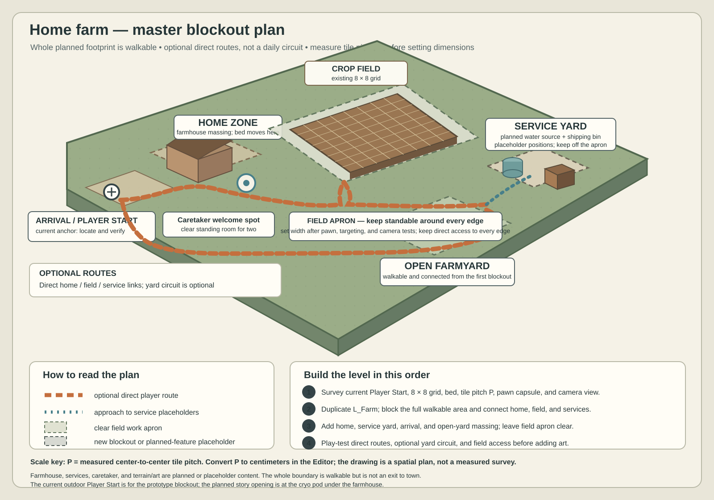

# Home farm layout plan

**Status:** the plan for laying out `/Game/Maps/L_Farm` for the vertical slice (roadmap item in [Roadmap.md, section 4.7](../../Roadmap.md#47-starting-and-testing-the-slice)). Rewritten on 2026-11-25 from the plan of 2026-11-14, which came before the well, the shipping bin, the seed dispensers and the contamination bands.
**Map:** work in `L_Farm` itself, not in a copy. Commit the map before starting, so Git is the way back.

## What it is for

The vertical slice needs one small farm where a first-time player can find the house, the field, Hob and the service yard without being told, and do a day's chores without long walks. This plan fixes what is already decided, sets size targets in walking time, and lists what the blockout must prove before the screenshot art pass dresses it. It adds no gameplay and no system.

It is not the robot town, not the cryo-pod opening and not the final art. Those come later and keep the room this plan leaves for them.

## Fixed by decisions already made

Don't rotate or mirror these; the game's data depends on them. Directions are on a north-up plan of the map: **east is +X** (from the field towards the well) and **south is +Y**.

- **The field stays where it is.** `BP_FarmGrid` in `L_Farm` is the anchor: yaw 0, 8 by 8 tiles of 100 cm (check the placed instance's `TileSize` in its Details panel). Everything else is placed around it. Moving the grid would move every tile's world position, and the editor scripts that set the field up (`SetUpContamination.py`, `SetUpSeedShop.py`) were run against it.
- **The farmhouse is on the clean side, west of the field.** The contamination bands are columns: 0 and 1 clean, 2 to 5 light, 6 and 7 heavy, with the clean ones "nearest the farmhouse" ([Systems/27-Contamination.md](../../Systems/27-Contamination.md)). Column 0 is the west edge, where the bed stands today. `Vestige.Level.TheFarmFieldStartsCleanOnTheBedsSideAndHeavyAtTheFarEdge` measures from the placed bed, so it guards the move indoors.
- **The service yard is on the heavy side, east of the field.** The well stands about 9 m from the field's nearest edge, on the far side from the farmhouse ([GameDesign.md, section 6](../../GameDesign.md#water)). The shipping bin and the seed dispensers stand in the same yard ([GameDesign.md, section 9](../../GameDesign.md#economy)). Today they are in a line at X 1880, north to south: the well, the bin, then the three dispensers 1 m apart ([Systems/24-Water.md](../../Systems/24-Water.md), [25-Selling.md](../../Systems/25-Selling.md), [26-Shops.md](../../Systems/26-Shops.md)). The blockout keeps that order and only spreads them if a front is too tight.
- **The bed is indoors.** The farmhouse gets a small interior with the bed in it (@DunderGG, 2026-11-25). `BP_Bed` moves inside; its sleep rule doesn't change.
- **The whole farm is walkable, and no route is compulsory** (@DunderGG, 2026-11-14, [GameDesign.md, section 14](../../GameDesign.md#14-decision-log)).
- **No exit.** The farm has no way off the map until the town exists.

## Size targets

Distances are set in walking time, because that is what the player feels. The player walks at 5 m/s (`MaxWalkSpeed` 500 in `VestigeCharacter.cpp`), so 1 s is 5 m. These are recommendations, open in [GameDesign.md, section 15](../../GameDesign.md#15-open-questions) and assumed until @DunderGG has walked the blockout.

| Between | Target | About |
|---|---|---|
| Farmhouse door and the field's west edge | about 1.5 s | 6 to 8 m |
| Field's east edge and the well | 2 s | 9 m (decided) |
| Well, shipping bin and dispensers | within a few steps of each other | 2 to 4 m apart |
| Farmhouse door and the well, the longest daily walk (straight across the field) | 6 s or less | 30 m or less |
| Along the walkable farm's long side | 10 s or less | about 50 by 35 m |

- **Field apron:** at least 1.5 m of flat, standable ground on every side of the field, so the player can stand outside an edge tile and target it. Check it in Play at each corner; widen it if a corner can't be targeted.
- **Routes:** at least 2 m wide, flat, with nothing to snag the capsule (radius 42 cm).
- **The rest is open yard.** Anything beyond the targets above is breathing room for later buildings and placement, not a destination. Keep it inside the 50 by 35 m; a bigger farm is a later decision, not something to fill now.

## The places

1. **The farmhouse** (west). A blockout box of about 8 by 6 m outside, one room inside, the door facing the field.
   - **Inside:** the bed and room to turn around: at least 5 by 5 m clear, a ceiling at least 3 m high, and a door at least 1.2 m wide (Hob walks through it on the navigation mesh). Check that the bed's prompt is readable.
   - **The camera:** walls and roof block the camera channel (basic shapes do by default), so the 4 m spring arm pulls the camera in close behind the player indoors. Judge in Play whether that is too cramped. If it is, make the room bigger first (6 by 6 m); hiding the roof or near walls while the player is inside is new behaviour with an owner, so it becomes a roadmap item for a design, not part of the blockout.
   - **Walls:** 20 to 30 cm thick and closed at every corner. Lumen here traces only the coarse global distance field (`r.Lumen.TraceMeshSDFs=0` in `DefaultEngine.ini`), so thin walls leak daylight and sky light into the room. Look at it at noon and at midnight.
   - **Light:** nights are properly dark (@DunderGG's preference), so the room gets one movable point light, its radius kept to the room, shadows off unless the look needs them, always on and with no logic (a light that switches with the time would be a design). Check how it reads under the night exposure, and look at `stat unit` with it on.
   - **The cryo pod comes later.** Leave a clear patch of floor where a hatch down to it can go; don't build the hatch, a basement or any other room.
2. **Hob's spot,** beside the farmhouse door, about 2 m off the route, in view from the Player Start. It is where Hob stands when Hob isn't working, placed as `BP_Hob` itself, whose placed rotation is the facing Hob turns back to after a talk (`Vestige.Level.HobStandsOffTheFieldInViewOfTheStart` checks it; a Smart Object comes with Hob's schedule, [Systems/10-Robots.md](../../Systems/10-Robots.md)); where Hob goes during the day is his schedule's job ([Systems/10-Robots.md](../../Systems/10-Robots.md)), not the map's. Leave room for two characters to stand facing each other without blocking the door.
3. **The field** (centre). Unchanged, with its apron kept clear: no props, no Hob, no path laid across it (the player may still walk over it). The sprinkler is placed on field tiles by the placement work ([Systems/16-PlacingAndBuilding.md](../../Systems/16-PlacingAndBuilding.md)), so the map reserves nothing for it.
4. **The service yard** (east). The well, the shipping bin and the three seed dispensers together, each reachable from the route without walking through the others. Leave a clear front of at least 1.5 m before each interaction box.
5. **The dirty water source** (north-east, nearer than the well). Dirty water has to be the easy one, so its spot is nearer the field than the well (assumed in [GameDesign.md, section 15](../../GameDesign.md#15-open-questions) until @DunderGG decides the source). Reserve a spot 3 to 5 m from the field's north-east corner, off the route to the yard, with a labelled placeholder. What it is (a ditch, a tank, a pipe) and what poisoned the field are section 15's and the writer's, not this plan's.
6. **The Player Start,** about 6 m out from the farmhouse wall, south-east of the door, turned towards Hob and the field's north-west corner, so Hob and the field's west part are in view and the farmhouse at the edge of the frame. Closer to the wall, the 4 m camera arm would end up against the house. Check the first view with a screenshot. It is the slice's start; the cryo-pod opening replaces it later.
7. **The boundary.** A blocking volume all round the walkable area, so the player can't leave the farm, with a custom collision preset that blocks the pawn and ignores the camera and visibility channels, so the camera doesn't snap in near the edge; with a low visible edge in front of it (blockout ridge or fence line) so the player sees the limit before touching it. Invisible walls with nothing to show them feel like bugs.

## Performance

Within the budget in [Architecture.md, section 10](../../Architecture.md#10-performance-by-design) (RTX 2060 class, 60 fps at 1080p High):

- The blockout uses engine basic shapes and one blockout material. No new lights except the farmhouse's one.
- The ground beyond the boundary and the sky are the screenshot art pass's job. Keep the scenery past the edge cheap there too: low meshes, cull distances set, no foliage that sways in the distance ([Architecture.md, section 10](../../Architecture.md#10-performance-by-design)).
- Check `stat unit` from the Player Start, from the farmhouse interior at night and from the farm's far corner, against the baseline. Write the numbers into the commit message.

## Build order

1. **Commit `L_Farm`** as it is, so Git can restore it.
2. **Read off the field:** the grid's location, `TileSize`, and the bed's, well's, bin's and dispensers' locations, from their Details panels (or the level survey, [Systems/23-EditorScripting.md](../../Systems/23-EditorScripting.md), once it is validated). Turn the targets above into world positions from the grid's corner.
3. **Floor and boundary:** flat ground for the whole walkable area, the blocking volume and the visible edge, and a Nav Mesh Bounds Volume over the walkable area and the interior (press P in the viewport to see the navigation mesh).
4. **Farmhouse, with its interior,** and move `BP_Bed` inside. Run the `Vestige.Level` tests, and in the same commit change "the bed's side" to "the farmhouse's side" in [Systems/27-Contamination.md](../../Systems/27-Contamination.md) and [GameDesign.md, section 15](../../GameDesign.md#15-open-questions). Play: walk in, sleep, wake, walk out; check the camera in every corner.
5. **Check the service yard** against its targets, and mark the dirty water spot with a labelled placeholder that doesn't look usable.
6. **Hob's spot and the Player Start.**
7. **Walk it:** door to field, every field corner, field to each service prop, door to well. Time the walks against the targets and fix the layout, not the numbers, when they miss.
8. **Hand over to the art pass.** Only then replace blockout shapes with meshes, materials and scenery.

## Done when

- From the Player Start, without signs or tutorial, the field and Hob are in view and the farmhouse at least in part.
- Every walk in the table above is within its target.
- Every edge and corner tile can be targeted from the apron.
- The bed works indoors, the `Vestige.Level` tests pass, the camera stays out of walls and the roof everywhere in the farmhouse, and the room is dark at midnight except for its light.
- The player can't leave the farm, and sees the edge before touching it.
- `stat unit` at the three spots is within the budget.

The play-test check for how the layout feels (does the morning walk feel short, does the yard feel like breathing room or empty, is the camera in the farmhouse comfortable) goes into [PlayTest.md](../../PlayTest.md) with the commit that builds it.
