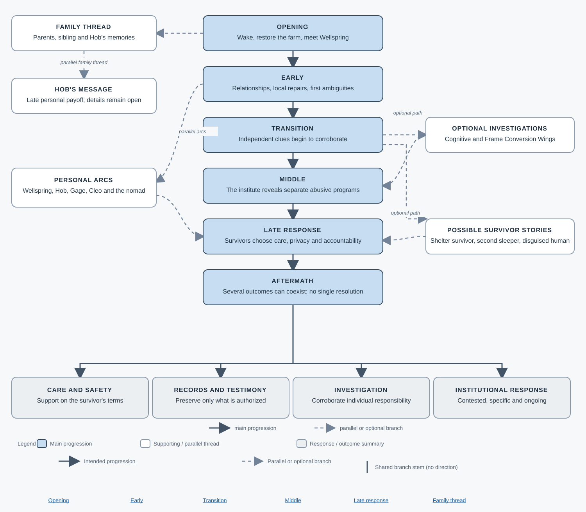
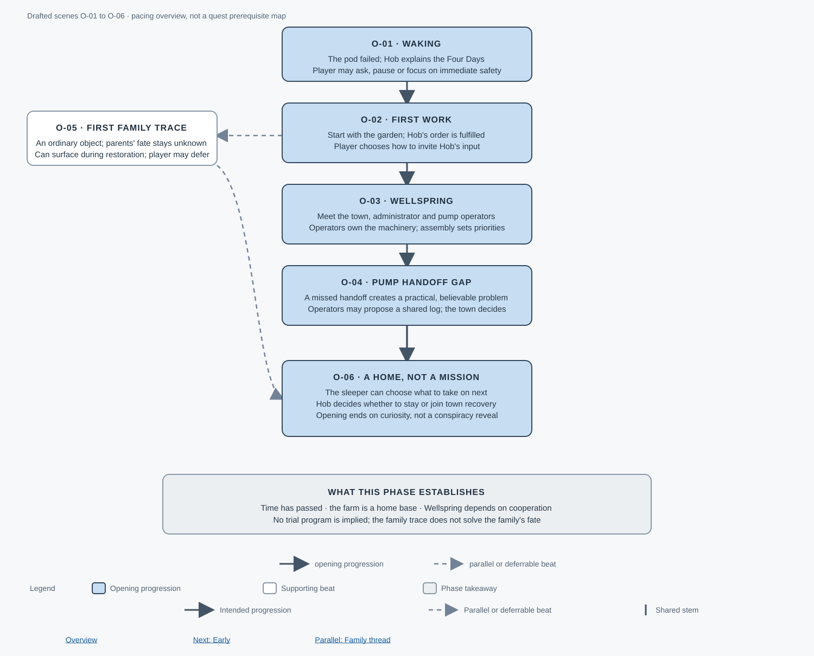
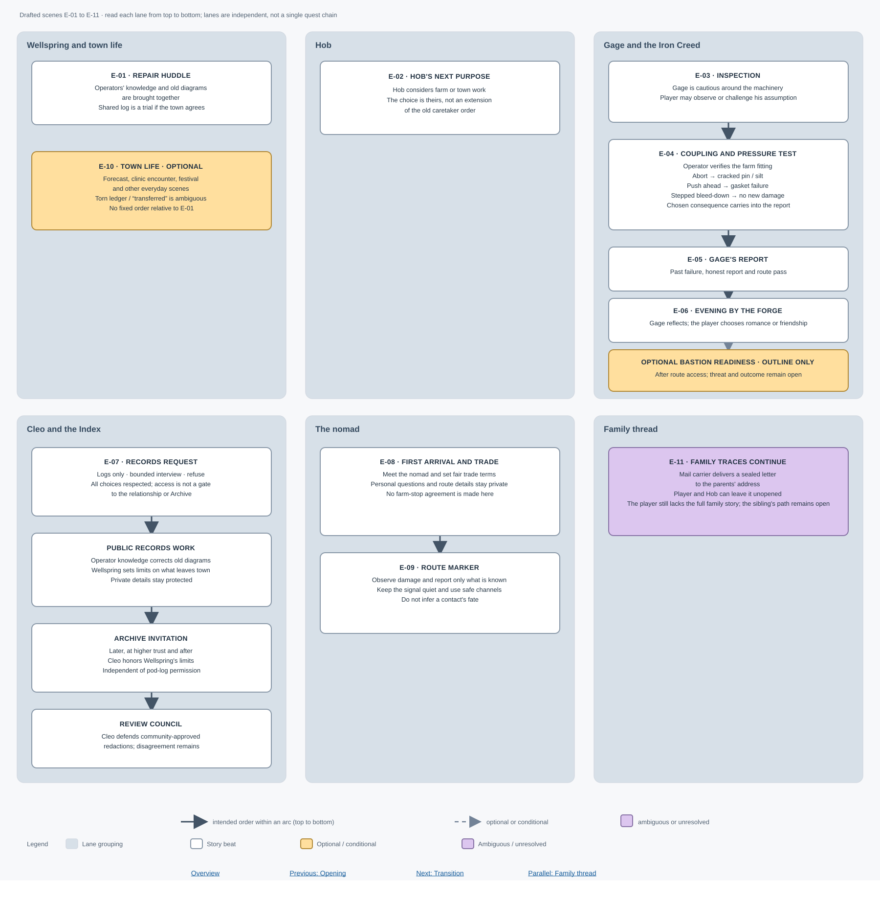
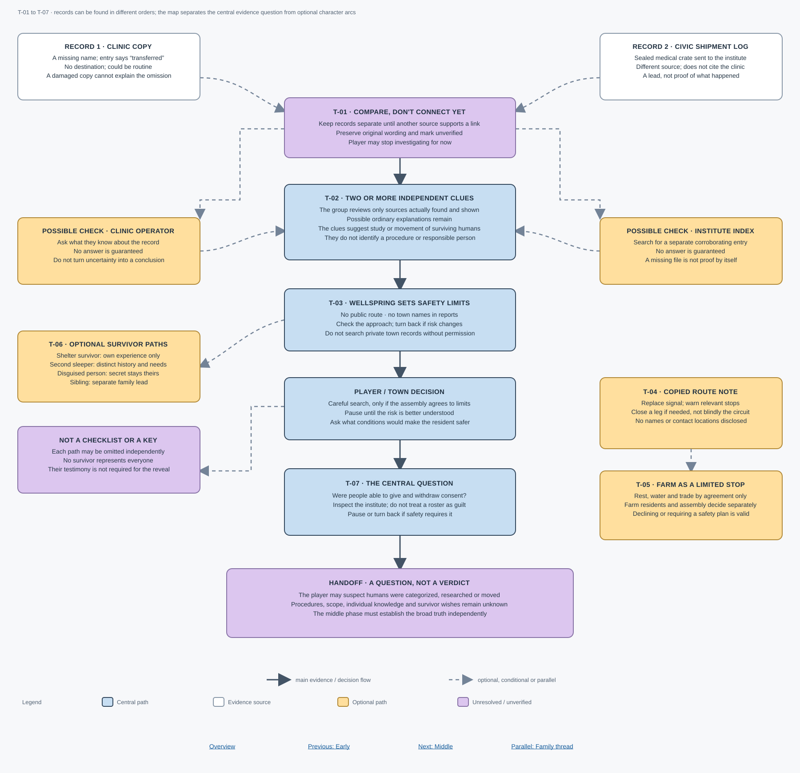
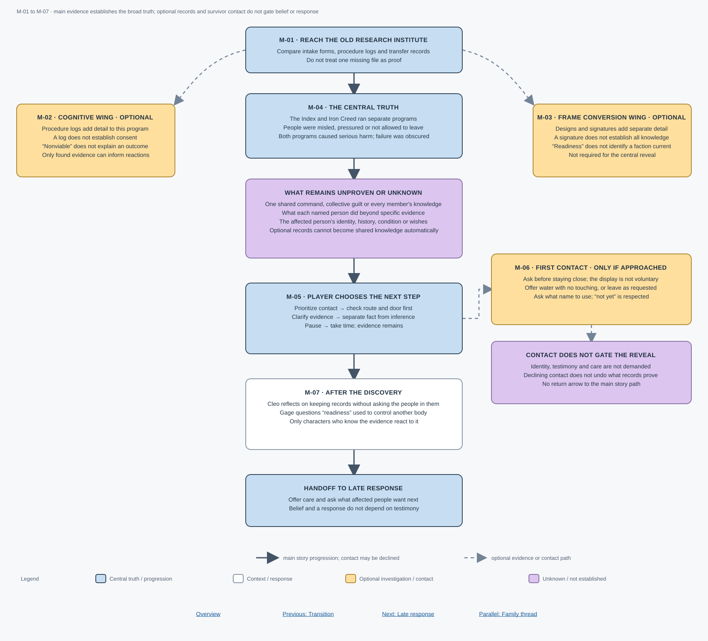
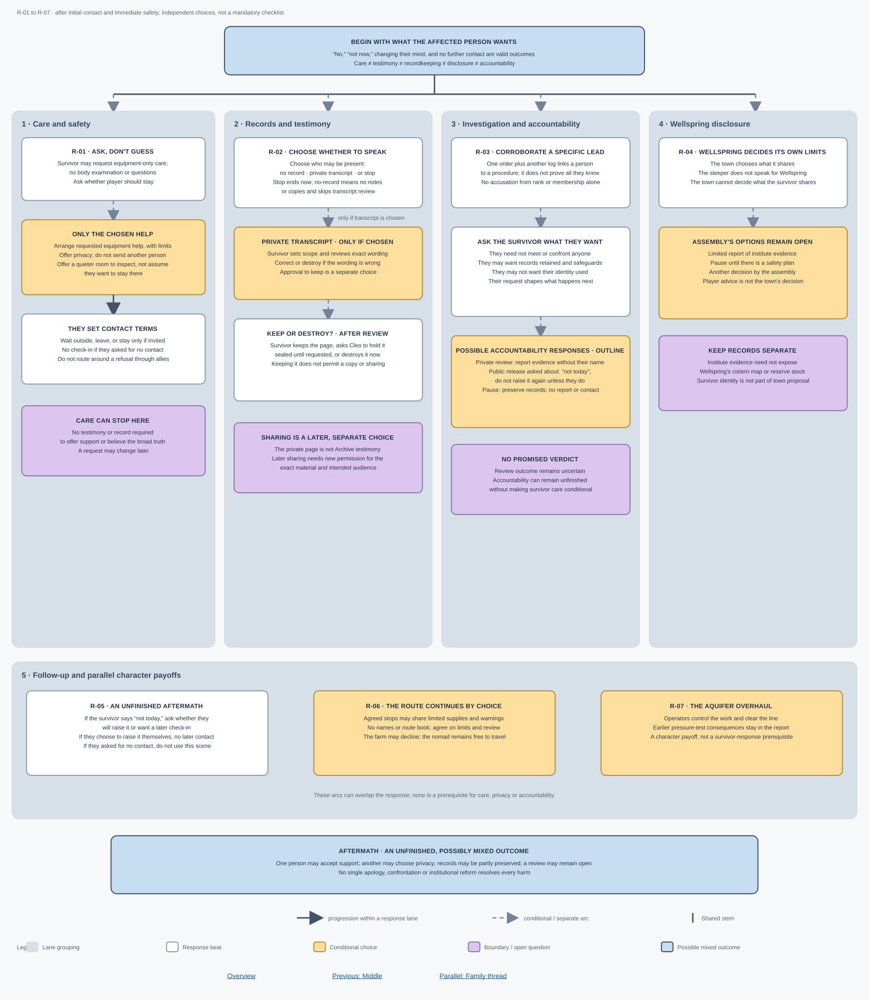
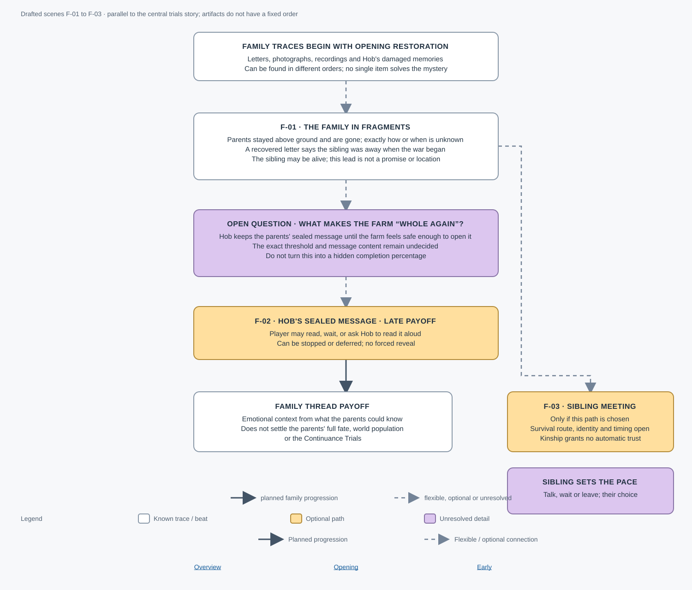

# Story flow

> **Spoilers.** These diagrams visualize the provisional story outline and draft scenes; they are not implemented quest maps.

The overview shows the broad story movement. The phase diagrams expand the scene IDs from the [dialogue draft index](../Dialogue/README.md). Arrows show intended story progression within an arc, not mandatory quest prerequisites. Separate character arcs can happen in different orders.

“Drafted” means a voice-ready scene draft exists; it does not mean the scene, branch or quest is implemented. Optional and undecided story material is labeled as such rather than drawn as required content.

## Legend and reading guide

The colors describe the **role of a box in that diagram**, not implementation status, quest completion, or a required player choice. Read the label inside each box for its specific meaning.

<table>
<thead>
<tr><th>Appearance</th><th>Meaning</th></tr>
</thead>
<tbody>
<tr bgcolor="#c7def2" style="background-color: #c7def2;"><td>Blue box (<code>#c7def2</code>)</td><td>Main story progression or central beat. In the late-response diagram, this also marks the possible mixed aftermath.</td></tr>
<tr bgcolor="#ffffff" style="background-color: #ffffff;"><td>White box (<code>#ffffff</code>)</td><td>Supporting beat, source record, character response, or other story detail. White does not mean mandatory.</td></tr>
<tr bgcolor="#ffdf9e" style="background-color: #ffdf9e;"><td>Amber box (<code>#ffdf9e</code>)</td><td>Optional, conditional, or player-choice-dependent material. Follow the label; not every amber box is a quest gate.</td></tr>
<tr bgcolor="#dcc6ef" style="background-color: #dcc6ef;"><td>Purple box (<code>#dcc6ef</code>)</td><td>Uncertainty, an unresolved fact, a boundary, or information the evidence does not establish.</td></tr>
<tr bgcolor="#eceff2" style="background-color: #eceff2;"><td>Neutral gray box (<code>#eceff2</code>)</td><td>A phase takeaway or response/outcome summary, as labeled in the diagram.</td></tr>
<tr bgcolor="#d7e0e8" style="background-color: #d7e0e8;"><td>Cool gray lane (<code>#d7e0e8</code>)</td><td>A visual grouping for a story thread or response lane, not a story event or prerequisite.</td></tr>
<tr bgcolor="#435466" style="background-color: #435466; color: #ffffff;"><td>Solid dark arrow (<code>#435466</code>)</td><td>Intended progression within the connected story path. It does not impose an order on separate lanes.</td></tr>
<tr bgcolor="#738397" style="background-color: #738397; color: #ffffff;"><td>Dashed gray arrow (<code>#738397</code>)</td><td>Optional, conditional, parallel, or choice-dependent connection. It is not a required prerequisite.</td></tr>
<tr bgcolor="#435466" style="background-color: #435466; color: #ffffff;"><td>Plain line without an arrowhead (<code>#435466</code>)</td><td>A shared connector or branch stem; follow the arrowheads on the paths leaving it.</td></tr>
</tbody>
</table>

Diagrams are read from top to bottom unless separate lanes are shown; in the Early diagram, read **each lane** from top to bottom. A missing arrow means the order is flexible or has not been decided. Solid arrows describe story flow, not necessarily a confirmed quest dependency. When a character's knowledge matters, only evidence shown or shared with them should affect their response.

Each diagram includes a compact legend for these same conventions so it can also be understood when opened separately.

**Jump to:** [Overview](#story-overview) · [Opening](#opening) · [Early](#early) · [Transition](#transition) · [Middle](#middle) · [Late response](#late-response) · [Family thread](#parallel-family-thread)

## Story overview

**Follow the story:** [Opening](Opening.svg) · [Early](Early.svg) · [Transition](Transition.svg) · [Middle](Middle.svg) · [Late response](LateResponse.svg) · [Family thread](Family.svg)

## Opening

Six opening beats, including the optional family trace.

**Continue:** [Early](Early.svg) · [Parallel family thread](Family.svg) · [Overview](Overview.svg)

## Early

Independent Wellspring, Hob, Gage, Cleo, nomad and family lanes, each read top to bottom.

**Continue:** [Transition](Transition.svg) · [Parallel family thread](Family.svg) · [Overview](Overview.svg)

## Transition

Expanded to show the two initial records, possible corroboration, the town's safety decision, and optional survivor and nomad branches. The clinic clue, shipment log, and possible follow-up checks stay distinct until evidence supports a connection.

**Continue:** [Middle](Middle.svg) · [Parallel family thread](Family.svg) · [Overview](Overview.svg)

## Middle

Separates the cognitive and frame-conversion programs, the choices after the reveal, first contact, and optional wing evidence. Safe contact is a side path: declining it does not block the central truth or late response.

**Continue:** [Late response](LateResponse.svg) · [Parallel family thread](Family.svg) · [Overview](Overview.svg)

## Late response

Expands each response lane into its specific permissions, possible outcomes, and independent character payoffs. Survivor care, testimony, recordkeeping, disclosure and accountability do not unlock one another.

**Related:** [Middle](Middle.svg) · [Parallel family thread](Family.svg) · [Overview](Overview.svg)

## Parallel family thread

Family evidence appears in flexible order; the message threshold and sibling path remain open.

**Related:** [Opening](Opening.svg) · [Early](Early.svg) · [Overview](Overview.svg)
