<p align="center"></p>
<p align="center"></p>

<h1 align="center">Project Vestige</h1>

<h3 align="center">A cozy 3D farming and life-sim game set in a retro-futuristic, post-apocalyptic world. 

You wake from decades of cryosleep under an overgrown homestead. Humans have almost vanished, and robots carry on with the jobs people gave them. 

You bring the farm back to life, help the town next door, and slowly push out into the wasteland.</h3>

## 📥 Download

Release builds and playable demosare coming for Windows.

## 🚀 Getting started

You need Windows 10 or 11, Unreal Engine 5.8, Git with **Git LFS**, and Visual Studio 2026 with the components in `.vsconfig` (the editor compiles the project's C++ the first time, even if you won't write code).

```
git lfs install
git clone https://github.com/DunderGG/ProjectVestige.git
```

Then double-click `Vestige.uproject`, let Unreal build the C++ modules, open `Content/Maps/L_Farm` in the editor and press **Play**. **[Docs/Setup.md](Docs/Setup.md)** walks through every step on a fresh PC, with troubleshooting; the controls are in [CONTRIBUTING.md](CONTRIBUTING.md#controls).

## 📚 Documentation

| Document | What's in it |
|---|---|
| [Docs/Setup.md](Docs/Setup.md) | Setting up a new Windows PC to build and run the project, step by step |
| [Docs/Architecture.md](Docs/Architecture.md) | How the code fits together, who owns what, and the decision log |
| [Docs/GameDesign.md](Docs/GameDesign.md) | What the game is, how it plays and why |
| [Docs/Systems.md](Docs/Systems.md) | How the game systems work, and how to add new ones |
| [Docs/CodingGuidelines.md](Docs/CodingGuidelines.md) | How the code looks |
| [CONTRIBUTING.md](CONTRIBUTING.md) | Project layout, and how to contribute code, art, audio and ideas |
| [Docs/Spoilers/Lore.md](Docs/Spoilers/Lore.md) | The story, the world and its characters (spoilers) |
| [Docs/Roadmap.md](Docs/Roadmap.md) | What's done and what comes next |

## 🧱 Built With

- [Unreal Engine 5.8](https://www.unrealengine.com/): cross-platform game engine
- [Blender](https://www.blender.org/): 3D modeling, animation and rendering

## 🤝 Contributing

Contributions are welcome: gameplay code, 3D art, audio, testing, documentation and mods. Start with [CONTRIBUTING.md](CONTRIBUTING.md), and open an issue to say what you'd like to work on.

## 👤 Author

**David Bennehag** - [@DunderGG](https://github.com/DunderGG) - [dunder.gg](https://dunder.gg)

## 📄 License
> Still under investigation. Any lawyers in chat? Hit me up!

- **Code** (`Source/`, `Config/`, scripts): [GPL-3.0-or-later](LICENSE), with an [additional permission](LICENSE-EXCEPTION.txt) to link with Unreal Engine and platform SDKs. Anyone may share and sell it, as long as they pass on the source under the same license.
- **Assets and documentation**: [CC BY-NC-SA 4.0](LICENSE-ASSETS.txt). Free for non-commercial use; commercial use is reserved to the maintainer, who sells official builds.
- **Epic Games template material** stays under the [Unreal Engine EULA](https://www.unrealengine.com/eula).

[LICENSING.md](LICENSING.md) explains what this means in practice. Contributors are listed in [CREDITS.md](CREDITS.md).
